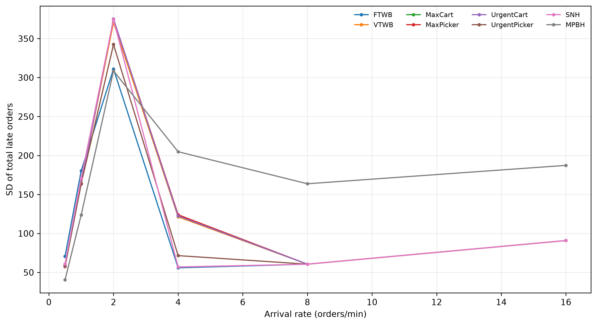
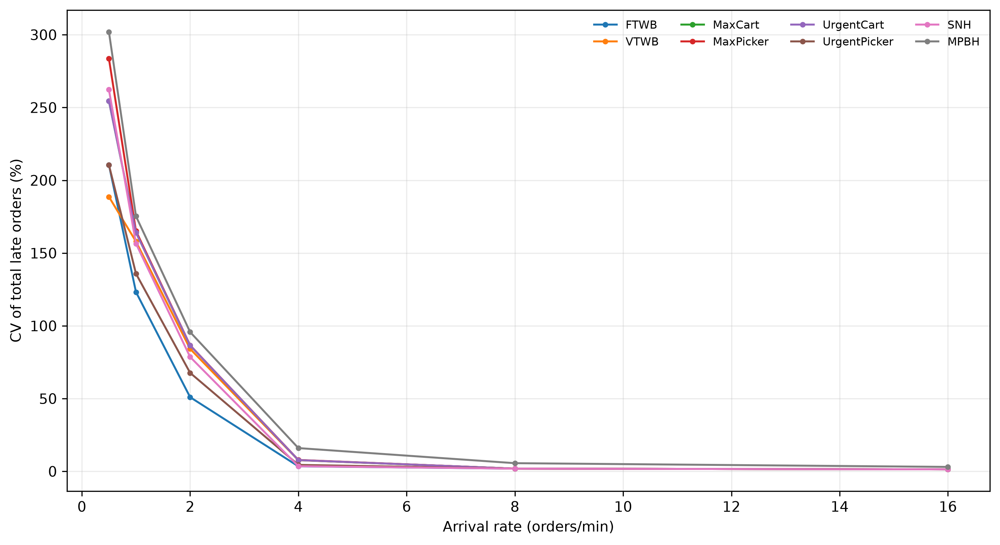
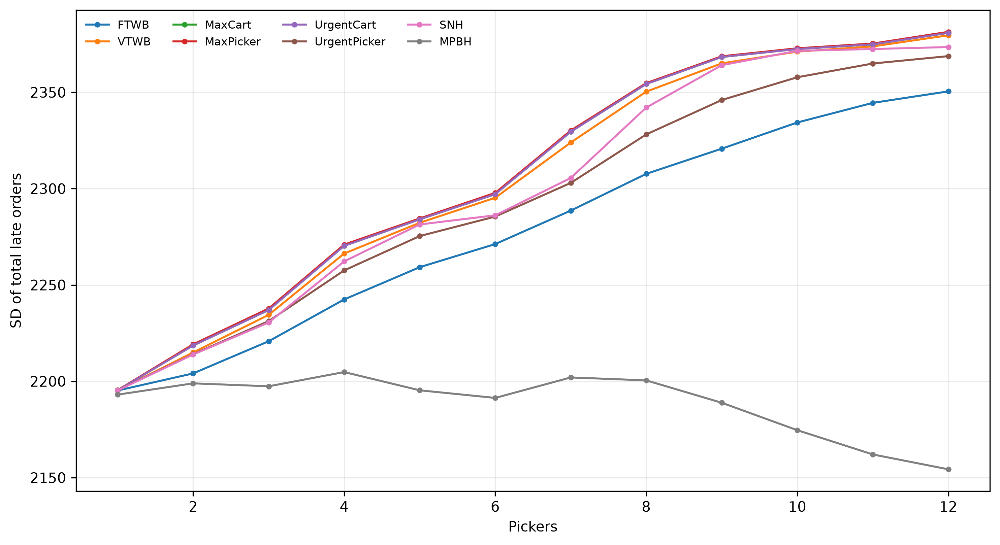
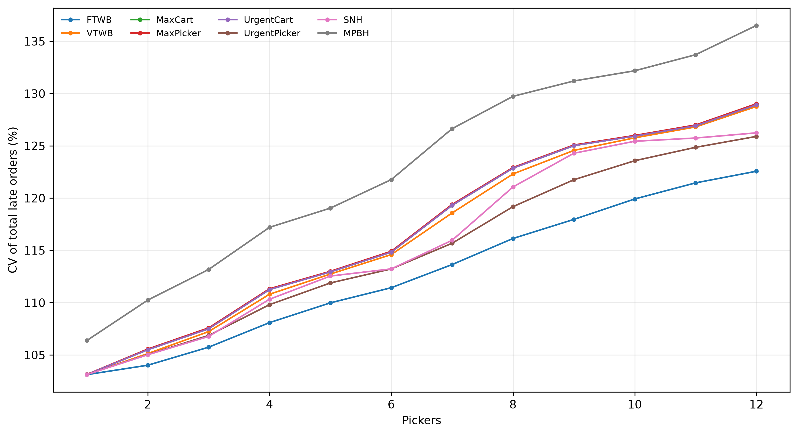
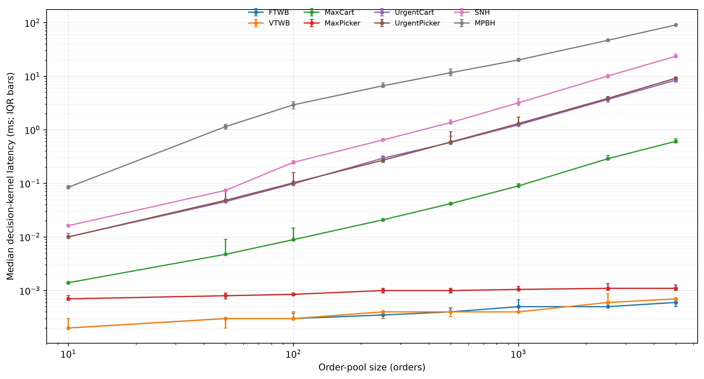

# Supplementary Material

Order-picking batching study: supplementary tables and figures. Tables are copied from the CSV files in this repository (values rounded to three decimals for display); no numbers are recomputed. Tables longer than 40 rows show the first 40 rows; the full table is in the cited file.

## Appendix A

Pseudocode of all eight batching-trigger policies: [docs/Appendix_A_pseudocode.md](../docs/Appendix_A_pseudocode.md).

## Table B1

Provenance of implementation parameters: [results/WP0/provenance_table_B1.csv](../results/WP0/provenance_table_B1.csv).

## Table S1. Tuning surface of FTWB and VTWB parameters: global and per class (arrival rate x picker group)

**Units.** TLO = total late orders per run (count of orders); times in seconds; arrival rate in orders/min. FTWB interval and VTWB threshold per the `unit` column.

**CI method.** No confidence intervals reported.

*Global tuning surface* — source: `results/WP5/tuning_surface_global.csv` (35 rows)

| method | parameter_value | mean_tlo | std_tlo | mean_throughput | mean_utilization | n_cells | n_reps | n_runs |
|---|---|---|---|---|---|---|---|---|
| MaxPicker (F->0 ref) | 0 | 1989.860 | 2305.733 | 42.610 | 91.680 | 144 | 15 | 2160 |
| FTWB | 5 | 1990.203 | 2305.511 | 42.512 | 91.333 | 144 | 15 | 2160 |
| FTWB | 10 | 1990.531 | 2305.270 | 42.410 | 90.965 | 144 | 15 | 2160 |
| FTWB | 15 | 1990.940 | 2305.022 | 42.302 | 90.616 | 144 | 15 | 2160 |
| FTWB | 20 | 1991.362 | 2304.751 | 42.198 | 90.237 | 144 | 15 | 2160 |
| FTWB | 30 | 1992.138 | 2304.274 | 41.974 | 89.549 | 144 | 15 | 2160 |
| FTWB | 45 | 1993.294 | 2303.559 | 41.623 | 88.511 | 144 | 15 | 2160 |
| FTWB | 60 | 1994.485 | 2302.799 | 41.268 | 87.499 | 144 | 15 | 2160 |
| FTWB | 90 | 1996.715 | 2301.413 | 40.626 | 85.662 | 144 | 15 | 2160 |
| FTWB | 120 | 1998.738 | 2300.163 | 39.971 | 83.971 | 144 | 15 | 2160 |
| FTWB | 180 | 2002.201 | 2297.982 | 38.751 | 81.186 | 144 | 15 | 2160 |
| FTWB | 240 | 2005.231 | 2295.996 | 37.652 | 78.771 | 144 | 15 | 2160 |
| FTWB | 300 | 2007.895 | 2294.247 | 36.739 | 77.168 | 144 | 15 | 2160 |
| FTWB | 360 | 2010.350 | 2292.672 | 35.403 | 74.629 | 144 | 15 | 2160 |
| FTWB | 480 | 2013.616 | 2290.504 | 34.154 | 72.609 | 144 | 15 | 2160 |
| FTWB | 600 | 2021.150 | 2285.138 | 31.178 | 66.889 | 144 | 15 | 2160 |
| FTWB | 720 | 2024.421 | 2282.500 | 30.684 | 66.159 | 144 | 15 | 2160 |
| FTWB | 900 | 2041.228 | 2270.081 | 28.027 | 64.948 | 144 | 15 | 2160 |
| FTWB | 1200 | 2034.541 | 2274.962 | 26.838 | 60.685 | 144 | 15 | 2160 |
| VTWB | 1 | 2059.889 | 2255.833 | 21.555 | 92.738 | 144 | 15 | 2160 |
| VTWB | 2 | 2016.337 | 2288.576 | 31.928 | 88.720 | 144 | 15 | 2160 |
| VTWB | 3 | 2004.304 | 2296.561 | 36.659 | 86.742 | 144 | 15 | 2160 |
| VTWB | 4 | 1997.814 | 2300.336 | 39.114 | 85.852 | 144 | 15 | 2160 |
| VTWB | 5 | 1994.330 | 2302.394 | 40.480 | 85.543 | 144 | 15 | 2160 |
| VTWB | 6 | 1993.026 | 2303.156 | 41.127 | 85.448 | 144 | 15 | 2160 |
| VTWB | 8 | 1992.980 | 2303.097 | 41.437 | 85.265 | 144 | 15 | 2160 |
| VTWB | 10 | 1993.876 | 2302.464 | 41.373 | 85.088 | 144 | 15 | 2160 |
| VTWB | 12 | 1994.816 | 2301.760 | 41.308 | 84.995 | 144 | 15 | 2160 |
| VTWB | 14 | 1995.936 | 2300.874 | 41.232 | 84.915 | 144 | 15 | 2160 |
| VTWB | 16 | 1997.205 | 2299.930 | 41.175 | 84.880 | 144 | 15 | 2160 |
| VTWB | 18 | 1998.595 | 2298.837 | 41.073 | 84.841 | 144 | 15 | 2160 |
| VTWB | 20 | 2000.057 | 2297.706 | 41.014 | 84.783 | 144 | 15 | 2160 |
| VTWB | 24 | 2003.214 | 2295.209 | 40.854 | 84.749 | 144 | 15 | 2160 |
| VTWB | 28 | 2006.467 | 2292.652 | 40.671 | 84.671 | 144 | 15 | 2160 |
| VTWB | 32 | 2010.077 | 2289.811 | 40.464 | 84.635 | 144 | 15 | 2160 |

*Per-class tuning surface* — source: `results/WP5/tuning_surface_class.csv` (630 rows)

| incoming_rate | picker_group | mean_tlo | std_tlo | mean_throughput | mean_utilization | n_cells | n_reps | n_runs | method | parameter_value |
|---|---|---|---|---|---|---|---|---|---|---|
| 0.500 | 1-4 | 72.667 | 89.586 | 24.124 | 92.931 | 8 | 15 | 120 | MaxPicker (F->0 ref) | 0 |
| 0.500 | 5-8 | 0.000 | 0.000 | 29.880 | 59.841 | 8 | 15 | 120 | MaxPicker (F->0 ref) | 0 |
| 0.500 | 9-12 | 0.000 | 0.000 | 29.879 | 37.061 | 8 | 15 | 120 | MaxPicker (F->0 ref) | 0 |
| 1.000 | 1-4 | 345.217 | 72.043 | 32.323 | 100.000 | 8 | 15 | 120 | MaxPicker (F->0 ref) | 0 |
| 1.000 | 5-8 | 0.275 | 1.152 | 58.530 | 93.389 | 8 | 15 | 120 | MaxPicker (F->0 ref) | 0 |
| 1.000 | 9-12 | 0.000 | 0.000 | 59.349 | 69.518 | 8 | 15 | 120 | MaxPicker (F->0 ref) | 0 |
| 2.000 | 1-4 | 812.467 | 23.792 | 20.624 | 100.000 | 8 | 15 | 120 | MaxPicker (F->0 ref) | 0 |
| 2.000 | 5-8 | 571.558 | 301.327 | 76.165 | 99.998 | 8 | 15 | 120 | MaxPicker (F->0 ref) | 0 |
| 2.000 | 9-12 | 9.583 | 43.182 | 115.151 | 97.510 | 8 | 15 | 120 | MaxPicker (F->0 ref) | 0 |
| 4.000 | 1-4 | 1630.000 | 47.990 | 5.393 | 100.000 | 8 | 15 | 120 | MaxPicker (F->0 ref) | 0 |
| 4.000 | 5-8 | 1627.717 | 48.956 | 69.428 | 100.000 | 8 | 15 | 120 | MaxPicker (F->0 ref) | 0 |
| 4.000 | 9-12 | 1554.000 | 107.381 | 117.460 | 100.000 | 8 | 15 | 120 | MaxPicker (F->0 ref) | 0 |
| 8.000 | 1-4 | 3238.933 | 53.981 | 0.232 | 100.000 | 8 | 15 | 120 | MaxPicker (F->0 ref) | 0 |
| 8.000 | 5-8 | 3238.933 | 53.981 | 17.337 | 100.000 | 8 | 15 | 120 | MaxPicker (F->0 ref) | 0 |
| 8.000 | 9-12 | 3238.925 | 53.975 | 90.604 | 100.000 | 8 | 15 | 120 | MaxPicker (F->0 ref) | 0 |
| 16.000 | 1-4 | 6492.400 | 106.892 | 0.000 | 100.000 | 8 | 15 | 120 | MaxPicker (F->0 ref) | 0 |
| 16.000 | 5-8 | 6492.400 | 106.892 | 0.623 | 100.000 | 8 | 15 | 120 | MaxPicker (F->0 ref) | 0 |
| 16.000 | 9-12 | 6492.400 | 106.892 | 19.871 | 100.000 | 8 | 15 | 120 | MaxPicker (F->0 ref) | 0 |
| 0.500 | 1-4 | 73.050 | 89.576 | 24.079 | 92.639 | 8 | 15 | 120 | FTWB | 5 |
| 0.500 | 1-4 | 73.292 | 89.593 | 24.039 | 92.284 | 8 | 15 | 120 | FTWB | 10 |
| 0.500 | 1-4 | 73.508 | 89.601 | 24.003 | 92.009 | 8 | 15 | 120 | FTWB | 15 |
| 0.500 | 1-4 | 73.867 | 89.845 | 23.997 | 91.689 | 8 | 15 | 120 | FTWB | 20 |
| 0.500 | 1-4 | 74.408 | 89.886 | 23.945 | 91.124 | 8 | 15 | 120 | FTWB | 30 |
| 0.500 | 1-4 | 75.125 | 89.990 | 23.849 | 90.112 | 8 | 15 | 120 | FTWB | 45 |
| 0.500 | 1-4 | 76.092 | 90.229 | 23.749 | 89.158 | 8 | 15 | 120 | FTWB | 60 |
| 0.500 | 1-4 | 77.642 | 90.402 | 23.567 | 87.465 | 8 | 15 | 120 | FTWB | 90 |
| 0.500 | 1-4 | 79.125 | 90.676 | 23.471 | 85.772 | 8 | 15 | 120 | FTWB | 120 |
| 0.500 | 1-4 | 83.067 | 90.688 | 23.072 | 82.678 | 8 | 15 | 120 | FTWB | 180 |
| 0.500 | 1-4 | 85.242 | 90.497 | 22.788 | 80.189 | 8 | 15 | 120 | FTWB | 240 |
| 0.500 | 1-4 | 89.642 | 90.208 | 22.404 | 77.600 | 8 | 15 | 120 | FTWB | 300 |
| 0.500 | 1-4 | 90.975 | 90.926 | 22.118 | 75.973 | 8 | 15 | 120 | FTWB | 360 |
| 0.500 | 1-4 | 93.242 | 90.667 | 21.779 | 73.592 | 8 | 15 | 120 | FTWB | 480 |
| 0.500 | 1-4 | 112.408 | 92.840 | 20.211 | 67.673 | 8 | 15 | 120 | FTWB | 600 |
| 0.500 | 1-4 | 97.625 | 92.210 | 20.755 | 68.995 | 8 | 15 | 120 | FTWB | 720 |
| 0.500 | 1-4 | 116.900 | 91.188 | 19.438 | 63.704 | 8 | 15 | 120 | FTWB | 900 |
| 0.500 | 1-4 | 128.517 | 94.822 | 17.845 | 59.569 | 8 | 15 | 120 | FTWB | 1200 |
| 0.500 | 5-8 | 0.000 | 0.000 | 29.863 | 59.236 | 8 | 15 | 120 | FTWB | 5 |
| 0.500 | 5-8 | 0.000 | 0.000 | 29.863 | 58.600 | 8 | 15 | 120 | FTWB | 10 |
| 0.500 | 5-8 | 0.000 | 0.000 | 29.857 | 58.230 | 8 | 15 | 120 | FTWB | 15 |
| 0.500 | 5-8 | 0.000 | 0.000 | 29.867 | 57.597 | 8 | 15 | 120 | FTWB | 20 |

*Showing 40 of 630 rows; complete table in `results/WP5/tuning_surface_class.csv`.*

*Selected parameters* — source: `results/WP5/selected_parameters.csv` (4 rows)

| benchmark | criterion | selected_value | unit | canonical_value | tuning_replications | tuning_cells |
|---|---|---|---|---|---|---|
| FTWB | S1 (Minimum TLO) | 5 | seconds | 720 | 0-14 (15 reps) | 144 |
| FTWB | S2 (Maximum Composite Score) | 5 | seconds | 720 | 0-14 (15 reps) | 144 |
| VTWB | S1 (Minimum TLO) | 8 | orders | 12 | 0-14 (15 reps) | 144 |
| VTWB | S2 (Maximum Composite Score) | 6 | orders | 12 | 0-14 (15 reps) | 144 |

## Table S2. Run-status partition (order-weighted) and tardiness summary, including conditional-late and p95

**Units.** Shares are fractions of cohort orders; tardiness in seconds.

**CI method.** No confidence intervals reported. p95 definitions (run-mean vs order-weighted) are given in the header comments of the tardiness source file.

*Status partition of cohort orders (shares)* — source: `results/WP3/table4d_status_partition_exact.csv` (16 rows)

| trigger_method | weighting | share_comp_ontime | share_comp_late | share_out_overdue | share_out_notdue | cohort_N_per_policy | sum_check |
|---|---|---|---|---|---|---|---|
| FTWB | run_mean | 0.270 | 0.104 | 0.498 | 0.128 | 65339136 | 1.000 |
| MPBH | run_mean | 0.431 | 0.065 | 0.395 | 0.109 | 65339136 | 1.000 |
| MaxCart | run_mean | 0.337 | 0.107 | 0.437 | 0.119 | 65339136 | 1.000 |
| MaxPicker | run_mean | 0.345 | 0.105 | 0.437 | 0.112 | 65339136 | 1.000 |
| SNH | run_mean | 0.329 | 0.137 | 0.421 | 0.113 | 65339136 | 1.000 |
| UrgentCart | run_mean | 0.337 | 0.107 | 0.437 | 0.119 | 65339136 | 1.000 |
| UrgentPicker | run_mean | 0.304 | 0.127 | 0.443 | 0.126 | 65339136 | 1.000 |
| VTWB | run_mean | 0.326 | 0.113 | 0.439 | 0.122 | 65339136 | 1.000 |
| FTWB | order_weighted | 0.046 | 0.051 | 0.752 | 0.151 | 65339136 | 1.000 |
| MPBH | order_weighted | 0.145 | 0.048 | 0.661 | 0.145 | 65339136 | 1.000 |
| MaxCart | order_weighted | 0.066 | 0.068 | 0.716 | 0.149 | 65339136 | 1.000 |
| MaxPicker | order_weighted | 0.068 | 0.068 | 0.716 | 0.148 | 65339136 | 1.000 |
| SNH | order_weighted | 0.062 | 0.091 | 0.699 | 0.148 | 65339136 | 1.000 |
| UrgentCart | order_weighted | 0.066 | 0.068 | 0.716 | 0.149 | 65339136 | 1.000 |
| UrgentPicker | order_weighted | 0.057 | 0.073 | 0.720 | 0.150 | 65339136 | 1.000 |
| VTWB | order_weighted | 0.065 | 0.067 | 0.719 | 0.149 | 65339136 | 1.000 |

*Tardiness summary (seconds)* — source: `results/WP3/tardiness_all_policies_summary.csv` (8 rows)

> Tardiness Summary and p95 Definition:
> - run_mean_p95_s: The 95th percentile of tardiness among completed orders is calculated per simulation run (omitting zero-completed runs), and then averaged across all runs for that policy.
> - order_weighted_p95_s: Calculated directly on the pooled order-level tardiness distribution of all completed orders across all runs of that policy.
> - all_order_horizon_lower_bound: The theoretical lower bound of tardiness across all generated cohort orders: max(0, min(c_i, H) - d_i).

| policy | run_mean_completed_only_s | order_weighted_completed_only_s | run_mean_conditional_late_s | order_weighted_conditional_late_s | run_mean_p95_s | order_weighted_p95_s | all_order_horizon_lower_bound_mean_s | all_order_horizon_lower_bound_sd_s |
|---|---|---|---|---|---|---|---|---|
| FTWB | 8214.160 | 4904.956 | 8319.695 | 9398.393 | 10913.875 | 7505.270 | 6211.023 | 4475.910 |
| VTWB | 6340.947 | 4657.509 | 6512.999 | 9143.773 | 8868.883 | 7330.558 | 5517.286 | 4570.909 |
| MaxPicker | 7374.042 | 4673.925 | 7458.353 | 9316.741 | 9919.421 | 7220.711 | 5465.659 | 4565.642 |
| MaxCart | 7384.953 | 4717.940 | 7494.916 | 9301.788 | 9933.773 | 7284.784 | 5469.194 | 4563.501 |
| UrgentPicker | 7576.843 | 5022.119 | 7709.162 | 8910.343 | 10139.045 | 7627.387 | 5566.531 | 4525.266 |
| UrgentCart | 7384.953 | 4717.940 | 7494.916 | 9301.788 | 9933.773 | 7284.784 | 5469.194 | 4563.501 |
| SNH | 7135.821 | 4896.965 | 7174.207 | 8223.859 | 11608.504 | 8182.881 | 5282.469 | 4459.346 |
| MPBH | 1393.042 | 1798.523 | 3623.606 | 7181.694 | 6516.299 | 7995.556 | 4877.198 | 4188.424 |

## Table S3. MPBH versus canonical pool by arrival rate and picker group

**Units.** TLO = total late orders per run (count of orders); times in seconds; arrival rate in orders/min. `*_pct_of_N` columns in percent of cohort orders N.

**CI method.** Two-sided 95% t interval over the 30 replication-cluster means of the arrival-rate stratum (df = 29). Differences are paired within scenario x replication blocks; for a single arrival rate the stratified cluster estimator has one stratum. Each row pools the cells of one picker group, so the 30 clusters are the replication means within that row. Interval for the difference MPBH minus canonical pool (FTWB and VTWB).

*MPBH vs canonical, per arrival rate x picker group* — source: `results/WP9/table10_v3.csv` (18 rows)

| lam | m_group | mean_N | mpbh_ontime_orders_per_run | mpbh_ontime_pct_of_N | canonical_ontime_orders_per_run | canonical_ontime_pct_of_N | maxpicker_ontime_orders_per_run | maxpicker_ontime_pct_of_N | mean_canonical_TLO | mean_maxpicker_TLO | mean_mpbh_TLO | delta_vs_canonical | delta_vs_canonical_ci95_low | delta_vs_canonical_ci95_high | rel_reduction_canonical_pct | delta_as_pct_of_N | practical_sig_flag_prespec | delta_vs_maxpicker | rel_reduction_maxpicker_pct |
|---|---|---|---|---|---|---|---|---|---|---|---|---|---|---|---|---|---|---|---|
| 0.500 | abundant (9-12) | 237.933 | 234.033 | 98.361 | 220.592 | 92.712 | 234.033 | 98.361 | 4.851 | 0.000 | 0.000 | -4.851 | -5.332 | -4.370 | 100.000 | -2.039 | True | 0.000 | 0.000 |
| 0.500 | mid (5-8) | 237.933 | 233.953 | 98.327 | 220.660 | 92.740 | 233.957 | 98.329 | 4.812 | 0.000 | 0.000 | -4.812 | -5.257 | -4.367 | 100.000 | -2.022 | True | 0.000 | 0.000 |
| 0.500 | scarce (1-4) | 237.933 | 180.738 | 75.961 | 126.406 | 53.127 | 158.233 | 66.503 | 86.117 | 61.303 | 40.154 | -45.963 | -48.059 | -43.866 | 53.373 | -19.318 | True | -21.149 | 34.499 |
| 1.000 | abundant (9-12) | 477.467 | 469.503 | 98.332 | 453.507 | 94.982 | 469.500 | 98.331 | 1.933 | 0.000 | 0.000 | -1.933 | -2.170 | -1.696 | 100.000 | -0.405 | False | 0.000 | 0.000 |
| 1.000 | mid (5-8) | 477.467 | 464.756 | 97.338 | 407.440 | 85.334 | 463.776 | 97.133 | 37.811 | 0.479 | 0.026 | -37.784 | -41.341 | -34.227 | 99.930 | -7.914 | True | -0.453 | 94.493 |
| 1.000 | scarce (1-4) | 477.467 | 202.483 | 42.408 | 70.819 | 14.832 | 113.225 | 23.714 | 335.730 | 296.694 | 211.821 | -123.909 | -125.794 | -122.024 | 36.907 | -25.951 | True | -84.874 | 28.606 |
| 2.000 | abundant (9-12) | 963.433 | 930.533 | 96.585 | 728.389 | 75.603 | 918.888 | 95.376 | 158.266 | 7.249 | 0.146 | -158.120 | -166.670 | -149.570 | 99.908 | -16.412 | True | -7.103 | 97.988 |
| 2.000 | mid (5-8) | 963.433 | 551.053 | 57.197 | 220.281 | 22.864 | 354.125 | 36.757 | 604.284 | 478.672 | 291.774 | -312.511 | -316.322 | -308.699 | 51.716 | -32.437 | True | -186.898 | 39.045 |
| 2.000 | scarce (1-4) | 963.433 | 143.290 | 14.873 | 0.497 | 0.052 | 1.192 | 0.124 | 813.770 | 813.075 | 675.310 | -138.460 | -140.969 | -135.951 | 17.015 | -14.372 | True | -137.765 | 16.944 |
| 4.000 | abundant (9-12) | 1921.533 | 569.612 | 29.644 | 70.561 | 3.672 | 122.397 | 6.370 | 1552.851 | 1501.052 | 1068.389 | -484.462 | -490.511 | -478.414 | 31.198 | -25.212 | True | -432.663 | 28.824 |
| 4.000 | mid (5-8) | 1921.533 | 331.143 | 17.233 | 0.421 | 0.022 | 1.197 | 0.062 | 1622.946 | 1622.170 | 1302.132 | -320.814 | -323.551 | -318.076 | 19.767 | -16.696 | True | -320.038 | 19.729 |
| 4.000 | scarce (1-4) | 1921.533 | 153.889 | 8.009 | 0.000 | 0.000 | 0.000 | 0.000 | 1623.367 | 1623.367 | 1473.633 | -149.733 | -151.470 | -147.997 | 9.224 | -7.792 | True | -149.733 | 9.224 |
| 8.000 | abundant (9-12) | 3847.800 | 521.582 | 13.555 | 0.000 | 0.000 | 0.009 | 0.000 | 3249.667 | 3249.658 | 2742.954 | -506.712 | -510.928 | -502.497 | 15.593 | -13.169 | True | -506.703 | 15.593 |
| 8.000 | mid (5-8) | 3847.800 | 358.701 | 9.322 | 0.000 | 0.000 | 0.000 | 0.000 | 3249.667 | 3249.667 | 2900.783 | -348.883 | -351.938 | -345.829 | 10.736 | -9.067 | True | -348.883 | 10.736 |
| 8.000 | scarce (1-4) | 3847.800 | 161.669 | 4.202 | 0.000 | 0.000 | 0.000 | 0.000 | 3249.667 | 3249.667 | 3091.879 | -157.787 | -159.981 | -155.594 | 4.855 | -4.101 | True | -157.787 | 4.855 |
| 16.000 | abundant (9-12) | 7676.633 | 546.847 | 7.124 | 0.000 | 0.000 | 0.000 | 0.000 | 6481.867 | 6481.867 | 5951.251 | -530.615 | -535.160 | -526.070 | 8.186 | -6.912 | True | -530.615 | 8.186 |
| 16.000 | mid (5-8) | 7676.633 | 368.125 | 4.795 | 0.000 | 0.000 | 0.000 | 0.000 | 6481.867 | 6481.867 | 6123.269 | -358.597 | -362.086 | -355.108 | 5.532 | -4.671 | True | -358.597 | 5.532 |
| 16.000 | scarce (1-4) | 7676.633 | 158.969 | 2.071 | 0.000 | 0.000 | 0.000 | 0.000 | 6481.867 | 6481.867 | 6325.417 | -156.450 | -158.048 | -154.852 | 2.414 | -2.038 | True | -156.450 | 2.414 |

## Table S4. All-arrivals TLO and inherited backlog

**Units.** TLO = total late orders per run (count of orders); times in seconds; arrival rate in orders/min. Ages in seconds.

**CI method.** All-arrivals TLO: two-sided 95% t interval over the 30 per-replication mean paired differences (canonical pool minus MPBH) within each slice (overall, arrival rate, load band), df = 29. Backlog triage: no confidence intervals reported.

*All-arrivals TLO by slice* — source: `results/WP8/all_arrivals_tlo_v4.csv` (10 rows)

| slice_type | slice_value | mpbh_all_arrivals_tlo | canonical_pooled_all_arrivals_tlo | maxpicker_all_arrivals_tlo | delta_vs_canonical_abs | ci95_vs_canonical_low | ci95_vs_canonical_high | rel_reduction_vs_canonical_pct | delta_vs_maxpicker_abs | rel_reduction_vs_maxpicker_pct |
|---|---|---|---|---|---|---|---|---|---|---|
| overall | all | 2127.753 | 2386.347 | 2348.721 | 258.594 | 257.303 | 259.884 | 10.836 | 220.967 | 9.408 |
| lambda | 0.500 | 14.769 | 35.844 | 22.262 | 21.075 | 20.129 | 22.020 | 58.796 | 7.493 | 33.658 |
| lambda | 1.000 | 77.748 | 137.989 | 108.266 | 60.241 | 58.495 | 61.987 | 43.657 | 30.518 | 28.188 |
| lambda | 2.000 | 358.806 | 583.946 | 478.765 | 225.140 | 220.392 | 229.887 | 38.555 | 119.959 | 25.056 |
| lambda | 4.000 | 1455.191 | 1842.508 | 1793.080 | 387.318 | 384.895 | 389.740 | 21.021 | 337.889 | 18.844 |
| lambda | 8.000 | 3446.410 | 3868.421 | 3848.034 | 422.011 | 418.411 | 425.610 | 10.909 | 401.625 | 10.437 |
| lambda | 16.000 | 7413.597 | 7849.376 | 7841.917 | 435.779 | 432.899 | 438.659 | 5.552 | 428.320 | 5.462 |
| band | light | 3.300 | 63.413 | 11.873 | 60.114 | 58.238 | 61.989 | 94.796 | 8.573 | 72.208 |
| band | heavy | 548.854 | 982.975 | 849.073 | 434.120 | 430.772 | 437.468 | 44.164 | 300.219 | 35.358 |
| band | overloaded | 3580.273 | 3936.114 | 3918.231 | 355.841 | 354.577 | 357.104 | 9.040 | 337.957 | 8.625 |

*Backlog triage by policy and class* — source: `results/WP8/backlog_triage_v4.csv` (216 rows)

| trigger_method | group_level | incoming_rate | picker_group | backlog_at_W | pre_completed_by_H | pre_outstanding_at_H | mean_age_outstanding_inherited_s | p95_age_outstanding_inherited_s | max_age_outstanding_inherited_s | cohort_N | cohort_late | cohort_ontime_completed | cohort_ontime_pct_of_N |
|---|---|---|---|---|---|---|---|---|---|---|---|---|---|
| FTWB | picker_group | 0.500 | abundant (9-12) | 11.047 | 11.047 | 0.000 | 0.000 | 0.000 | 0.000 | 237.933 | 0.583 | 226.453 | 95.175 |
| FTWB | picker_group | 0.500 | mid (5-8) | 11.145 | 11.145 | 0.000 | 0.000 | 0.000 | 0.000 | 237.933 | 0.608 | 226.379 | 95.144 |
| FTWB | picker_group | 0.500 | scarce (1-4) | 20.860 | 20.847 | 0.014 | 143.477 | 144.976 | 145.211 | 237.933 | 99.398 | 111.732 | 46.959 |
| FTWB | picker_group | 1.000 | abundant (9-12) | 23.113 | 23.113 | 0.000 | 0.000 | 0.000 | 0.000 | 477.467 | 1.696 | 453.473 | 94.975 |
| FTWB | picker_group | 1.000 | mid (5-8) | 27.250 | 27.250 | 0.000 | 0.000 | 0.000 | 0.000 | 477.467 | 72.203 | 364.819 | 76.407 |
| FTWB | picker_group | 1.000 | scarce (1-4) | 57.361 | 55.388 | 1.974 | 4284.113 | 4388.032 | 4408.237 | 477.467 | 365.430 | 38.763 | 8.118 |
| FTWB | picker_group | 2.000 | abundant (9-12) | 65.118 | 65.118 | 0.000 | 0.000 | 0.000 | 0.000 | 963.433 | 304.303 | 554.315 | 57.535 |
| FTWB | picker_group | 2.000 | mid (5-8) | 100.249 | 100.249 | 0.000 | 0.000 | 0.000 | 0.000 | 963.433 | 712.174 | 104.992 | 10.898 |
| FTWB | picker_group | 2.000 | scarce (1-4) | 148.918 | 123.780 | 25.138 | 13331.280 | 13895.490 | 14022.580 | 963.433 | 814.160 | 0.107 | 0.011 |
| FTWB | picker_group | 4.000 | abundant (9-12) | 243.049 | 243.049 | 0.000 | 0.000 | 0.000 | 0.000 | 1921.533 | 1604.787 | 18.579 | 0.967 |
| FTWB | picker_group | 4.000 | mid (5-8) | 291.294 | 286.227 | 5.067 | 5864.707 | 5977.054 | 6007.158 | 1921.533 | 1623.304 | 0.062 | 0.003 |
| FTWB | picker_group | 4.000 | scarce (1-4) | 343.292 | 195.213 | 148.080 | 26983.971 | 28393.735 | 28723.869 | 1921.533 | 1623.367 | 0.000 | 0.000 |
| FTWB | picker_group | 8.000 | abundant (9-12) | 583.778 | 564.644 | 19.134 | 9584.164 | 9809.175 | 9876.449 | 3847.800 | 3249.667 | 0.000 | 0.000 |
| FTWB | picker_group | 8.000 | mid (5-8) | 636.486 | 495.649 | 140.838 | 24250.535 | 25156.003 | 25447.030 | 3847.800 | 3249.667 | 0.000 | 0.000 |
| FTWB | picker_group | 8.000 | scarce (1-4) | 689.357 | 216.903 | 472.453 | 30706.199 | 32728.489 | 33168.922 | 3847.800 | 3249.667 | 0.000 | 0.000 |
| FTWB | picker_group | 16.000 | abundant (9-12) | 1315.124 | 874.156 | 440.968 | 28559.654 | 29844.950 | 30266.719 | 7676.633 | 6481.867 | 0.000 | 0.000 |
| FTWB | picker_group | 16.000 | mid (5-8) | 1367.128 | 560.822 | 806.306 | 30512.662 | 32414.451 | 32903.938 | 7676.633 | 6481.867 | 0.000 | 0.000 |
| FTWB | picker_group | 16.000 | scarce (1-4) | 1420.053 | 216.709 | 1203.344 | 31128.857 | 33434.233 | 33789.899 | 7676.633 | 6481.867 | 0.000 | 0.000 |
| MPBH | picker_group | 0.500 | abundant (9-12) | 3.458 | 3.458 | 0.000 | 0.000 | 0.000 | 0.000 | 237.933 | 0.000 | 234.033 | 98.361 |
| MPBH | picker_group | 0.500 | mid (5-8) | 3.900 | 3.900 | 0.000 | 0.000 | 0.000 | 0.000 | 237.933 | 0.000 | 233.953 | 98.327 |
| MPBH | picker_group | 0.500 | scarce (1-4) | 13.407 | 13.407 | 0.000 | 0.000 | 0.000 | 0.000 | 237.933 | 40.154 | 180.738 | 75.961 |
| MPBH | picker_group | 1.000 | abundant (9-12) | 9.047 | 9.047 | 0.000 | 0.000 | 0.000 | 0.000 | 477.467 | 0.000 | 469.503 | 98.332 |
| MPBH | picker_group | 1.000 | mid (5-8) | 12.918 | 12.918 | 0.000 | 0.000 | 0.000 | 0.000 | 477.467 | 0.026 | 464.756 | 97.338 |
| MPBH | picker_group | 1.000 | scarce (1-4) | 42.572 | 41.051 | 1.521 | 6957.977 | 7092.100 | 7118.895 | 477.467 | 211.821 | 202.483 | 42.408 |
| MPBH | picker_group | 2.000 | abundant (9-12) | 30.058 | 30.058 | 0.000 | 0.000 | 0.000 | 0.000 | 963.433 | 0.146 | 930.533 | 96.585 |
| MPBH | picker_group | 2.000 | mid (5-8) | 62.754 | 62.754 | 0.000 | 0.000 | 0.000 | 0.000 | 963.433 | 291.774 | 551.053 | 57.197 |
| MPBH | picker_group | 2.000 | scarce (1-4) | 128.017 | 106.396 | 21.621 | 15005.934 | 15723.121 | 15924.275 | 963.433 | 675.310 | 143.290 | 14.873 |
| MPBH | picker_group | 4.000 | abundant (9-12) | 173.169 | 173.169 | 0.000 | 0.000 | 0.000 | 0.000 | 1921.533 | 1068.389 | 569.612 | 29.644 |
| MPBH | picker_group | 4.000 | mid (5-8) | 242.424 | 241.886 | 0.537 | 4324.437 | 4349.520 | 4353.023 | 1921.533 | 1302.132 | 331.143 | 17.233 |
| MPBH | picker_group | 4.000 | scarce (1-4) | 318.350 | 185.540 | 132.810 | 30302.310 | 32143.493 | 32681.249 | 1921.533 | 1473.633 | 153.889 | 8.009 |
| MPBH | picker_group | 8.000 | abundant (9-12) | 499.392 | 496.212 | 3.179 | 9691.591 | 9783.490 | 9803.048 | 3847.800 | 2742.954 | 521.582 | 13.555 |
| MPBH | picker_group | 8.000 | mid (5-8) | 575.326 | 463.849 | 111.478 | 29802.556 | 31095.690 | 31560.037 | 3847.800 | 2900.783 | 358.701 | 9.322 |
| MPBH | picker_group | 8.000 | scarce (1-4) | 659.531 | 217.537 | 441.993 | 30841.617 | 33308.777 | 34044.364 | 3847.800 | 3091.879 | 161.669 | 4.202 |
| MPBH | picker_group | 16.000 | abundant (9-12) | 1209.779 | 846.689 | 363.090 | 30145.051 | 31917.458 | 32641.831 | 7676.633 | 5951.251 | 546.847 | 7.124 |
| MPBH | picker_group | 16.000 | mid (5-8) | 1293.737 | 567.642 | 726.096 | 30681.234 | 33130.009 | 34023.746 | 7676.633 | 6123.269 | 368.125 | 4.795 |
| MPBH | picker_group | 16.000 | scarce (1-4) | 1385.969 | 228.450 | 1157.519 | 31178.867 | 33751.791 | 34241.291 | 7676.633 | 6325.417 | 158.969 | 2.071 |
| MaxCart | picker_group | 0.500 | abundant (9-12) | 10.653 | 10.653 | 0.000 | 0.000 | 0.000 | 0.000 | 237.933 | 2.281 | 225.239 | 94.665 |
| MaxCart | picker_group | 0.500 | mid (5-8) | 10.695 | 10.695 | 0.000 | 0.000 | 0.000 | 0.000 | 237.933 | 2.269 | 225.257 | 94.672 |
| MaxCart | picker_group | 0.500 | scarce (1-4) | 17.158 | 17.158 | 0.000 | 0.000 | 0.000 | 0.000 | 237.933 | 63.406 | 153.273 | 64.418 |
| MaxCart | picker_group | 1.000 | abundant (9-12) | 18.958 | 18.958 | 0.000 | 0.000 | 0.000 | 0.000 | 477.467 | 0.379 | 458.836 | 96.098 |

*Showing 40 of 216 rows; complete table in `results/WP8/backlog_triage_v4.csv`.*

## Table S5. Crossed timing x composition effects per arrival rate and Shapley decomposition (canonical and tuned)

**Units.** Effects in late orders per run; shares in percent.

**CI method.** Canonical effects: Two-sided 95% t interval over the 30 replication-cluster means of the arrival-rate stratum (df = 29). Differences are paired within scenario x replication blocks; for a single arrival rate the stratified cluster estimator has one stratum. Canonical Shapley timing share: point estimate is the ratio of the mean Shapley timing contribution to the mean total reduction; the interval is a two-sided 95% t interval (df = 29) based on the standard deviation of the 30 per-replication shares. Tuned (held-out replications 15-29): two-sided 95% t interval over the 15 replication-level mean differences (df = 14); the tuned Shapley timing share uses the same ratio estimate with the t interval over the 15 per-replication shares (df = 14).

*Canonical: crossed effects per arrival rate* — source: `results/WP4/crossed_effects_by_lambda_ci.csv` (6 rows)

| incoming_rate | simple_effect_timing_at_FCFS | simple_effect_timing_at_EDT | simple_effect_timing_at_MPBH | simple_effect_comp_MPBH_vs_FCFS_at_IMM | simple_effect_comp_MPBH_vs_FCFS_at_FTWB | interaction_timing_x_comp | interaction_ci95_low | interaction_ci95_high | clusters | df |
|---|---|---|---|---|---|---|---|---|---|---|
| 0.500 | 13.232 | 12.958 | 10.775 | -7.485 | -9.941 | -2.456 | -2.833 | -2.080 | 30 | 29 |
| 1.000 | 48.777 | 45.993 | 38.813 | -29.101 | -39.065 | -9.964 | -10.809 | -9.118 | 30 | 29 |
| 2.000 | 175.819 | 178.610 | 148.223 | -114.465 | -142.061 | -27.595 | -28.838 | -26.352 | 30 | 29 |
| 4.000 | 37.252 | 32.661 | 114.224 | -297.230 | -220.258 | 76.972 | 75.493 | 78.451 | 30 | 29 |
| 8.000 | 0.000 | 0.006 | 99.743 | -337.794 | -238.052 | 99.743 | 98.643 | 100.843 | 30 | 29 |
| 16.000 | 0.000 | 0.000 | 105.026 | -348.554 | -243.528 | 105.026 | 103.524 | 106.527 | 30 | 29 |

*Canonical: Shapley decomposition* — source: `results/WP4/shapley_by_lambda.csv` (6 rows)

| incoming_rate | total_reduction | shapley_timing | shapley_composition | timing_share_pct | timing_share_ci_low | timing_share_ci_high |
|---|---|---|---|---|---|---|
| 0.500 | 20.717 | 12.004 | 8.713 | 57.942 | 57.141 | 58.744 |
| 1.000 | 77.879 | 43.795 | 34.083 | 56.235 | 55.817 | 56.653 |
| 2.000 | 290.284 | 162.021 | 128.263 | 55.815 | 55.467 | 56.162 |
| 4.000 | 334.482 | 75.738 | 258.744 | 22.643 | 21.773 | 23.513 |
| 8.000 | 337.794 | 49.871 | 287.923 | 14.764 | 14.594 | 14.933 |
| 16.000 | 348.554 | 52.513 | 296.041 | 15.066 | 14.903 | 15.229 |

*Tuned: crossed effects per arrival rate* — source: `results/WP5/crossed_tuned_timing_effects_by_lambda_ci.csv` (6 rows)

| incoming_rate | simple_effect_timing_at_FCFS | timing_at_FCFS_ci_low | timing_at_FCFS_ci_high | simple_effect_timing_at_EDT | timing_at_EDT_ci_low | timing_at_EDT_ci_high | simple_effect_timing_at_MPBH | timing_at_MPBH_ci_low | timing_at_MPBH_ci_high | simple_effect_comp_MPBH_vs_FCFS_at_IMM | comp_at_IMM_ci_low | comp_at_IMM_ci_high | simple_effect_comp_MPBH_vs_FCFS_at_FTWB | comp_at_FTWB_ci_low | comp_at_FTWB_ci_high | interaction_timing_x_comp | interaction_ci95_low | interaction_ci95_high | clusters | df |
|---|---|---|---|---|---|---|---|---|---|---|---|---|---|---|---|---|---|---|---|---|
| 0.500 | 0.042 | -0.005 | 0.088 | 0.051 | -0.013 | 0.115 | 0.067 | -0.063 | 0.196 | -7.135 | -7.655 | -6.616 | -7.110 | -7.624 | -6.596 | 0.025 | -0.092 | 0.142 | 15 | 14 |
| 1.000 | 0.245 | 0.173 | 0.318 | 0.142 | -0.012 | 0.296 | 0.219 | -0.019 | 0.458 | -28.150 | -29.537 | -26.763 | -28.176 | -29.457 | -26.895 | -0.026 | -0.297 | 0.245 | 15 | 14 |
| 2.000 | 0.927 | 0.782 | 1.072 | 1.532 | 1.161 | 1.904 | 0.774 | 0.299 | 1.249 | -115.031 | -119.301 | -110.762 | -115.184 | -119.365 | -111.003 | -0.153 | -0.662 | 0.356 | 15 | 14 |
| 4.000 | 0.517 | 0.318 | 0.715 | 0.581 | 0.163 | 0.998 | 0.883 | 0.328 | 1.439 | -296.437 | -299.722 | -293.152 | -296.070 | -299.438 | -292.703 | 0.367 | -0.136 | 0.869 | 15 | 14 |
| 8.000 | 0.000 | 0.000 | 0.000 | -0.005 | -0.011 | 0.002 | 1.207 | 0.471 | 1.944 | -337.705 | -341.850 | -333.559 | -336.497 | -340.705 | -332.290 | 1.207 | 0.471 | 1.944 | 15 | 14 |
| 16.000 | 0.000 | 0.000 | 0.000 | 0.000 | 0.000 | 0.000 | 1.090 | -0.160 | 2.340 | -346.897 | -350.852 | -342.943 | -345.807 | -349.629 | -341.986 | 1.090 | -0.160 | 2.340 | 15 | 14 |

*Tuned: Shapley decomposition* — source: `results/WP5/crossed_tuned_timing_shapley.csv` (7 rows)

| stratum | total_reduction_orders | shapley_timing_orders | shapley_composition_orders | timing_share_pct | timing_share_ci95_low | timing_share_ci95_high |
|---|---|---|---|---|---|---|
| overall | 188.848 | 0.498 | 188.350 | 0.263 | 0.175 | 0.352 |
| lambda=0.5 | 7.177 | 0.054 | 7.123 | 0.755 | -0.305 | 1.815 |
| lambda=1.0 | 28.395 | 0.232 | 28.163 | 0.818 | 0.440 | 1.197 |
| lambda=2.0 | 115.958 | 0.850 | 115.108 | 0.733 | 0.529 | 0.938 |
| lambda=4.0 | 296.954 | 0.700 | 296.254 | 0.236 | 0.123 | 0.348 |
| lambda=8.0 | 337.705 | 0.604 | 337.101 | 0.179 | 0.069 | 0.288 |
| lambda=16.0 | 346.897 | 0.545 | 346.352 | 0.157 | -0.023 | 0.337 |

## Table S6. Sensitivity to setup time and to warm-up length (5,460 s vs 11,000 s)

**Units.** TLO = total late orders per run (count of orders); times in seconds; arrival rate in orders/min. Setup time in seconds.

**CI method.** Setup-time sensitivity (36-cell subset): two-sided 95% t interval over the 30 replication cluster means (df = 29). Warm-up comparison files: paired differences per replication, t interval with df = 29.

*Setup-time sensitivity* — source: `results/WP6/setup_sensitivity_with_tuned_and_cis.csv` (5 rows)

| setup_time | mpbh_mean_tlo | canonical_pooled_mean_tlo | tuned_pooled_mean_tlo | tuned_ftwb_f5_mean_tlo | tuned_vtwb_v8_mean_tlo | tuned_vtwb_v6_mean_tlo | maxpicker_mean_tlo | advantage_vs_canonical_pooled | ci95_vs_canonical_pooled_low | ci95_vs_canonical_pooled_high | rel_red_vs_canonical_pooled_pct | advantage_vs_tuned_ftwb | ci95_vs_tuned_ftwb_low | ci95_vs_tuned_ftwb_high | rel_red_vs_tuned_ftwb_pct | advantage_vs_maxpicker | ci95_vs_maxpicker_low | ci95_vs_maxpicker_high | rel_red_vs_maxpicker_pct |
|---|---|---|---|---|---|---|---|---|---|---|---|---|---|---|---|---|---|---|---|
| 30.000 | 1738.118 | 1976.982 | 1949.828 | 1948.524 | 1951.132 | 1952.444 | 1947.610 | 238.865 | 237.163 | 240.567 | 12.082 | 210.406 | 208.830 | 211.983 | 10.798 | 209.493 | 207.899 | 211.087 | 10.756 |
| 60.000 | 1754.385 | 1984.672 | 1960.501 | 1959.228 | 1961.774 | 1963.368 | 1958.576 | 230.287 | 228.921 | 231.652 | 11.603 | 204.843 | 203.701 | 205.985 | 10.455 | 204.191 | 203.062 | 205.319 | 10.425 |
| 120.000 | 1782.101 | 2002.059 | 1977.629 | 1976.544 | 1978.715 | 1980.405 | 1976.101 | 219.958 | 218.496 | 221.421 | 10.987 | 194.443 | 193.344 | 195.541 | 9.838 | 194.000 | 192.925 | 195.075 | 9.817 |
| 180.000 | 1803.156 | 2014.181 | 1989.572 | 1988.642 | 1990.503 | 1991.787 | 1988.362 | 211.024 | 209.760 | 212.288 | 10.477 | 185.485 | 184.375 | 186.595 | 9.327 | 185.206 | 184.084 | 186.327 | 9.314 |
| 300.000 | 1832.908 | 2026.866 | 2003.780 | 2003.001 | 2004.558 | 2005.012 | 2002.862 | 193.958 | 192.858 | 195.057 | 9.569 | 170.093 | 169.136 | 171.049 | 8.492 | 169.954 | 169.005 | 170.903 | 8.486 |

*Warm-up comparison by setup time* — source: `results/WP6/warmup_11k_vs_5k_by_setup.csv` (2 rows)

| setup_time | canonical_pool_mean_tlo_w5k | mpbh_mean_tlo_w5k | advantage_diff_w5k | ci95_low_w5k | ci95_high_w5k | relative_reduction_pct_w5k | canonical_pool_mean_tlo_w11k | mpbh_mean_tlo_w11k | advantage_diff_w11k | ci95_low_w11k | ci95_high_w11k | relative_reduction_pct_w11k |
|---|---|---|---|---|---|---|---|---|---|---|---|---|
| 30.000 | 1976.982 | 1738.118 | 238.865 | 237.163 | 240.567 | 12.082 | 1985.206 | 1749.063 | 236.143 | 234.320 | 237.965 | 11.895 |
| 60.000 | 1984.672 | 1754.385 | 230.287 | 228.921 | 231.652 | 11.603 | 1992.988 | 1766.258 | 226.730 | 225.345 | 228.115 | 11.376 |

*Warm-up comparison by setup time and arrival rate* — source: `results/WP6/warmup_11k_vs_5k_by_lambda.csv` (12 rows)

| setup_time | incoming_rate | canonical_pool_mean_tlo_w5k | mpbh_mean_tlo_w5k | advantage_diff_w5k | ci95_low_w5k | ci95_high_w5k | relative_reduction_pct_w5k | canonical_pool_mean_tlo_w11k | mpbh_mean_tlo_w11k | advantage_diff_w11k | ci95_low_w11k | ci95_high_w11k | relative_reduction_pct_w11k |
|---|---|---|---|---|---|---|---|---|---|---|---|---|---|
| 30.000 | 0.500 | 26.072 | 0.539 | 25.533 | 23.124 | 27.943 | 97.933 | 29.067 | 0.617 | 28.450 | 26.103 | 30.797 | 97.878 |
| 30.000 | 1.000 | 133.769 | 92.517 | 41.253 | 40.337 | 42.168 | 30.839 | 136.411 | 96.133 | 40.278 | 39.214 | 41.342 | 29.527 |
| 30.000 | 2.000 | 473.183 | 306.756 | 166.428 | 162.930 | 169.925 | 35.172 | 501.650 | 339.867 | 161.783 | 156.944 | 166.623 | 32.250 |
| 30.000 | 4.000 | 1497.361 | 1091.978 | 405.383 | 395.798 | 414.969 | 27.073 | 1541.539 | 1152.844 | 388.694 | 377.940 | 399.449 | 25.215 |
| 30.000 | 8.000 | 3249.642 | 2863.644 | 385.997 | 382.589 | 389.406 | 11.878 | 3237.000 | 2851.111 | 385.889 | 382.642 | 389.136 | 11.921 |
| 30.000 | 16.000 | 6481.867 | 6073.272 | 408.594 | 405.232 | 411.957 | 6.304 | 6465.567 | 6053.806 | 411.761 | 408.879 | 414.643 | 6.369 |
| 60.000 | 0.500 | 30.161 | 1.217 | 28.944 | 26.746 | 31.143 | 95.966 | 32.889 | 1.606 | 31.283 | 29.056 | 33.511 | 95.118 |
| 60.000 | 1.000 | 138.017 | 94.172 | 43.844 | 42.322 | 45.367 | 31.767 | 141.681 | 96.961 | 44.719 | 42.878 | 46.561 | 31.564 |
| 60.000 | 2.000 | 489.833 | 326.083 | 163.750 | 160.333 | 167.167 | 33.430 | 520.136 | 361.189 | 158.947 | 154.895 | 162.999 | 30.559 |
| 60.000 | 4.000 | 1518.486 | 1140.322 | 378.164 | 370.503 | 385.825 | 24.904 | 1560.658 | 1204.517 | 356.142 | 349.295 | 362.989 | 22.820 |
| 60.000 | 8.000 | 3249.667 | 2877.533 | 372.133 | 368.268 | 375.999 | 11.451 | 3237.000 | 2865.328 | 371.672 | 368.328 | 375.017 | 11.482 |
| 60.000 | 16.000 | 6481.867 | 6086.983 | 394.883 | 391.393 | 398.374 | 6.092 | 6465.567 | 6067.950 | 397.617 | 394.661 | 400.572 | 6.150 |

## Table S7. Surrogate accuracy at batch level and oracle check

**Units.** Tour-time errors in seconds (mae, rmse, signed_bias); TLO in orders per run; mismatch rate in percent.

**CI method.** No confidence intervals reported.

*Surrogate vs exact tour time by batch size* — source: `results/WP7/surrogate_batch_validation.csv` (30 rows)

| batch_size | routing_policy | mae | rmse | signed_bias | r2 | mean_exact | mean_surrogate |
|---|---|---|---|---|---|---|---|
| 1 | S-shape | 15.296 | 18.409 | -7.720 | 0.833 | 310.318 | 302.598 |
| 1 | Largest Gap | 8.850 | 15.717 | 7.443 | 0.837 | 309.994 | 317.437 |
| 2 | S-shape | 13.273 | 15.810 | -5.114 | 0.895 | 384.430 | 379.316 |
| 2 | Largest Gap | 5.220 | 7.015 | 2.908 | 0.939 | 355.230 | 358.138 |
| 3 | S-shape | 11.931 | 14.532 | -6.673 | 0.924 | 446.619 | 439.946 |
| 3 | Largest Gap | 7.189 | 9.140 | 3.879 | 0.876 | 385.820 | 389.699 |
| 4 | S-shape | 11.919 | 14.823 | -6.173 | 0.920 | 495.852 | 489.679 |
| 4 | Largest Gap | 8.556 | 10.853 | 3.936 | 0.819 | 410.804 | 414.740 |
| 5 | S-shape | 11.077 | 14.088 | -5.365 | 0.931 | 540.385 | 535.020 |
| 5 | Largest Gap | 8.982 | 11.466 | 2.816 | 0.827 | 435.538 | 438.354 |
| 6 | S-shape | 10.894 | 14.289 | -5.380 | 0.926 | 577.056 | 571.676 |
| 6 | Largest Gap | 9.895 | 12.340 | 1.576 | 0.791 | 458.904 | 460.480 |
| 7 | S-shape | 9.896 | 13.580 | -4.880 | 0.931 | 608.891 | 604.011 |
| 7 | Largest Gap | 10.267 | 12.874 | -0.749 | 0.788 | 480.575 | 479.826 |
| 8 | S-shape | 9.694 | 13.725 | -4.264 | 0.926 | 637.844 | 633.580 |
| 8 | Largest Gap | 11.414 | 14.229 | -3.940 | 0.753 | 500.270 | 496.330 |
| 9 | S-shape | 9.007 | 13.208 | -3.703 | 0.926 | 666.377 | 662.674 |
| 9 | Largest Gap | 12.393 | 15.203 | -5.827 | 0.714 | 520.143 | 514.316 |
| 10 | S-shape | 9.177 | 13.486 | -4.529 | 0.914 | 689.721 | 685.192 |
| 10 | Largest Gap | 13.169 | 16.074 | -8.814 | 0.686 | 539.037 | 530.223 |
| 11 | S-shape | 9.319 | 13.705 | -3.974 | 0.909 | 708.575 | 704.601 |
| 11 | Largest Gap | 15.263 | 18.631 | -11.673 | 0.568 | 556.500 | 544.827 |
| 12 | S-shape | 8.785 | 13.025 | -3.980 | 0.912 | 731.392 | 727.412 |
| 12 | Largest Gap | 16.449 | 20.078 | -13.903 | 0.554 | 573.667 | 559.764 |
| 13 | S-shape | 8.421 | 12.650 | -4.135 | 0.903 | 748.712 | 744.577 |
| 13 | Largest Gap | 18.890 | 22.468 | -17.265 | 0.389 | 592.878 | 575.613 |
| 14 | S-shape | 8.645 | 12.919 | -3.866 | 0.894 | 765.399 | 761.533 |
| 14 | Largest Gap | 20.839 | 24.382 | -19.228 | 0.357 | 606.897 | 587.669 |
| 15 | S-shape | 9.121 | 13.277 | -3.863 | 0.869 | 781.867 | 778.004 |
| 15 | Largest Gap | 23.695 | 27.157 | -22.570 | 0.224 | 624.232 | 601.662 |

*Oracle decision mismatches* — source: `results/WP7/oracle_decision_mismatch.csv` (72 rows)

| incoming_rate | num_pickers | total_decisions | decision_mismatches | mismatch_rate_pct |
|---|---|---|---|---|
| 0.500 | 1 | 27560 | 250 | 0.907 |
| 0.500 | 2 | 5092 | 18 | 0.353 |
| 0.500 | 3 | 5080 | 0 | 0.000 |
| 0.500 | 4 | 5082 | 0 | 0.000 |
| 0.500 | 5 | 5085 | 0 | 0.000 |
| 0.500 | 6 | 5088 | 0 | 0.000 |
| 0.500 | 7 | 5088 | 0 | 0.000 |
| 0.500 | 8 | 5088 | 0 | 0.000 |
| 0.500 | 9 | 5088 | 0 | 0.000 |
| 0.500 | 10 | 5088 | 0 | 0.000 |
| 0.500 | 11 | 5088 | 0 | 0.000 |
| 0.500 | 12 | 5088 | 0 | 0.000 |
| 1.000 | 1 | 115164 | 823 | 0.715 |
| 1.000 | 2 | 116543 | 1021 | 0.876 |
| 1.000 | 3 | 55125 | 731 | 1.326 |
| 1.000 | 4 | 10347 | 21 | 0.203 |
| 1.000 | 5 | 10456 | 0 | 0.000 |
| 1.000 | 6 | 10507 | 0 | 0.000 |
| 1.000 | 7 | 10522 | 0 | 0.000 |
| 1.000 | 8 | 10525 | 0 | 0.000 |
| 1.000 | 9 | 10526 | 0 | 0.000 |
| 1.000 | 10 | 10539 | 0 | 0.000 |
| 1.000 | 11 | 10542 | 0 | 0.000 |
| 1.000 | 12 | 10542 | 0 | 0.000 |
| 2.000 | 1 | 291049 | 2052 | 0.705 |
| 2.000 | 2 | 441322 | 2808 | 0.636 |
| 2.000 | 3 | 505168 | 3648 | 0.722 |
| 2.000 | 4 | 486333 | 4145 | 0.852 |
| 2.000 | 5 | 400608 | 3986 | 0.995 |
| 2.000 | 6 | 232286 | 3010 | 1.296 |
| 2.000 | 7 | 54850 | 768 | 1.400 |
| 2.000 | 8 | 22312 | 84 | 0.376 |
| 2.000 | 9 | 20424 | 0 | 0.000 |
| 2.000 | 10 | 20565 | 0 | 0.000 |
| 2.000 | 11 | 20610 | 0 | 0.000 |
| 2.000 | 12 | 20621 | 0 | 0.000 |
| 4.000 | 1 | 710964 | 4613 | 0.649 |
| 4.000 | 2 | 1161211 | 7312 | 0.630 |
| 4.000 | 3 | 1546048 | 8909 | 0.576 |
| 4.000 | 4 | 1819860 | 10505 | 0.577 |

*Showing 40 of 72 rows; complete table in `results/WP7/oracle_decision_mismatch.csv`.*

*Oracle check results* — source: `results/WP7/oracle_check_results_rerun.csv` (360 rows)

| routing_policy | incoming_rate | num_pickers | repetition | surrogate_tlo | oracle_tlo | delta_tlo |
|---|---|---|---|---|---|---|
| S-shape | 0.500 | 2 | 0 | 3 | 3 | 0 |
| S-shape | 0.500 | 2 | 1 | 3 | 3 | 0 |
| S-shape | 0.500 | 2 | 2 | 12 | 10 | -2 |
| S-shape | 0.500 | 2 | 3 | 57 | 59 | 2 |
| S-shape | 0.500 | 2 | 4 | 4 | 4 | 0 |
| S-shape | 0.500 | 2 | 5 | 2 | 2 | 0 |
| S-shape | 0.500 | 2 | 6 | 12 | 12 | 0 |
| S-shape | 0.500 | 2 | 7 | 2 | 2 | 0 |
| S-shape | 0.500 | 2 | 8 | 3 | 3 | 0 |
| S-shape | 0.500 | 2 | 9 | 3 | 3 | 0 |
| S-shape | 0.500 | 6 | 0 | 0 | 0 | 0 |
| S-shape | 0.500 | 6 | 1 | 0 | 0 | 0 |
| S-shape | 0.500 | 6 | 2 | 0 | 0 | 0 |
| S-shape | 0.500 | 6 | 3 | 0 | 0 | 0 |
| S-shape | 0.500 | 6 | 4 | 0 | 0 | 0 |
| S-shape | 0.500 | 6 | 5 | 0 | 0 | 0 |
| S-shape | 0.500 | 6 | 6 | 0 | 0 | 0 |
| S-shape | 0.500 | 6 | 7 | 0 | 0 | 0 |
| S-shape | 0.500 | 6 | 8 | 0 | 0 | 0 |
| S-shape | 0.500 | 6 | 9 | 0 | 0 | 0 |
| S-shape | 0.500 | 12 | 0 | 0 | 0 | 0 |
| S-shape | 0.500 | 12 | 1 | 0 | 0 | 0 |
| S-shape | 0.500 | 12 | 2 | 0 | 0 | 0 |
| S-shape | 0.500 | 12 | 3 | 0 | 0 | 0 |
| S-shape | 0.500 | 12 | 4 | 0 | 0 | 0 |
| S-shape | 0.500 | 12 | 5 | 0 | 0 | 0 |
| S-shape | 0.500 | 12 | 6 | 0 | 0 | 0 |
| S-shape | 0.500 | 12 | 7 | 0 | 0 | 0 |
| S-shape | 0.500 | 12 | 8 | 0 | 0 | 0 |
| S-shape | 0.500 | 12 | 9 | 0 | 0 | 0 |
| S-shape | 1.000 | 2 | 0 | 293 | 273 | -20 |
| S-shape | 1.000 | 2 | 1 | 302 | 294 | -8 |
| S-shape | 1.000 | 2 | 2 | 298 | 290 | -8 |
| S-shape | 1.000 | 2 | 3 | 291 | 293 | 2 |
| S-shape | 1.000 | 2 | 4 | 274 | 262 | -12 |
| S-shape | 1.000 | 2 | 5 | 294 | 277 | -17 |
| S-shape | 1.000 | 2 | 6 | 299 | 281 | -18 |
| S-shape | 1.000 | 2 | 7 | 284 | 272 | -12 |
| S-shape | 1.000 | 2 | 8 | 276 | 265 | -11 |
| S-shape | 1.000 | 2 | 9 | 313 | 298 | -15 |

*Showing 40 of 360 rows; complete table in `results/WP7/oracle_check_results_rerun.csv`.*

## Table S8. Single-change (one-factor-at-a-time) change ladder and combined revert

**Units.** TLO = total late orders per run (count of orders); times in seconds; arrival rate in orders/min. Commit column as stored in the source file.

**CI method.** No confidence intervals reported.

*Change ladder, one change at a time* — source: `results/WP0/change_ladder_ofat.csv` (7 rows)

| step | factor | commit | design | run_count | canonical_pool_TLO | mpbh_TLO | delta_TLO | relative_reduction_pct | notes |
|---|---|---|---|---|---|---|---|---|---|
| 0 | Baseline (current canonical model) | a2e7d35 | 6 lambdas x 3 m x 1 C (150) x S-shape x FCFS x 10 reps (reps 0-9) | 720 | 1998.740 | 1797.040 | -201.710 | 10.090 | Pool definition: FTWB + VTWB + MaxPicker (540 canonical runs + 180 MPBH runs = 720 runs; with FTWB + VTWB only, canonical TLO is 2003.75, reduction 10.32%). Bitwise verified against outputs/final-q1-v1/full-factorial/results.csv |
| 1 | Revert beta -> 1 | a2e7d35 | 18 cells x 10 reps MPBH (reps 0-9) | 180 | 1998.740 | 1738.230 | -260.510 | 13.030 | Holding canonical pool constant; MPBH evaluated with urgency_beta=1. Step 1 changes only MPBH. |
| 2 | Revert pick time -> 3 s | a2e7d35 | 18 cells x 10 reps x 4 policies | 720 | 1931.190 | 1675.060 | -256.140 | 13.260 | Item pick service time reverted from 5s to legacy 3s |
| 3 | Revert warm-up W -> 0 s | a2e7d35 | 18 cells x 10 reps x 4 policies | 720 | 1924.340 | 1730.470 | -193.870 | 10.070 | Starting from empty warehouse without Welch transient purge (W=0) |
| 4 | Revert horizon H -> 3,600 s | a2e7d35 | 18 cells x 10 reps x 4 policies | 720 | 25.470 | 21.670 | -3.790 | 14.900 | Simulation horizon truncated to 1 hour (3600s). Note: the 1-hour horizon gives canonical TLO of 15–25 orders vs 1,136.92 in the legacy dataset, so the legacy results were not produced with H = 3,600 s; 27.04% is not reproducible. |
| 5 | Revert travel surrogate -> exact routing | a2e7d35 | 18 cells x 10 reps MPBH | 180 | 1998.740 | 1753.440 | -245.300 | 12.270 | MPBH decision filter using exact S-shape routing tour calculation. Step 5 changes only MPBH. |
| 6 | Revert TLO definition -> legacy (analysis.py at 50c4298) | 50c4298 | Re-aggregated baseline (720 runs) using late_completed_orders only | 720 | 161.240 | 133.230 | -28.000 | 17.370 | Rule: total_late_orders aggregated only over completed orders (late_completed_orders) |

*Combined revert, per-run results* — source: `results/WP0/combined_revert_results.csv` (720 rows)

| policy | incoming_rate | num_pickers | cart_capacity | routing_policy | batching_method | repetition | warmup_seconds | simulation_time | picking_time_per_item | urgency_beta | exact_routing | canonical_tlo | legacy_tlo | completed_orders | generated_orders | late_outstanding_orders |
|---|---|---|---|---|---|---|---|---|---|---|---|---|---|---|---|---|
| FTWB | 0.500 | 2 | 150 | S-shape | FCFS | 0 | 0.000 | 3600.000 | 3.000 | 1 | True | 0 | 0 | 8 | 27 | 0 |
| FTWB | 0.500 | 2 | 150 | S-shape | FCFS | 1 | 0.000 | 3600.000 | 3.000 | 1 | True | 0 | 0 | 11 | 28 | 0 |
| FTWB | 0.500 | 2 | 150 | S-shape | FCFS | 2 | 0.000 | 3600.000 | 3.000 | 1 | True | 0 | 0 | 20 | 38 | 0 |
| FTWB | 0.500 | 2 | 150 | S-shape | FCFS | 3 | 0.000 | 3600.000 | 3.000 | 1 | True | 1 | 1 | 14 | 43 | 0 |
| FTWB | 0.500 | 2 | 150 | S-shape | FCFS | 4 | 0.000 | 3600.000 | 3.000 | 1 | True | 0 | 0 | 17 | 36 | 0 |
| FTWB | 0.500 | 2 | 150 | S-shape | FCFS | 5 | 0.000 | 3600.000 | 3.000 | 1 | True | 0 | 0 | 17 | 36 | 0 |
| FTWB | 0.500 | 2 | 150 | S-shape | FCFS | 6 | 0.000 | 3600.000 | 3.000 | 1 | True | 0 | 0 | 16 | 23 | 0 |
| FTWB | 0.500 | 2 | 150 | S-shape | FCFS | 7 | 0.000 | 3600.000 | 3.000 | 1 | True | 1 | 1 | 14 | 36 | 0 |
| FTWB | 0.500 | 2 | 150 | S-shape | FCFS | 8 | 0.000 | 3600.000 | 3.000 | 1 | True | 0 | 0 | 17 | 24 | 0 |
| FTWB | 0.500 | 2 | 150 | S-shape | FCFS | 9 | 0.000 | 3600.000 | 3.000 | 1 | True | 0 | 0 | 16 | 30 | 0 |
| FTWB | 0.500 | 6 | 150 | S-shape | FCFS | 0 | 0.000 | 3600.000 | 3.000 | 1 | True | 0 | 0 | 22 | 27 | 0 |
| FTWB | 0.500 | 6 | 150 | S-shape | FCFS | 1 | 0.000 | 3600.000 | 3.000 | 1 | True | 0 | 0 | 11 | 28 | 0 |
| FTWB | 0.500 | 6 | 150 | S-shape | FCFS | 2 | 0.000 | 3600.000 | 3.000 | 1 | True | 0 | 0 | 24 | 38 | 0 |
| FTWB | 0.500 | 6 | 150 | S-shape | FCFS | 3 | 0.000 | 3600.000 | 3.000 | 1 | True | 0 | 0 | 30 | 43 | 0 |
| FTWB | 0.500 | 6 | 150 | S-shape | FCFS | 4 | 0.000 | 3600.000 | 3.000 | 1 | True | 0 | 0 | 22 | 36 | 0 |
| FTWB | 0.500 | 6 | 150 | S-shape | FCFS | 5 | 0.000 | 3600.000 | 3.000 | 1 | True | 0 | 0 | 21 | 36 | 0 |
| FTWB | 0.500 | 6 | 150 | S-shape | FCFS | 6 | 0.000 | 3600.000 | 3.000 | 1 | True | 0 | 0 | 16 | 23 | 0 |
| FTWB | 0.500 | 6 | 150 | S-shape | FCFS | 7 | 0.000 | 3600.000 | 3.000 | 1 | True | 0 | 0 | 23 | 36 | 0 |
| FTWB | 0.500 | 6 | 150 | S-shape | FCFS | 8 | 0.000 | 3600.000 | 3.000 | 1 | True | 0 | 0 | 17 | 24 | 0 |
| FTWB | 0.500 | 6 | 150 | S-shape | FCFS | 9 | 0.000 | 3600.000 | 3.000 | 1 | True | 0 | 0 | 21 | 30 | 0 |
| FTWB | 0.500 | 12 | 150 | S-shape | FCFS | 0 | 0.000 | 3600.000 | 3.000 | 1 | True | 0 | 0 | 22 | 27 | 0 |
| FTWB | 0.500 | 12 | 150 | S-shape | FCFS | 1 | 0.000 | 3600.000 | 3.000 | 1 | True | 0 | 0 | 11 | 28 | 0 |
| FTWB | 0.500 | 12 | 150 | S-shape | FCFS | 2 | 0.000 | 3600.000 | 3.000 | 1 | True | 0 | 0 | 24 | 38 | 0 |
| FTWB | 0.500 | 12 | 150 | S-shape | FCFS | 3 | 0.000 | 3600.000 | 3.000 | 1 | True | 0 | 0 | 30 | 43 | 0 |
| FTWB | 0.500 | 12 | 150 | S-shape | FCFS | 4 | 0.000 | 3600.000 | 3.000 | 1 | True | 0 | 0 | 22 | 36 | 0 |
| FTWB | 0.500 | 12 | 150 | S-shape | FCFS | 5 | 0.000 | 3600.000 | 3.000 | 1 | True | 0 | 0 | 21 | 36 | 0 |
| FTWB | 0.500 | 12 | 150 | S-shape | FCFS | 6 | 0.000 | 3600.000 | 3.000 | 1 | True | 0 | 0 | 16 | 23 | 0 |
| FTWB | 0.500 | 12 | 150 | S-shape | FCFS | 7 | 0.000 | 3600.000 | 3.000 | 1 | True | 0 | 0 | 23 | 36 | 0 |
| FTWB | 0.500 | 12 | 150 | S-shape | FCFS | 8 | 0.000 | 3600.000 | 3.000 | 1 | True | 0 | 0 | 17 | 24 | 0 |
| FTWB | 0.500 | 12 | 150 | S-shape | FCFS | 9 | 0.000 | 3600.000 | 3.000 | 1 | True | 0 | 0 | 21 | 30 | 0 |
| FTWB | 1.000 | 2 | 150 | S-shape | FCFS | 0 | 0.000 | 3600.000 | 3.000 | 1 | True | 1 | 0 | 16 | 61 | 1 |
| FTWB | 1.000 | 2 | 150 | S-shape | FCFS | 1 | 0.000 | 3600.000 | 3.000 | 1 | True | 5 | 3 | 14 | 61 | 2 |
| FTWB | 1.000 | 2 | 150 | S-shape | FCFS | 2 | 0.000 | 3600.000 | 3.000 | 1 | True | 2 | 1 | 20 | 69 | 1 |
| FTWB | 1.000 | 2 | 150 | S-shape | FCFS | 3 | 0.000 | 3600.000 | 3.000 | 1 | True | 2 | 1 | 19 | 63 | 1 |
| FTWB | 1.000 | 2 | 150 | S-shape | FCFS | 4 | 0.000 | 3600.000 | 3.000 | 1 | True | 0 | 0 | 17 | 62 | 0 |
| FTWB | 1.000 | 2 | 150 | S-shape | FCFS | 5 | 0.000 | 3600.000 | 3.000 | 1 | True | 1 | 0 | 15 | 51 | 1 |
| FTWB | 1.000 | 2 | 150 | S-shape | FCFS | 6 | 0.000 | 3600.000 | 3.000 | 1 | True | 3 | 2 | 19 | 53 | 1 |
| FTWB | 1.000 | 2 | 150 | S-shape | FCFS | 7 | 0.000 | 3600.000 | 3.000 | 1 | True | 1 | 1 | 21 | 58 | 0 |
| FTWB | 1.000 | 2 | 150 | S-shape | FCFS | 8 | 0.000 | 3600.000 | 3.000 | 1 | True | 0 | 0 | 18 | 56 | 0 |
| FTWB | 1.000 | 2 | 150 | S-shape | FCFS | 9 | 0.000 | 3600.000 | 3.000 | 1 | True | 2 | 2 | 20 | 55 | 0 |
| FTWB | 1.000 | 6 | 150 | S-shape | FCFS | 0 | 0.000 | 3600.000 | 3.000 | 1 | True | 0 | 0 | 37 | 61 | 0 |
| FTWB | 1.000 | 6 | 150 | S-shape | FCFS | 1 | 0.000 | 3600.000 | 3.000 | 1 | True | 0 | 0 | 34 | 61 | 0 |
| FTWB | 1.000 | 6 | 150 | S-shape | FCFS | 2 | 0.000 | 3600.000 | 3.000 | 1 | True | 0 | 0 | 49 | 69 | 0 |
| FTWB | 1.000 | 6 | 150 | S-shape | FCFS | 3 | 0.000 | 3600.000 | 3.000 | 1 | True | 0 | 0 | 39 | 63 | 0 |
| FTWB | 1.000 | 6 | 150 | S-shape | FCFS | 4 | 0.000 | 3600.000 | 3.000 | 1 | True | 0 | 0 | 39 | 62 | 0 |
| FTWB | 1.000 | 6 | 150 | S-shape | FCFS | 5 | 0.000 | 3600.000 | 3.000 | 1 | True | 0 | 0 | 33 | 51 | 0 |
| FTWB | 1.000 | 6 | 150 | S-shape | FCFS | 6 | 0.000 | 3600.000 | 3.000 | 1 | True | 0 | 0 | 31 | 53 | 0 |
| FTWB | 1.000 | 6 | 150 | S-shape | FCFS | 7 | 0.000 | 3600.000 | 3.000 | 1 | True | 0 | 0 | 37 | 58 | 0 |
| FTWB | 1.000 | 6 | 150 | S-shape | FCFS | 8 | 0.000 | 3600.000 | 3.000 | 1 | True | 0 | 0 | 28 | 56 | 0 |
| FTWB | 1.000 | 6 | 150 | S-shape | FCFS | 9 | 0.000 | 3600.000 | 3.000 | 1 | True | 0 | 0 | 36 | 55 | 0 |
| FTWB | 1.000 | 12 | 150 | S-shape | FCFS | 0 | 0.000 | 3600.000 | 3.000 | 1 | True | 0 | 0 | 43 | 61 | 0 |
| FTWB | 1.000 | 12 | 150 | S-shape | FCFS | 1 | 0.000 | 3600.000 | 3.000 | 1 | True | 0 | 0 | 34 | 61 | 0 |
| FTWB | 1.000 | 12 | 150 | S-shape | FCFS | 2 | 0.000 | 3600.000 | 3.000 | 1 | True | 0 | 0 | 49 | 69 | 0 |
| FTWB | 1.000 | 12 | 150 | S-shape | FCFS | 3 | 0.000 | 3600.000 | 3.000 | 1 | True | 0 | 0 | 39 | 63 | 0 |
| FTWB | 1.000 | 12 | 150 | S-shape | FCFS | 4 | 0.000 | 3600.000 | 3.000 | 1 | True | 0 | 0 | 39 | 62 | 0 |
| FTWB | 1.000 | 12 | 150 | S-shape | FCFS | 5 | 0.000 | 3600.000 | 3.000 | 1 | True | 0 | 0 | 35 | 51 | 0 |
| FTWB | 1.000 | 12 | 150 | S-shape | FCFS | 6 | 0.000 | 3600.000 | 3.000 | 1 | True | 0 | 0 | 31 | 53 | 0 |
| FTWB | 1.000 | 12 | 150 | S-shape | FCFS | 7 | 0.000 | 3600.000 | 3.000 | 1 | True | 0 | 0 | 37 | 58 | 0 |
| FTWB | 1.000 | 12 | 150 | S-shape | FCFS | 8 | 0.000 | 3600.000 | 3.000 | 1 | True | 0 | 0 | 28 | 56 | 0 |
| FTWB | 1.000 | 12 | 150 | S-shape | FCFS | 9 | 0.000 | 3600.000 | 3.000 | 1 | True | 0 | 0 | 36 | 55 | 0 |
| FTWB | 2.000 | 2 | 150 | S-shape | FCFS | 0 | 0.000 | 3600.000 | 3.000 | 1 | True | 3 | 1 | 18 | 140 | 2 |
| FTWB | 2.000 | 2 | 150 | S-shape | FCFS | 1 | 0.000 | 3600.000 | 3.000 | 1 | True | 5 | 0 | 20 | 131 | 5 |
| FTWB | 2.000 | 2 | 150 | S-shape | FCFS | 2 | 0.000 | 3600.000 | 3.000 | 1 | True | 7 | 1 | 13 | 120 | 6 |
| FTWB | 2.000 | 2 | 150 | S-shape | FCFS | 3 | 0.000 | 3600.000 | 3.000 | 1 | True | 11 | 3 | 17 | 122 | 8 |
| FTWB | 2.000 | 2 | 150 | S-shape | FCFS | 4 | 0.000 | 3600.000 | 3.000 | 1 | True | 9 | 2 | 18 | 141 | 7 |
| FTWB | 2.000 | 2 | 150 | S-shape | FCFS | 5 | 0.000 | 3600.000 | 3.000 | 1 | True | 4 | 1 | 17 | 110 | 3 |
| FTWB | 2.000 | 2 | 150 | S-shape | FCFS | 6 | 0.000 | 3600.000 | 3.000 | 1 | True | 4 | 1 | 25 | 114 | 3 |
| FTWB | 2.000 | 2 | 150 | S-shape | FCFS | 7 | 0.000 | 3600.000 | 3.000 | 1 | True | 8 | 2 | 19 | 129 | 6 |
| FTWB | 2.000 | 2 | 150 | S-shape | FCFS | 8 | 0.000 | 3600.000 | 3.000 | 1 | True | 5 | 0 | 20 | 112 | 5 |
| FTWB | 2.000 | 2 | 150 | S-shape | FCFS | 9 | 0.000 | 3600.000 | 3.000 | 1 | True | 2 | 0 | 18 | 130 | 2 |
| FTWB | 2.000 | 6 | 150 | S-shape | FCFS | 0 | 0.000 | 3600.000 | 3.000 | 1 | True | 1 | 1 | 56 | 140 | 0 |
| FTWB | 2.000 | 6 | 150 | S-shape | FCFS | 1 | 0.000 | 3600.000 | 3.000 | 1 | True | 1 | 1 | 56 | 131 | 0 |
| FTWB | 2.000 | 6 | 150 | S-shape | FCFS | 2 | 0.000 | 3600.000 | 3.000 | 1 | True | 0 | 0 | 53 | 120 | 0 |
| FTWB | 2.000 | 6 | 150 | S-shape | FCFS | 3 | 0.000 | 3600.000 | 3.000 | 1 | True | 1 | 0 | 55 | 122 | 1 |
| FTWB | 2.000 | 6 | 150 | S-shape | FCFS | 4 | 0.000 | 3600.000 | 3.000 | 1 | True | 1 | 0 | 54 | 141 | 1 |
| FTWB | 2.000 | 6 | 150 | S-shape | FCFS | 5 | 0.000 | 3600.000 | 3.000 | 1 | True | 1 | 1 | 52 | 110 | 0 |
| FTWB | 2.000 | 6 | 150 | S-shape | FCFS | 6 | 0.000 | 3600.000 | 3.000 | 1 | True | 0 | 0 | 48 | 114 | 0 |
| FTWB | 2.000 | 6 | 150 | S-shape | FCFS | 7 | 0.000 | 3600.000 | 3.000 | 1 | True | 0 | 0 | 50 | 129 | 0 |
| FTWB | 2.000 | 6 | 150 | S-shape | FCFS | 8 | 0.000 | 3600.000 | 3.000 | 1 | True | 1 | 0 | 41 | 112 | 1 |
| FTWB | 2.000 | 6 | 150 | S-shape | FCFS | 9 | 0.000 | 3600.000 | 3.000 | 1 | True | 0 | 0 | 53 | 130 | 0 |
| FTWB | 2.000 | 12 | 150 | S-shape | FCFS | 0 | 0.000 | 3600.000 | 3.000 | 1 | True | 0 | 0 | 74 | 140 | 0 |
| FTWB | 2.000 | 12 | 150 | S-shape | FCFS | 1 | 0.000 | 3600.000 | 3.000 | 1 | True | 0 | 0 | 80 | 131 | 0 |
| FTWB | 2.000 | 12 | 150 | S-shape | FCFS | 2 | 0.000 | 3600.000 | 3.000 | 1 | True | 0 | 0 | 72 | 120 | 0 |
| FTWB | 2.000 | 12 | 150 | S-shape | FCFS | 3 | 0.000 | 3600.000 | 3.000 | 1 | True | 0 | 0 | 84 | 122 | 0 |
| FTWB | 2.000 | 12 | 150 | S-shape | FCFS | 4 | 0.000 | 3600.000 | 3.000 | 1 | True | 0 | 0 | 83 | 141 | 0 |
| FTWB | 2.000 | 12 | 150 | S-shape | FCFS | 5 | 0.000 | 3600.000 | 3.000 | 1 | True | 0 | 0 | 76 | 110 | 0 |
| FTWB | 2.000 | 12 | 150 | S-shape | FCFS | 6 | 0.000 | 3600.000 | 3.000 | 1 | True | 0 | 0 | 67 | 114 | 0 |
| FTWB | 2.000 | 12 | 150 | S-shape | FCFS | 7 | 0.000 | 3600.000 | 3.000 | 1 | True | 0 | 0 | 76 | 129 | 0 |
| FTWB | 2.000 | 12 | 150 | S-shape | FCFS | 8 | 0.000 | 3600.000 | 3.000 | 1 | True | 0 | 0 | 75 | 112 | 0 |
| FTWB | 2.000 | 12 | 150 | S-shape | FCFS | 9 | 0.000 | 3600.000 | 3.000 | 1 | True | 0 | 0 | 82 | 130 | 0 |
| FTWB | 4.000 | 2 | 150 | S-shape | FCFS | 0 | 0.000 | 3600.000 | 3.000 | 1 | True | 15 | 1 | 20 | 263 | 14 |
| FTWB | 4.000 | 2 | 150 | S-shape | FCFS | 1 | 0.000 | 3600.000 | 3.000 | 1 | True | 14 | 2 | 19 | 244 | 12 |
| FTWB | 4.000 | 2 | 150 | S-shape | FCFS | 2 | 0.000 | 3600.000 | 3.000 | 1 | True | 7 | 0 | 17 | 218 | 7 |
| FTWB | 4.000 | 2 | 150 | S-shape | FCFS | 3 | 0.000 | 3600.000 | 3.000 | 1 | True | 13 | 0 | 14 | 240 | 13 |
| FTWB | 4.000 | 2 | 150 | S-shape | FCFS | 4 | 0.000 | 3600.000 | 3.000 | 1 | True | 17 | 2 | 18 | 253 | 15 |
| FTWB | 4.000 | 2 | 150 | S-shape | FCFS | 5 | 0.000 | 3600.000 | 3.000 | 1 | True | 11 | 1 | 18 | 231 | 10 |
| FTWB | 4.000 | 2 | 150 | S-shape | FCFS | 6 | 0.000 | 3600.000 | 3.000 | 1 | True | 20 | 1 | 13 | 267 | 19 |
| FTWB | 4.000 | 2 | 150 | S-shape | FCFS | 7 | 0.000 | 3600.000 | 3.000 | 1 | True | 21 | 1 | 16 | 260 | 20 |
| FTWB | 4.000 | 2 | 150 | S-shape | FCFS | 8 | 0.000 | 3600.000 | 3.000 | 1 | True | 20 | 2 | 20 | 252 | 18 |
| FTWB | 4.000 | 2 | 150 | S-shape | FCFS | 9 | 0.000 | 3600.000 | 3.000 | 1 | True | 14 | 2 | 26 | 227 | 12 |
| FTWB | 4.000 | 6 | 150 | S-shape | FCFS | 0 | 0.000 | 3600.000 | 3.000 | 1 | True | 7 | 2 | 61 | 263 | 5 |
| FTWB | 4.000 | 6 | 150 | S-shape | FCFS | 1 | 0.000 | 3600.000 | 3.000 | 1 | True | 10 | 4 | 51 | 244 | 6 |
| FTWB | 4.000 | 6 | 150 | S-shape | FCFS | 2 | 0.000 | 3600.000 | 3.000 | 1 | True | 4 | 1 | 52 | 218 | 3 |
| FTWB | 4.000 | 6 | 150 | S-shape | FCFS | 3 | 0.000 | 3600.000 | 3.000 | 1 | True | 10 | 5 | 48 | 240 | 5 |
| FTWB | 4.000 | 6 | 150 | S-shape | FCFS | 4 | 0.000 | 3600.000 | 3.000 | 1 | True | 14 | 5 | 51 | 253 | 9 |
| FTWB | 4.000 | 6 | 150 | S-shape | FCFS | 5 | 0.000 | 3600.000 | 3.000 | 1 | True | 5 | 1 | 53 | 231 | 4 |
| FTWB | 4.000 | 6 | 150 | S-shape | FCFS | 6 | 0.000 | 3600.000 | 3.000 | 1 | True | 12 | 5 | 47 | 267 | 7 |
| FTWB | 4.000 | 6 | 150 | S-shape | FCFS | 7 | 0.000 | 3600.000 | 3.000 | 1 | True | 11 | 2 | 56 | 260 | 9 |
| FTWB | 4.000 | 6 | 150 | S-shape | FCFS | 8 | 0.000 | 3600.000 | 3.000 | 1 | True | 12 | 1 | 60 | 252 | 11 |
| FTWB | 4.000 | 6 | 150 | S-shape | FCFS | 9 | 0.000 | 3600.000 | 3.000 | 1 | True | 11 | 2 | 57 | 227 | 9 |
| FTWB | 4.000 | 12 | 150 | S-shape | FCFS | 0 | 0.000 | 3600.000 | 3.000 | 1 | True | 1 | 0 | 113 | 263 | 1 |
| FTWB | 4.000 | 12 | 150 | S-shape | FCFS | 1 | 0.000 | 3600.000 | 3.000 | 1 | True | 1 | 0 | 97 | 244 | 1 |
| FTWB | 4.000 | 12 | 150 | S-shape | FCFS | 2 | 0.000 | 3600.000 | 3.000 | 1 | True | 2 | 1 | 92 | 218 | 1 |
| FTWB | 4.000 | 12 | 150 | S-shape | FCFS | 3 | 0.000 | 3600.000 | 3.000 | 1 | True | 1 | 0 | 93 | 240 | 1 |
| FTWB | 4.000 | 12 | 150 | S-shape | FCFS | 4 | 0.000 | 3600.000 | 3.000 | 1 | True | 4 | 1 | 104 | 253 | 3 |
| FTWB | 4.000 | 12 | 150 | S-shape | FCFS | 5 | 0.000 | 3600.000 | 3.000 | 1 | True | 1 | 0 | 98 | 231 | 1 |
| FTWB | 4.000 | 12 | 150 | S-shape | FCFS | 6 | 0.000 | 3600.000 | 3.000 | 1 | True | 5 | 1 | 97 | 267 | 4 |
| FTWB | 4.000 | 12 | 150 | S-shape | FCFS | 7 | 0.000 | 3600.000 | 3.000 | 1 | True | 5 | 1 | 100 | 260 | 4 |
| FTWB | 4.000 | 12 | 150 | S-shape | FCFS | 8 | 0.000 | 3600.000 | 3.000 | 1 | True | 3 | 2 | 110 | 252 | 1 |
| FTWB | 4.000 | 12 | 150 | S-shape | FCFS | 9 | 0.000 | 3600.000 | 3.000 | 1 | True | 0 | 0 | 96 | 227 | 0 |
| FTWB | 8.000 | 2 | 150 | S-shape | FCFS | 0 | 0.000 | 3600.000 | 3.000 | 1 | True | 36 | 2 | 16 | 474 | 34 |
| FTWB | 8.000 | 2 | 150 | S-shape | FCFS | 1 | 0.000 | 3600.000 | 3.000 | 1 | True | 39 | 3 | 17 | 433 | 36 |
| FTWB | 8.000 | 2 | 150 | S-shape | FCFS | 2 | 0.000 | 3600.000 | 3.000 | 1 | True | 40 | 6 | 21 | 505 | 34 |
| FTWB | 8.000 | 2 | 150 | S-shape | FCFS | 3 | 0.000 | 3600.000 | 3.000 | 1 | True | 36 | 2 | 16 | 469 | 34 |
| FTWB | 8.000 | 2 | 150 | S-shape | FCFS | 4 | 0.000 | 3600.000 | 3.000 | 1 | True | 31 | 3 | 21 | 441 | 28 |
| FTWB | 8.000 | 2 | 150 | S-shape | FCFS | 5 | 0.000 | 3600.000 | 3.000 | 1 | True | 41 | 2 | 21 | 502 | 39 |
| FTWB | 8.000 | 2 | 150 | S-shape | FCFS | 6 | 0.000 | 3600.000 | 3.000 | 1 | True | 25 | 3 | 23 | 458 | 22 |
| FTWB | 8.000 | 2 | 150 | S-shape | FCFS | 7 | 0.000 | 3600.000 | 3.000 | 1 | True | 33 | 1 | 17 | 428 | 32 |
| FTWB | 8.000 | 2 | 150 | S-shape | FCFS | 8 | 0.000 | 3600.000 | 3.000 | 1 | True | 43 | 3 | 20 | 485 | 40 |
| FTWB | 8.000 | 2 | 150 | S-shape | FCFS | 9 | 0.000 | 3600.000 | 3.000 | 1 | True | 35 | 0 | 21 | 505 | 35 |
| FTWB | 8.000 | 6 | 150 | S-shape | FCFS | 0 | 0.000 | 3600.000 | 3.000 | 1 | True | 28 | 2 | 50 | 474 | 26 |
| FTWB | 8.000 | 6 | 150 | S-shape | FCFS | 1 | 0.000 | 3600.000 | 3.000 | 1 | True | 28 | 3 | 54 | 433 | 25 |
| FTWB | 8.000 | 6 | 150 | S-shape | FCFS | 2 | 0.000 | 3600.000 | 3.000 | 1 | True | 28 | 1 | 60 | 505 | 27 |
| FTWB | 8.000 | 6 | 150 | S-shape | FCFS | 3 | 0.000 | 3600.000 | 3.000 | 1 | True | 26 | 6 | 54 | 469 | 20 |
| FTWB | 8.000 | 6 | 150 | S-shape | FCFS | 4 | 0.000 | 3600.000 | 3.000 | 1 | True | 21 | 4 | 54 | 441 | 17 |
| FTWB | 8.000 | 6 | 150 | S-shape | FCFS | 5 | 0.000 | 3600.000 | 3.000 | 1 | True | 31 | 2 | 61 | 502 | 29 |
| FTWB | 8.000 | 6 | 150 | S-shape | FCFS | 6 | 0.000 | 3600.000 | 3.000 | 1 | True | 16 | 1 | 55 | 458 | 15 |
| FTWB | 8.000 | 6 | 150 | S-shape | FCFS | 7 | 0.000 | 3600.000 | 3.000 | 1 | True | 25 | 3 | 51 | 428 | 22 |
| FTWB | 8.000 | 6 | 150 | S-shape | FCFS | 8 | 0.000 | 3600.000 | 3.000 | 1 | True | 31 | 2 | 58 | 485 | 29 |
| FTWB | 8.000 | 6 | 150 | S-shape | FCFS | 9 | 0.000 | 3600.000 | 3.000 | 1 | True | 32 | 3 | 56 | 505 | 29 |
| FTWB | 8.000 | 12 | 150 | S-shape | FCFS | 0 | 0.000 | 3600.000 | 3.000 | 1 | True | 20 | 5 | 110 | 474 | 15 |
| FTWB | 8.000 | 12 | 150 | S-shape | FCFS | 1 | 0.000 | 3600.000 | 3.000 | 1 | True | 19 | 8 | 102 | 433 | 11 |
| FTWB | 8.000 | 12 | 150 | S-shape | FCFS | 2 | 0.000 | 3600.000 | 3.000 | 1 | True | 19 | 4 | 112 | 505 | 15 |
| FTWB | 8.000 | 12 | 150 | S-shape | FCFS | 3 | 0.000 | 3600.000 | 3.000 | 1 | True | 16 | 4 | 109 | 469 | 12 |
| FTWB | 8.000 | 12 | 150 | S-shape | FCFS | 4 | 0.000 | 3600.000 | 3.000 | 1 | True | 11 | 2 | 101 | 441 | 9 |
| FTWB | 8.000 | 12 | 150 | S-shape | FCFS | 5 | 0.000 | 3600.000 | 3.000 | 1 | True | 21 | 7 | 107 | 502 | 14 |
| FTWB | 8.000 | 12 | 150 | S-shape | FCFS | 6 | 0.000 | 3600.000 | 3.000 | 1 | True | 10 | 3 | 110 | 458 | 7 |
| FTWB | 8.000 | 12 | 150 | S-shape | FCFS | 7 | 0.000 | 3600.000 | 3.000 | 1 | True | 15 | 6 | 99 | 428 | 9 |
| FTWB | 8.000 | 12 | 150 | S-shape | FCFS | 8 | 0.000 | 3600.000 | 3.000 | 1 | True | 20 | 8 | 112 | 485 | 12 |
| FTWB | 8.000 | 12 | 150 | S-shape | FCFS | 9 | 0.000 | 3600.000 | 3.000 | 1 | True | 24 | 4 | 108 | 505 | 20 |
| FTWB | 16.000 | 2 | 150 | S-shape | FCFS | 0 | 0.000 | 3600.000 | 3.000 | 1 | True | 97 | 3 | 20 | 919 | 94 |
| FTWB | 16.000 | 2 | 150 | S-shape | FCFS | 1 | 0.000 | 3600.000 | 3.000 | 1 | True | 75 | 3 | 18 | 922 | 72 |
| FTWB | 16.000 | 2 | 150 | S-shape | FCFS | 2 | 0.000 | 3600.000 | 3.000 | 1 | True | 86 | 0 | 14 | 958 | 86 |
| FTWB | 16.000 | 2 | 150 | S-shape | FCFS | 3 | 0.000 | 3600.000 | 3.000 | 1 | True | 76 | 1 | 16 | 976 | 75 |
| FTWB | 16.000 | 2 | 150 | S-shape | FCFS | 4 | 0.000 | 3600.000 | 3.000 | 1 | True | 65 | 1 | 18 | 965 | 64 |
| FTWB | 16.000 | 2 | 150 | S-shape | FCFS | 5 | 0.000 | 3600.000 | 3.000 | 1 | True | 84 | 2 | 17 | 976 | 82 |
| FTWB | 16.000 | 2 | 150 | S-shape | FCFS | 6 | 0.000 | 3600.000 | 3.000 | 1 | True | 87 | 3 | 19 | 972 | 84 |
| FTWB | 16.000 | 2 | 150 | S-shape | FCFS | 7 | 0.000 | 3600.000 | 3.000 | 1 | True | 86 | 1 | 16 | 977 | 85 |
| FTWB | 16.000 | 2 | 150 | S-shape | FCFS | 8 | 0.000 | 3600.000 | 3.000 | 1 | True | 64 | 0 | 14 | 967 | 64 |
| FTWB | 16.000 | 2 | 150 | S-shape | FCFS | 9 | 0.000 | 3600.000 | 3.000 | 1 | True | 72 | 0 | 13 | 1020 | 72 |
| FTWB | 16.000 | 6 | 150 | S-shape | FCFS | 0 | 0.000 | 3600.000 | 3.000 | 1 | True | 86 | 6 | 54 | 919 | 80 |
| FTWB | 16.000 | 6 | 150 | S-shape | FCFS | 1 | 0.000 | 3600.000 | 3.000 | 1 | True | 67 | 5 | 54 | 922 | 62 |
| FTWB | 16.000 | 6 | 150 | S-shape | FCFS | 2 | 0.000 | 3600.000 | 3.000 | 1 | True | 81 | 5 | 49 | 958 | 76 |
| FTWB | 16.000 | 6 | 150 | S-shape | FCFS | 3 | 0.000 | 3600.000 | 3.000 | 1 | True | 71 | 4 | 47 | 976 | 67 |
| FTWB | 16.000 | 6 | 150 | S-shape | FCFS | 4 | 0.000 | 3600.000 | 3.000 | 1 | True | 56 | 6 | 49 | 965 | 50 |
| FTWB | 16.000 | 6 | 150 | S-shape | FCFS | 5 | 0.000 | 3600.000 | 3.000 | 1 | True | 76 | 5 | 52 | 976 | 71 |
| FTWB | 16.000 | 6 | 150 | S-shape | FCFS | 6 | 0.000 | 3600.000 | 3.000 | 1 | True | 80 | 8 | 57 | 972 | 72 |
| FTWB | 16.000 | 6 | 150 | S-shape | FCFS | 7 | 0.000 | 3600.000 | 3.000 | 1 | True | 77 | 7 | 47 | 977 | 70 |
| FTWB | 16.000 | 6 | 150 | S-shape | FCFS | 8 | 0.000 | 3600.000 | 3.000 | 1 | True | 61 | 6 | 48 | 967 | 55 |
| FTWB | 16.000 | 6 | 150 | S-shape | FCFS | 9 | 0.000 | 3600.000 | 3.000 | 1 | True | 67 | 10 | 52 | 1020 | 57 |
| FTWB | 16.000 | 12 | 150 | S-shape | FCFS | 0 | 0.000 | 3600.000 | 3.000 | 1 | True | 73 | 8 | 103 | 919 | 65 |
| FTWB | 16.000 | 12 | 150 | S-shape | FCFS | 1 | 0.000 | 3600.000 | 3.000 | 1 | True | 56 | 14 | 108 | 922 | 42 |
| FTWB | 16.000 | 12 | 150 | S-shape | FCFS | 2 | 0.000 | 3600.000 | 3.000 | 1 | True | 63 | 10 | 109 | 958 | 53 |
| FTWB | 16.000 | 12 | 150 | S-shape | FCFS | 3 | 0.000 | 3600.000 | 3.000 | 1 | True | 54 | 3 | 95 | 976 | 51 |
| FTWB | 16.000 | 12 | 150 | S-shape | FCFS | 4 | 0.000 | 3600.000 | 3.000 | 1 | True | 45 | 9 | 106 | 965 | 36 |
| FTWB | 16.000 | 12 | 150 | S-shape | FCFS | 5 | 0.000 | 3600.000 | 3.000 | 1 | True | 63 | 8 | 100 | 976 | 55 |
| FTWB | 16.000 | 12 | 150 | S-shape | FCFS | 6 | 0.000 | 3600.000 | 3.000 | 1 | True | 67 | 10 | 109 | 972 | 57 |
| FTWB | 16.000 | 12 | 150 | S-shape | FCFS | 7 | 0.000 | 3600.000 | 3.000 | 1 | True | 66 | 10 | 105 | 977 | 56 |
| FTWB | 16.000 | 12 | 150 | S-shape | FCFS | 8 | 0.000 | 3600.000 | 3.000 | 1 | True | 52 | 11 | 101 | 967 | 41 |
| FTWB | 16.000 | 12 | 150 | S-shape | FCFS | 9 | 0.000 | 3600.000 | 3.000 | 1 | True | 55 | 8 | 105 | 1020 | 47 |
| MPBH | 0.500 | 2 | 150 | S-shape | FCFS | 0 | 0.000 | 3600.000 | 3.000 | 1 | True | 0 | 0 | 22 | 27 | 0 |
| MPBH | 0.500 | 2 | 150 | S-shape | FCFS | 1 | 0.000 | 3600.000 | 3.000 | 1 | True | 0 | 0 | 16 | 28 | 0 |
| MPBH | 0.500 | 2 | 150 | S-shape | FCFS | 2 | 0.000 | 3600.000 | 3.000 | 1 | True | 0 | 0 | 21 | 38 | 0 |
| MPBH | 0.500 | 2 | 150 | S-shape | FCFS | 3 | 0.000 | 3600.000 | 3.000 | 1 | True | 0 | 0 | 32 | 43 | 0 |
| MPBH | 0.500 | 2 | 150 | S-shape | FCFS | 4 | 0.000 | 3600.000 | 3.000 | 1 | True | 0 | 0 | 24 | 36 | 0 |
| MPBH | 0.500 | 2 | 150 | S-shape | FCFS | 5 | 0.000 | 3600.000 | 3.000 | 1 | True | 0 | 0 | 27 | 36 | 0 |
| MPBH | 0.500 | 2 | 150 | S-shape | FCFS | 6 | 0.000 | 3600.000 | 3.000 | 1 | True | 0 | 0 | 18 | 23 | 0 |
| MPBH | 0.500 | 2 | 150 | S-shape | FCFS | 7 | 0.000 | 3600.000 | 3.000 | 1 | True | 0 | 0 | 21 | 36 | 0 |
| MPBH | 0.500 | 2 | 150 | S-shape | FCFS | 8 | 0.000 | 3600.000 | 3.000 | 1 | True | 0 | 0 | 18 | 24 | 0 |
| MPBH | 0.500 | 2 | 150 | S-shape | FCFS | 9 | 0.000 | 3600.000 | 3.000 | 1 | True | 0 | 0 | 22 | 30 | 0 |
| MPBH | 0.500 | 6 | 150 | S-shape | FCFS | 0 | 0.000 | 3600.000 | 3.000 | 1 | True | 0 | 0 | 25 | 27 | 0 |
| MPBH | 0.500 | 6 | 150 | S-shape | FCFS | 1 | 0.000 | 3600.000 | 3.000 | 1 | True | 0 | 0 | 24 | 28 | 0 |
| MPBH | 0.500 | 6 | 150 | S-shape | FCFS | 2 | 0.000 | 3600.000 | 3.000 | 1 | True | 0 | 0 | 33 | 38 | 0 |
| MPBH | 0.500 | 6 | 150 | S-shape | FCFS | 3 | 0.000 | 3600.000 | 3.000 | 1 | True | 0 | 0 | 40 | 43 | 0 |
| MPBH | 0.500 | 6 | 150 | S-shape | FCFS | 4 | 0.000 | 3600.000 | 3.000 | 1 | True | 0 | 0 | 32 | 36 | 0 |
| MPBH | 0.500 | 6 | 150 | S-shape | FCFS | 5 | 0.000 | 3600.000 | 3.000 | 1 | True | 0 | 0 | 30 | 36 | 0 |
| MPBH | 0.500 | 6 | 150 | S-shape | FCFS | 6 | 0.000 | 3600.000 | 3.000 | 1 | True | 0 | 0 | 19 | 23 | 0 |
| MPBH | 0.500 | 6 | 150 | S-shape | FCFS | 7 | 0.000 | 3600.000 | 3.000 | 1 | True | 0 | 0 | 32 | 36 | 0 |
| MPBH | 0.500 | 6 | 150 | S-shape | FCFS | 8 | 0.000 | 3600.000 | 3.000 | 1 | True | 0 | 0 | 20 | 24 | 0 |
| MPBH | 0.500 | 6 | 150 | S-shape | FCFS | 9 | 0.000 | 3600.000 | 3.000 | 1 | True | 0 | 0 | 29 | 30 | 0 |
| MPBH | 0.500 | 12 | 150 | S-shape | FCFS | 0 | 0.000 | 3600.000 | 3.000 | 1 | True | 0 | 0 | 25 | 27 | 0 |
| MPBH | 0.500 | 12 | 150 | S-shape | FCFS | 1 | 0.000 | 3600.000 | 3.000 | 1 | True | 0 | 0 | 24 | 28 | 0 |
| MPBH | 0.500 | 12 | 150 | S-shape | FCFS | 2 | 0.000 | 3600.000 | 3.000 | 1 | True | 0 | 0 | 33 | 38 | 0 |
| MPBH | 0.500 | 12 | 150 | S-shape | FCFS | 3 | 0.000 | 3600.000 | 3.000 | 1 | True | 0 | 0 | 40 | 43 | 0 |
| MPBH | 0.500 | 12 | 150 | S-shape | FCFS | 4 | 0.000 | 3600.000 | 3.000 | 1 | True | 0 | 0 | 32 | 36 | 0 |
| MPBH | 0.500 | 12 | 150 | S-shape | FCFS | 5 | 0.000 | 3600.000 | 3.000 | 1 | True | 0 | 0 | 30 | 36 | 0 |
| MPBH | 0.500 | 12 | 150 | S-shape | FCFS | 6 | 0.000 | 3600.000 | 3.000 | 1 | True | 0 | 0 | 19 | 23 | 0 |
| MPBH | 0.500 | 12 | 150 | S-shape | FCFS | 7 | 0.000 | 3600.000 | 3.000 | 1 | True | 0 | 0 | 32 | 36 | 0 |
| MPBH | 0.500 | 12 | 150 | S-shape | FCFS | 8 | 0.000 | 3600.000 | 3.000 | 1 | True | 0 | 0 | 20 | 24 | 0 |
| MPBH | 0.500 | 12 | 150 | S-shape | FCFS | 9 | 0.000 | 3600.000 | 3.000 | 1 | True | 0 | 0 | 29 | 30 | 0 |
| MPBH | 1.000 | 2 | 150 | S-shape | FCFS | 0 | 0.000 | 3600.000 | 3.000 | 1 | True | 0 | 0 | 32 | 61 | 0 |
| MPBH | 1.000 | 2 | 150 | S-shape | FCFS | 1 | 0.000 | 3600.000 | 3.000 | 1 | True | 0 | 0 | 26 | 61 | 0 |
| MPBH | 1.000 | 2 | 150 | S-shape | FCFS | 2 | 0.000 | 3600.000 | 3.000 | 1 | True | 0 | 0 | 33 | 69 | 0 |
| MPBH | 1.000 | 2 | 150 | S-shape | FCFS | 3 | 0.000 | 3600.000 | 3.000 | 1 | True | 0 | 0 | 37 | 63 | 0 |
| MPBH | 1.000 | 2 | 150 | S-shape | FCFS | 4 | 0.000 | 3600.000 | 3.000 | 1 | True | 0 | 0 | 31 | 62 | 0 |
| MPBH | 1.000 | 2 | 150 | S-shape | FCFS | 5 | 0.000 | 3600.000 | 3.000 | 1 | True | 0 | 0 | 23 | 51 | 0 |
| MPBH | 1.000 | 2 | 150 | S-shape | FCFS | 6 | 0.000 | 3600.000 | 3.000 | 1 | True | 0 | 0 | 26 | 53 | 0 |
| MPBH | 1.000 | 2 | 150 | S-shape | FCFS | 7 | 0.000 | 3600.000 | 3.000 | 1 | True | 0 | 0 | 35 | 58 | 0 |
| MPBH | 1.000 | 2 | 150 | S-shape | FCFS | 8 | 0.000 | 3600.000 | 3.000 | 1 | True | 0 | 0 | 28 | 56 | 0 |
| MPBH | 1.000 | 2 | 150 | S-shape | FCFS | 9 | 0.000 | 3600.000 | 3.000 | 1 | True | 0 | 0 | 30 | 55 | 0 |
| MPBH | 1.000 | 6 | 150 | S-shape | FCFS | 0 | 0.000 | 3600.000 | 3.000 | 1 | True | 0 | 0 | 53 | 61 | 0 |
| MPBH | 1.000 | 6 | 150 | S-shape | FCFS | 1 | 0.000 | 3600.000 | 3.000 | 1 | True | 0 | 0 | 48 | 61 | 0 |
| MPBH | 1.000 | 6 | 150 | S-shape | FCFS | 2 | 0.000 | 3600.000 | 3.000 | 1 | True | 0 | 0 | 61 | 69 | 0 |
| MPBH | 1.000 | 6 | 150 | S-shape | FCFS | 3 | 0.000 | 3600.000 | 3.000 | 1 | True | 0 | 0 | 56 | 63 | 0 |
| MPBH | 1.000 | 6 | 150 | S-shape | FCFS | 4 | 0.000 | 3600.000 | 3.000 | 1 | True | 0 | 0 | 48 | 62 | 0 |
| MPBH | 1.000 | 6 | 150 | S-shape | FCFS | 5 | 0.000 | 3600.000 | 3.000 | 1 | True | 0 | 0 | 44 | 51 | 0 |
| MPBH | 1.000 | 6 | 150 | S-shape | FCFS | 6 | 0.000 | 3600.000 | 3.000 | 1 | True | 0 | 0 | 45 | 53 | 0 |
| MPBH | 1.000 | 6 | 150 | S-shape | FCFS | 7 | 0.000 | 3600.000 | 3.000 | 1 | True | 0 | 0 | 48 | 58 | 0 |
| MPBH | 1.000 | 6 | 150 | S-shape | FCFS | 8 | 0.000 | 3600.000 | 3.000 | 1 | True | 0 | 0 | 41 | 56 | 0 |
| MPBH | 1.000 | 6 | 150 | S-shape | FCFS | 9 | 0.000 | 3600.000 | 3.000 | 1 | True | 0 | 0 | 53 | 55 | 0 |
| MPBH | 1.000 | 12 | 150 | S-shape | FCFS | 0 | 0.000 | 3600.000 | 3.000 | 1 | True | 0 | 0 | 56 | 61 | 0 |
| MPBH | 1.000 | 12 | 150 | S-shape | FCFS | 1 | 0.000 | 3600.000 | 3.000 | 1 | True | 0 | 0 | 54 | 61 | 0 |
| MPBH | 1.000 | 12 | 150 | S-shape | FCFS | 2 | 0.000 | 3600.000 | 3.000 | 1 | True | 0 | 0 | 64 | 69 | 0 |
| MPBH | 1.000 | 12 | 150 | S-shape | FCFS | 3 | 0.000 | 3600.000 | 3.000 | 1 | True | 0 | 0 | 59 | 63 | 0 |
| MPBH | 1.000 | 12 | 150 | S-shape | FCFS | 4 | 0.000 | 3600.000 | 3.000 | 1 | True | 0 | 0 | 52 | 62 | 0 |
| MPBH | 1.000 | 12 | 150 | S-shape | FCFS | 5 | 0.000 | 3600.000 | 3.000 | 1 | True | 0 | 0 | 44 | 51 | 0 |
| MPBH | 1.000 | 12 | 150 | S-shape | FCFS | 6 | 0.000 | 3600.000 | 3.000 | 1 | True | 0 | 0 | 45 | 53 | 0 |
| MPBH | 1.000 | 12 | 150 | S-shape | FCFS | 7 | 0.000 | 3600.000 | 3.000 | 1 | True | 0 | 0 | 48 | 58 | 0 |
| MPBH | 1.000 | 12 | 150 | S-shape | FCFS | 8 | 0.000 | 3600.000 | 3.000 | 1 | True | 0 | 0 | 44 | 56 | 0 |
| MPBH | 1.000 | 12 | 150 | S-shape | FCFS | 9 | 0.000 | 3600.000 | 3.000 | 1 | True | 0 | 0 | 53 | 55 | 0 |
| MPBH | 2.000 | 2 | 150 | S-shape | FCFS | 0 | 0.000 | 3600.000 | 3.000 | 1 | True | 0 | 0 | 37 | 140 | 0 |
| MPBH | 2.000 | 2 | 150 | S-shape | FCFS | 1 | 0.000 | 3600.000 | 3.000 | 1 | True | 0 | 0 | 35 | 131 | 0 |
| MPBH | 2.000 | 2 | 150 | S-shape | FCFS | 2 | 0.000 | 3600.000 | 3.000 | 1 | True | 0 | 0 | 31 | 120 | 0 |
| MPBH | 2.000 | 2 | 150 | S-shape | FCFS | 3 | 0.000 | 3600.000 | 3.000 | 1 | True | 0 | 0 | 35 | 122 | 0 |
| MPBH | 2.000 | 2 | 150 | S-shape | FCFS | 4 | 0.000 | 3600.000 | 3.000 | 1 | True | 0 | 0 | 37 | 141 | 0 |
| MPBH | 2.000 | 2 | 150 | S-shape | FCFS | 5 | 0.000 | 3600.000 | 3.000 | 1 | True | 0 | 0 | 34 | 110 | 0 |
| MPBH | 2.000 | 2 | 150 | S-shape | FCFS | 6 | 0.000 | 3600.000 | 3.000 | 1 | True | 0 | 0 | 41 | 114 | 0 |
| MPBH | 2.000 | 2 | 150 | S-shape | FCFS | 7 | 0.000 | 3600.000 | 3.000 | 1 | True | 0 | 0 | 35 | 129 | 0 |
| MPBH | 2.000 | 2 | 150 | S-shape | FCFS | 8 | 0.000 | 3600.000 | 3.000 | 1 | True | 0 | 0 | 34 | 112 | 0 |
| MPBH | 2.000 | 2 | 150 | S-shape | FCFS | 9 | 0.000 | 3600.000 | 3.000 | 1 | True | 0 | 0 | 36 | 130 | 0 |
| MPBH | 2.000 | 6 | 150 | S-shape | FCFS | 0 | 0.000 | 3600.000 | 3.000 | 1 | True | 0 | 0 | 88 | 140 | 0 |
| MPBH | 2.000 | 6 | 150 | S-shape | FCFS | 1 | 0.000 | 3600.000 | 3.000 | 1 | True | 0 | 0 | 89 | 131 | 0 |
| MPBH | 2.000 | 6 | 150 | S-shape | FCFS | 2 | 0.000 | 3600.000 | 3.000 | 1 | True | 0 | 0 | 85 | 120 | 0 |
| MPBH | 2.000 | 6 | 150 | S-shape | FCFS | 3 | 0.000 | 3600.000 | 3.000 | 1 | True | 0 | 0 | 81 | 122 | 0 |
| MPBH | 2.000 | 6 | 150 | S-shape | FCFS | 4 | 0.000 | 3600.000 | 3.000 | 1 | True | 0 | 0 | 88 | 141 | 0 |
| MPBH | 2.000 | 6 | 150 | S-shape | FCFS | 5 | 0.000 | 3600.000 | 3.000 | 1 | True | 0 | 0 | 85 | 110 | 0 |
| MPBH | 2.000 | 6 | 150 | S-shape | FCFS | 6 | 0.000 | 3600.000 | 3.000 | 1 | True | 0 | 0 | 69 | 114 | 0 |
| MPBH | 2.000 | 6 | 150 | S-shape | FCFS | 7 | 0.000 | 3600.000 | 3.000 | 1 | True | 0 | 0 | 82 | 129 | 0 |
| MPBH | 2.000 | 6 | 150 | S-shape | FCFS | 8 | 0.000 | 3600.000 | 3.000 | 1 | True | 0 | 0 | 76 | 112 | 0 |
| MPBH | 2.000 | 6 | 150 | S-shape | FCFS | 9 | 0.000 | 3600.000 | 3.000 | 1 | True | 0 | 0 | 91 | 130 | 0 |
| MPBH | 2.000 | 12 | 150 | S-shape | FCFS | 0 | 0.000 | 3600.000 | 3.000 | 1 | True | 0 | 0 | 114 | 140 | 0 |
| MPBH | 2.000 | 12 | 150 | S-shape | FCFS | 1 | 0.000 | 3600.000 | 3.000 | 1 | True | 0 | 0 | 115 | 131 | 0 |
| MPBH | 2.000 | 12 | 150 | S-shape | FCFS | 2 | 0.000 | 3600.000 | 3.000 | 1 | True | 0 | 0 | 109 | 120 | 0 |
| MPBH | 2.000 | 12 | 150 | S-shape | FCFS | 3 | 0.000 | 3600.000 | 3.000 | 1 | True | 0 | 0 | 108 | 122 | 0 |
| MPBH | 2.000 | 12 | 150 | S-shape | FCFS | 4 | 0.000 | 3600.000 | 3.000 | 1 | True | 0 | 0 | 118 | 141 | 0 |
| MPBH | 2.000 | 12 | 150 | S-shape | FCFS | 5 | 0.000 | 3600.000 | 3.000 | 1 | True | 0 | 0 | 98 | 110 | 0 |
| MPBH | 2.000 | 12 | 150 | S-shape | FCFS | 6 | 0.000 | 3600.000 | 3.000 | 1 | True | 0 | 0 | 100 | 114 | 0 |
| MPBH | 2.000 | 12 | 150 | S-shape | FCFS | 7 | 0.000 | 3600.000 | 3.000 | 1 | True | 0 | 0 | 114 | 129 | 0 |
| MPBH | 2.000 | 12 | 150 | S-shape | FCFS | 8 | 0.000 | 3600.000 | 3.000 | 1 | True | 0 | 0 | 93 | 112 | 0 |
| MPBH | 2.000 | 12 | 150 | S-shape | FCFS | 9 | 0.000 | 3600.000 | 3.000 | 1 | True | 0 | 0 | 107 | 130 | 0 |
| MPBH | 4.000 | 2 | 150 | S-shape | FCFS | 0 | 0.000 | 3600.000 | 3.000 | 1 | True | 0 | 0 | 45 | 263 | 0 |
| MPBH | 4.000 | 2 | 150 | S-shape | FCFS | 1 | 0.000 | 3600.000 | 3.000 | 1 | True | 0 | 0 | 32 | 244 | 0 |
| MPBH | 4.000 | 2 | 150 | S-shape | FCFS | 2 | 0.000 | 3600.000 | 3.000 | 1 | True | 0 | 0 | 36 | 218 | 0 |
| MPBH | 4.000 | 2 | 150 | S-shape | FCFS | 3 | 0.000 | 3600.000 | 3.000 | 1 | True | 0 | 0 | 35 | 240 | 0 |
| MPBH | 4.000 | 2 | 150 | S-shape | FCFS | 4 | 0.000 | 3600.000 | 3.000 | 1 | True | 0 | 0 | 39 | 253 | 0 |
| MPBH | 4.000 | 2 | 150 | S-shape | FCFS | 5 | 0.000 | 3600.000 | 3.000 | 1 | True | 0 | 0 | 35 | 231 | 0 |
| MPBH | 4.000 | 2 | 150 | S-shape | FCFS | 6 | 0.000 | 3600.000 | 3.000 | 1 | True | 0 | 0 | 29 | 267 | 0 |
| MPBH | 4.000 | 2 | 150 | S-shape | FCFS | 7 | 0.000 | 3600.000 | 3.000 | 1 | True | 1 | 0 | 33 | 260 | 1 |
| MPBH | 4.000 | 2 | 150 | S-shape | FCFS | 8 | 0.000 | 3600.000 | 3.000 | 1 | True | 0 | 0 | 46 | 252 | 0 |
| MPBH | 4.000 | 2 | 150 | S-shape | FCFS | 9 | 0.000 | 3600.000 | 3.000 | 1 | True | 0 | 0 | 43 | 227 | 0 |
| MPBH | 4.000 | 6 | 150 | S-shape | FCFS | 0 | 0.000 | 3600.000 | 3.000 | 1 | True | 0 | 0 | 99 | 263 | 0 |
| MPBH | 4.000 | 6 | 150 | S-shape | FCFS | 1 | 0.000 | 3600.000 | 3.000 | 1 | True | 0 | 0 | 104 | 244 | 0 |
| MPBH | 4.000 | 6 | 150 | S-shape | FCFS | 2 | 0.000 | 3600.000 | 3.000 | 1 | True | 0 | 0 | 95 | 218 | 0 |
| MPBH | 4.000 | 6 | 150 | S-shape | FCFS | 3 | 0.000 | 3600.000 | 3.000 | 1 | True | 0 | 0 | 94 | 240 | 0 |
| MPBH | 4.000 | 6 | 150 | S-shape | FCFS | 4 | 0.000 | 3600.000 | 3.000 | 1 | True | 0 | 0 | 104 | 253 | 0 |
| MPBH | 4.000 | 6 | 150 | S-shape | FCFS | 5 | 0.000 | 3600.000 | 3.000 | 1 | True | 0 | 0 | 95 | 231 | 0 |
| MPBH | 4.000 | 6 | 150 | S-shape | FCFS | 6 | 0.000 | 3600.000 | 3.000 | 1 | True | 0 | 0 | 96 | 267 | 0 |
| MPBH | 4.000 | 6 | 150 | S-shape | FCFS | 7 | 0.000 | 3600.000 | 3.000 | 1 | True | 0 | 0 | 102 | 260 | 0 |
| MPBH | 4.000 | 6 | 150 | S-shape | FCFS | 8 | 0.000 | 3600.000 | 3.000 | 1 | True | 0 | 0 | 107 | 252 | 0 |
| MPBH | 4.000 | 6 | 150 | S-shape | FCFS | 9 | 0.000 | 3600.000 | 3.000 | 1 | True | 0 | 0 | 101 | 227 | 0 |
| MPBH | 4.000 | 12 | 150 | S-shape | FCFS | 0 | 0.000 | 3600.000 | 3.000 | 1 | True | 0 | 0 | 180 | 263 | 0 |
| MPBH | 4.000 | 12 | 150 | S-shape | FCFS | 1 | 0.000 | 3600.000 | 3.000 | 1 | True | 0 | 0 | 173 | 244 | 0 |
| MPBH | 4.000 | 12 | 150 | S-shape | FCFS | 2 | 0.000 | 3600.000 | 3.000 | 1 | True | 0 | 0 | 168 | 218 | 0 |
| MPBH | 4.000 | 12 | 150 | S-shape | FCFS | 3 | 0.000 | 3600.000 | 3.000 | 1 | True | 0 | 0 | 158 | 240 | 0 |
| MPBH | 4.000 | 12 | 150 | S-shape | FCFS | 4 | 0.000 | 3600.000 | 3.000 | 1 | True | 0 | 0 | 186 | 253 | 0 |
| MPBH | 4.000 | 12 | 150 | S-shape | FCFS | 5 | 0.000 | 3600.000 | 3.000 | 1 | True | 0 | 0 | 168 | 231 | 0 |
| MPBH | 4.000 | 12 | 150 | S-shape | FCFS | 6 | 0.000 | 3600.000 | 3.000 | 1 | True | 0 | 0 | 173 | 267 | 0 |
| MPBH | 4.000 | 12 | 150 | S-shape | FCFS | 7 | 0.000 | 3600.000 | 3.000 | 1 | True | 0 | 0 | 178 | 260 | 0 |
| MPBH | 4.000 | 12 | 150 | S-shape | FCFS | 8 | 0.000 | 3600.000 | 3.000 | 1 | True | 0 | 0 | 176 | 252 | 0 |
| MPBH | 4.000 | 12 | 150 | S-shape | FCFS | 9 | 0.000 | 3600.000 | 3.000 | 1 | True | 0 | 0 | 159 | 227 | 0 |
| MPBH | 8.000 | 2 | 150 | S-shape | FCFS | 0 | 0.000 | 3600.000 | 3.000 | 1 | True | 9 | 0 | 41 | 474 | 9 |
| MPBH | 8.000 | 2 | 150 | S-shape | FCFS | 1 | 0.000 | 3600.000 | 3.000 | 1 | True | 17 | 2 | 34 | 433 | 15 |
| MPBH | 8.000 | 2 | 150 | S-shape | FCFS | 2 | 0.000 | 3600.000 | 3.000 | 1 | True | 6 | 0 | 45 | 505 | 6 |
| MPBH | 8.000 | 2 | 150 | S-shape | FCFS | 3 | 0.000 | 3600.000 | 3.000 | 1 | True | 4 | 0 | 45 | 469 | 4 |
| MPBH | 8.000 | 2 | 150 | S-shape | FCFS | 4 | 0.000 | 3600.000 | 3.000 | 1 | True | 1 | 1 | 45 | 441 | 0 |
| MPBH | 8.000 | 2 | 150 | S-shape | FCFS | 5 | 0.000 | 3600.000 | 3.000 | 1 | True | 14 | 4 | 48 | 502 | 10 |
| MPBH | 8.000 | 2 | 150 | S-shape | FCFS | 6 | 0.000 | 3600.000 | 3.000 | 1 | True | 3 | 1 | 44 | 458 | 2 |
| MPBH | 8.000 | 2 | 150 | S-shape | FCFS | 7 | 0.000 | 3600.000 | 3.000 | 1 | True | 9 | 1 | 38 | 428 | 8 |
| MPBH | 8.000 | 2 | 150 | S-shape | FCFS | 8 | 0.000 | 3600.000 | 3.000 | 1 | True | 11 | 1 | 47 | 485 | 10 |
| MPBH | 8.000 | 2 | 150 | S-shape | FCFS | 9 | 0.000 | 3600.000 | 3.000 | 1 | True | 9 | 3 | 55 | 505 | 6 |
| MPBH | 8.000 | 6 | 150 | S-shape | FCFS | 0 | 0.000 | 3600.000 | 3.000 | 1 | True | 0 | 0 | 116 | 474 | 0 |
| MPBH | 8.000 | 6 | 150 | S-shape | FCFS | 1 | 0.000 | 3600.000 | 3.000 | 1 | True | 0 | 0 | 101 | 433 | 0 |
| MPBH | 8.000 | 6 | 150 | S-shape | FCFS | 2 | 0.000 | 3600.000 | 3.000 | 1 | True | 0 | 0 | 114 | 505 | 0 |
| MPBH | 8.000 | 6 | 150 | S-shape | FCFS | 3 | 0.000 | 3600.000 | 3.000 | 1 | True | 0 | 0 | 110 | 469 | 0 |
| MPBH | 8.000 | 6 | 150 | S-shape | FCFS | 4 | 0.000 | 3600.000 | 3.000 | 1 | True | 0 | 0 | 105 | 441 | 0 |
| MPBH | 8.000 | 6 | 150 | S-shape | FCFS | 5 | 0.000 | 3600.000 | 3.000 | 1 | True | 0 | 0 | 105 | 502 | 0 |
| MPBH | 8.000 | 6 | 150 | S-shape | FCFS | 6 | 0.000 | 3600.000 | 3.000 | 1 | True | 0 | 0 | 113 | 458 | 0 |
| MPBH | 8.000 | 6 | 150 | S-shape | FCFS | 7 | 0.000 | 3600.000 | 3.000 | 1 | True | 0 | 0 | 103 | 428 | 0 |
| MPBH | 8.000 | 6 | 150 | S-shape | FCFS | 8 | 0.000 | 3600.000 | 3.000 | 1 | True | 0 | 0 | 107 | 485 | 0 |
| MPBH | 8.000 | 6 | 150 | S-shape | FCFS | 9 | 0.000 | 3600.000 | 3.000 | 1 | True | 0 | 0 | 114 | 505 | 0 |
| MPBH | 8.000 | 12 | 150 | S-shape | FCFS | 0 | 0.000 | 3600.000 | 3.000 | 1 | True | 0 | 0 | 203 | 474 | 0 |
| MPBH | 8.000 | 12 | 150 | S-shape | FCFS | 1 | 0.000 | 3600.000 | 3.000 | 1 | True | 0 | 0 | 189 | 433 | 0 |
| MPBH | 8.000 | 12 | 150 | S-shape | FCFS | 2 | 0.000 | 3600.000 | 3.000 | 1 | True | 0 | 0 | 208 | 505 | 0 |
| MPBH | 8.000 | 12 | 150 | S-shape | FCFS | 3 | 0.000 | 3600.000 | 3.000 | 1 | True | 0 | 0 | 197 | 469 | 0 |
| MPBH | 8.000 | 12 | 150 | S-shape | FCFS | 4 | 0.000 | 3600.000 | 3.000 | 1 | True | 0 | 0 | 196 | 441 | 0 |
| MPBH | 8.000 | 12 | 150 | S-shape | FCFS | 5 | 0.000 | 3600.000 | 3.000 | 1 | True | 0 | 0 | 191 | 502 | 0 |
| MPBH | 8.000 | 12 | 150 | S-shape | FCFS | 6 | 0.000 | 3600.000 | 3.000 | 1 | True | 0 | 0 | 205 | 458 | 0 |
| MPBH | 8.000 | 12 | 150 | S-shape | FCFS | 7 | 0.000 | 3600.000 | 3.000 | 1 | True | 0 | 0 | 187 | 428 | 0 |
| MPBH | 8.000 | 12 | 150 | S-shape | FCFS | 8 | 0.000 | 3600.000 | 3.000 | 1 | True | 0 | 0 | 202 | 485 | 0 |
| MPBH | 8.000 | 12 | 150 | S-shape | FCFS | 9 | 0.000 | 3600.000 | 3.000 | 1 | True | 0 | 0 | 195 | 505 | 0 |
| MPBH | 16.000 | 2 | 150 | S-shape | FCFS | 0 | 0.000 | 3600.000 | 3.000 | 1 | True | 72 | 4 | 48 | 919 | 68 |
| MPBH | 16.000 | 2 | 150 | S-shape | FCFS | 1 | 0.000 | 3600.000 | 3.000 | 1 | True | 46 | 5 | 49 | 922 | 41 |
| MPBH | 16.000 | 2 | 150 | S-shape | FCFS | 2 | 0.000 | 3600.000 | 3.000 | 1 | True | 56 | 4 | 45 | 958 | 52 |
| MPBH | 16.000 | 2 | 150 | S-shape | FCFS | 3 | 0.000 | 3600.000 | 3.000 | 1 | True | 52 | 4 | 48 | 976 | 48 |
| MPBH | 16.000 | 2 | 150 | S-shape | FCFS | 4 | 0.000 | 3600.000 | 3.000 | 1 | True | 38 | 4 | 39 | 965 | 34 |
| MPBH | 16.000 | 2 | 150 | S-shape | FCFS | 5 | 0.000 | 3600.000 | 3.000 | 1 | True | 52 | 4 | 43 | 976 | 48 |
| MPBH | 16.000 | 2 | 150 | S-shape | FCFS | 6 | 0.000 | 3600.000 | 3.000 | 1 | True | 62 | 4 | 43 | 972 | 58 |
| MPBH | 16.000 | 2 | 150 | S-shape | FCFS | 7 | 0.000 | 3600.000 | 3.000 | 1 | True | 59 | 5 | 43 | 977 | 54 |
| MPBH | 16.000 | 2 | 150 | S-shape | FCFS | 8 | 0.000 | 3600.000 | 3.000 | 1 | True | 32 | 2 | 44 | 967 | 30 |
| MPBH | 16.000 | 2 | 150 | S-shape | FCFS | 9 | 0.000 | 3600.000 | 3.000 | 1 | True | 41 | 3 | 44 | 1020 | 38 |
| MPBH | 16.000 | 6 | 150 | S-shape | FCFS | 0 | 0.000 | 3600.000 | 3.000 | 1 | True | 5 | 2 | 127 | 919 | 3 |
| MPBH | 16.000 | 6 | 150 | S-shape | FCFS | 1 | 0.000 | 3600.000 | 3.000 | 1 | True | 0 | 0 | 114 | 922 | 0 |
| MPBH | 16.000 | 6 | 150 | S-shape | FCFS | 2 | 0.000 | 3600.000 | 3.000 | 1 | True | 0 | 0 | 111 | 958 | 0 |
| MPBH | 16.000 | 6 | 150 | S-shape | FCFS | 3 | 0.000 | 3600.000 | 3.000 | 1 | True | 0 | 0 | 109 | 976 | 0 |
| MPBH | 16.000 | 6 | 150 | S-shape | FCFS | 4 | 0.000 | 3600.000 | 3.000 | 1 | True | 0 | 0 | 106 | 965 | 0 |
| MPBH | 16.000 | 6 | 150 | S-shape | FCFS | 5 | 0.000 | 3600.000 | 3.000 | 1 | True | 1 | 0 | 107 | 976 | 1 |
| MPBH | 16.000 | 6 | 150 | S-shape | FCFS | 6 | 0.000 | 3600.000 | 3.000 | 1 | True | 5 | 1 | 116 | 972 | 4 |
| MPBH | 16.000 | 6 | 150 | S-shape | FCFS | 7 | 0.000 | 3600.000 | 3.000 | 1 | True | 4 | 3 | 117 | 977 | 1 |
| MPBH | 16.000 | 6 | 150 | S-shape | FCFS | 8 | 0.000 | 3600.000 | 3.000 | 1 | True | 0 | 0 | 114 | 967 | 0 |
| MPBH | 16.000 | 6 | 150 | S-shape | FCFS | 9 | 0.000 | 3600.000 | 3.000 | 1 | True | 0 | 0 | 122 | 1020 | 0 |
| MPBH | 16.000 | 12 | 150 | S-shape | FCFS | 0 | 0.000 | 3600.000 | 3.000 | 1 | True | 0 | 0 | 220 | 919 | 0 |
| MPBH | 16.000 | 12 | 150 | S-shape | FCFS | 1 | 0.000 | 3600.000 | 3.000 | 1 | True | 0 | 0 | 213 | 922 | 0 |
| MPBH | 16.000 | 12 | 150 | S-shape | FCFS | 2 | 0.000 | 3600.000 | 3.000 | 1 | True | 0 | 0 | 218 | 958 | 0 |
| MPBH | 16.000 | 12 | 150 | S-shape | FCFS | 3 | 0.000 | 3600.000 | 3.000 | 1 | True | 0 | 0 | 201 | 976 | 0 |
| MPBH | 16.000 | 12 | 150 | S-shape | FCFS | 4 | 0.000 | 3600.000 | 3.000 | 1 | True | 0 | 0 | 207 | 965 | 0 |
| MPBH | 16.000 | 12 | 150 | S-shape | FCFS | 5 | 0.000 | 3600.000 | 3.000 | 1 | True | 0 | 0 | 211 | 976 | 0 |
| MPBH | 16.000 | 12 | 150 | S-shape | FCFS | 6 | 0.000 | 3600.000 | 3.000 | 1 | True | 0 | 0 | 220 | 972 | 0 |
| MPBH | 16.000 | 12 | 150 | S-shape | FCFS | 7 | 0.000 | 3600.000 | 3.000 | 1 | True | 0 | 0 | 206 | 977 | 0 |
| MPBH | 16.000 | 12 | 150 | S-shape | FCFS | 8 | 0.000 | 3600.000 | 3.000 | 1 | True | 0 | 0 | 225 | 967 | 0 |
| MPBH | 16.000 | 12 | 150 | S-shape | FCFS | 9 | 0.000 | 3600.000 | 3.000 | 1 | True | 0 | 0 | 222 | 1020 | 0 |
| MaxPicker | 0.500 | 2 | 150 | S-shape | FCFS | 0 | 0.000 | 3600.000 | 3.000 | 1 | True | 0 | 0 | 22 | 27 | 0 |
| MaxPicker | 0.500 | 2 | 150 | S-shape | FCFS | 1 | 0.000 | 3600.000 | 3.000 | 1 | True | 0 | 0 | 16 | 28 | 0 |
| MaxPicker | 0.500 | 2 | 150 | S-shape | FCFS | 2 | 0.000 | 3600.000 | 3.000 | 1 | True | 0 | 0 | 21 | 38 | 0 |
| MaxPicker | 0.500 | 2 | 150 | S-shape | FCFS | 3 | 0.000 | 3600.000 | 3.000 | 1 | True | 0 | 0 | 27 | 43 | 0 |
| MaxPicker | 0.500 | 2 | 150 | S-shape | FCFS | 4 | 0.000 | 3600.000 | 3.000 | 1 | True | 0 | 0 | 27 | 36 | 0 |
| MaxPicker | 0.500 | 2 | 150 | S-shape | FCFS | 5 | 0.000 | 3600.000 | 3.000 | 1 | True | 0 | 0 | 27 | 36 | 0 |
| MaxPicker | 0.500 | 2 | 150 | S-shape | FCFS | 6 | 0.000 | 3600.000 | 3.000 | 1 | True | 0 | 0 | 18 | 23 | 0 |
| MaxPicker | 0.500 | 2 | 150 | S-shape | FCFS | 7 | 0.000 | 3600.000 | 3.000 | 1 | True | 0 | 0 | 21 | 36 | 0 |
| MaxPicker | 0.500 | 2 | 150 | S-shape | FCFS | 8 | 0.000 | 3600.000 | 3.000 | 1 | True | 0 | 0 | 18 | 24 | 0 |
| MaxPicker | 0.500 | 2 | 150 | S-shape | FCFS | 9 | 0.000 | 3600.000 | 3.000 | 1 | True | 0 | 0 | 22 | 30 | 0 |
| MaxPicker | 0.500 | 6 | 150 | S-shape | FCFS | 0 | 0.000 | 3600.000 | 3.000 | 1 | True | 0 | 0 | 25 | 27 | 0 |
| MaxPicker | 0.500 | 6 | 150 | S-shape | FCFS | 1 | 0.000 | 3600.000 | 3.000 | 1 | True | 0 | 0 | 24 | 28 | 0 |
| MaxPicker | 0.500 | 6 | 150 | S-shape | FCFS | 2 | 0.000 | 3600.000 | 3.000 | 1 | True | 0 | 0 | 33 | 38 | 0 |
| MaxPicker | 0.500 | 6 | 150 | S-shape | FCFS | 3 | 0.000 | 3600.000 | 3.000 | 1 | True | 0 | 0 | 40 | 43 | 0 |
| MaxPicker | 0.500 | 6 | 150 | S-shape | FCFS | 4 | 0.000 | 3600.000 | 3.000 | 1 | True | 0 | 0 | 32 | 36 | 0 |
| MaxPicker | 0.500 | 6 | 150 | S-shape | FCFS | 5 | 0.000 | 3600.000 | 3.000 | 1 | True | 0 | 0 | 30 | 36 | 0 |
| MaxPicker | 0.500 | 6 | 150 | S-shape | FCFS | 6 | 0.000 | 3600.000 | 3.000 | 1 | True | 0 | 0 | 19 | 23 | 0 |
| MaxPicker | 0.500 | 6 | 150 | S-shape | FCFS | 7 | 0.000 | 3600.000 | 3.000 | 1 | True | 0 | 0 | 32 | 36 | 0 |
| MaxPicker | 0.500 | 6 | 150 | S-shape | FCFS | 8 | 0.000 | 3600.000 | 3.000 | 1 | True | 0 | 0 | 20 | 24 | 0 |
| MaxPicker | 0.500 | 6 | 150 | S-shape | FCFS | 9 | 0.000 | 3600.000 | 3.000 | 1 | True | 0 | 0 | 29 | 30 | 0 |
| MaxPicker | 0.500 | 12 | 150 | S-shape | FCFS | 0 | 0.000 | 3600.000 | 3.000 | 1 | True | 0 | 0 | 25 | 27 | 0 |
| MaxPicker | 0.500 | 12 | 150 | S-shape | FCFS | 1 | 0.000 | 3600.000 | 3.000 | 1 | True | 0 | 0 | 24 | 28 | 0 |
| MaxPicker | 0.500 | 12 | 150 | S-shape | FCFS | 2 | 0.000 | 3600.000 | 3.000 | 1 | True | 0 | 0 | 33 | 38 | 0 |
| MaxPicker | 0.500 | 12 | 150 | S-shape | FCFS | 3 | 0.000 | 3600.000 | 3.000 | 1 | True | 0 | 0 | 40 | 43 | 0 |
| MaxPicker | 0.500 | 12 | 150 | S-shape | FCFS | 4 | 0.000 | 3600.000 | 3.000 | 1 | True | 0 | 0 | 32 | 36 | 0 |
| MaxPicker | 0.500 | 12 | 150 | S-shape | FCFS | 5 | 0.000 | 3600.000 | 3.000 | 1 | True | 0 | 0 | 30 | 36 | 0 |
| MaxPicker | 0.500 | 12 | 150 | S-shape | FCFS | 6 | 0.000 | 3600.000 | 3.000 | 1 | True | 0 | 0 | 19 | 23 | 0 |
| MaxPicker | 0.500 | 12 | 150 | S-shape | FCFS | 7 | 0.000 | 3600.000 | 3.000 | 1 | True | 0 | 0 | 32 | 36 | 0 |
| MaxPicker | 0.500 | 12 | 150 | S-shape | FCFS | 8 | 0.000 | 3600.000 | 3.000 | 1 | True | 0 | 0 | 20 | 24 | 0 |
| MaxPicker | 0.500 | 12 | 150 | S-shape | FCFS | 9 | 0.000 | 3600.000 | 3.000 | 1 | True | 0 | 0 | 29 | 30 | 0 |
| MaxPicker | 1.000 | 2 | 150 | S-shape | FCFS | 0 | 0.000 | 3600.000 | 3.000 | 1 | True | 0 | 0 | 30 | 61 | 0 |
| MaxPicker | 1.000 | 2 | 150 | S-shape | FCFS | 1 | 0.000 | 3600.000 | 3.000 | 1 | True | 0 | 0 | 26 | 61 | 0 |
| MaxPicker | 1.000 | 2 | 150 | S-shape | FCFS | 2 | 0.000 | 3600.000 | 3.000 | 1 | True | 0 | 0 | 28 | 69 | 0 |
| MaxPicker | 1.000 | 2 | 150 | S-shape | FCFS | 3 | 0.000 | 3600.000 | 3.000 | 1 | True | 0 | 0 | 30 | 63 | 0 |
| MaxPicker | 1.000 | 2 | 150 | S-shape | FCFS | 4 | 0.000 | 3600.000 | 3.000 | 1 | True | 0 | 0 | 27 | 62 | 0 |
| MaxPicker | 1.000 | 2 | 150 | S-shape | FCFS | 5 | 0.000 | 3600.000 | 3.000 | 1 | True | 1 | 0 | 25 | 51 | 1 |
| MaxPicker | 1.000 | 2 | 150 | S-shape | FCFS | 6 | 0.000 | 3600.000 | 3.000 | 1 | True | 0 | 0 | 25 | 53 | 0 |
| MaxPicker | 1.000 | 2 | 150 | S-shape | FCFS | 7 | 0.000 | 3600.000 | 3.000 | 1 | True | 0 | 0 | 32 | 58 | 0 |
| MaxPicker | 1.000 | 2 | 150 | S-shape | FCFS | 8 | 0.000 | 3600.000 | 3.000 | 1 | True | 0 | 0 | 29 | 56 | 0 |
| MaxPicker | 1.000 | 2 | 150 | S-shape | FCFS | 9 | 0.000 | 3600.000 | 3.000 | 1 | True | 0 | 0 | 32 | 55 | 0 |
| MaxPicker | 1.000 | 6 | 150 | S-shape | FCFS | 0 | 0.000 | 3600.000 | 3.000 | 1 | True | 0 | 0 | 53 | 61 | 0 |
| MaxPicker | 1.000 | 6 | 150 | S-shape | FCFS | 1 | 0.000 | 3600.000 | 3.000 | 1 | True | 0 | 0 | 48 | 61 | 0 |
| MaxPicker | 1.000 | 6 | 150 | S-shape | FCFS | 2 | 0.000 | 3600.000 | 3.000 | 1 | True | 0 | 0 | 62 | 69 | 0 |
| MaxPicker | 1.000 | 6 | 150 | S-shape | FCFS | 3 | 0.000 | 3600.000 | 3.000 | 1 | True | 0 | 0 | 56 | 63 | 0 |
| MaxPicker | 1.000 | 6 | 150 | S-shape | FCFS | 4 | 0.000 | 3600.000 | 3.000 | 1 | True | 0 | 0 | 48 | 62 | 0 |
| MaxPicker | 1.000 | 6 | 150 | S-shape | FCFS | 5 | 0.000 | 3600.000 | 3.000 | 1 | True | 0 | 0 | 44 | 51 | 0 |
| MaxPicker | 1.000 | 6 | 150 | S-shape | FCFS | 6 | 0.000 | 3600.000 | 3.000 | 1 | True | 0 | 0 | 45 | 53 | 0 |
| MaxPicker | 1.000 | 6 | 150 | S-shape | FCFS | 7 | 0.000 | 3600.000 | 3.000 | 1 | True | 0 | 0 | 48 | 58 | 0 |
| MaxPicker | 1.000 | 6 | 150 | S-shape | FCFS | 8 | 0.000 | 3600.000 | 3.000 | 1 | True | 0 | 0 | 41 | 56 | 0 |
| MaxPicker | 1.000 | 6 | 150 | S-shape | FCFS | 9 | 0.000 | 3600.000 | 3.000 | 1 | True | 0 | 0 | 53 | 55 | 0 |
| MaxPicker | 1.000 | 12 | 150 | S-shape | FCFS | 0 | 0.000 | 3600.000 | 3.000 | 1 | True | 0 | 0 | 56 | 61 | 0 |
| MaxPicker | 1.000 | 12 | 150 | S-shape | FCFS | 1 | 0.000 | 3600.000 | 3.000 | 1 | True | 0 | 0 | 54 | 61 | 0 |
| MaxPicker | 1.000 | 12 | 150 | S-shape | FCFS | 2 | 0.000 | 3600.000 | 3.000 | 1 | True | 0 | 0 | 64 | 69 | 0 |
| MaxPicker | 1.000 | 12 | 150 | S-shape | FCFS | 3 | 0.000 | 3600.000 | 3.000 | 1 | True | 0 | 0 | 59 | 63 | 0 |
| MaxPicker | 1.000 | 12 | 150 | S-shape | FCFS | 4 | 0.000 | 3600.000 | 3.000 | 1 | True | 0 | 0 | 52 | 62 | 0 |
| MaxPicker | 1.000 | 12 | 150 | S-shape | FCFS | 5 | 0.000 | 3600.000 | 3.000 | 1 | True | 0 | 0 | 44 | 51 | 0 |
| MaxPicker | 1.000 | 12 | 150 | S-shape | FCFS | 6 | 0.000 | 3600.000 | 3.000 | 1 | True | 0 | 0 | 45 | 53 | 0 |
| MaxPicker | 1.000 | 12 | 150 | S-shape | FCFS | 7 | 0.000 | 3600.000 | 3.000 | 1 | True | 0 | 0 | 48 | 58 | 0 |
| MaxPicker | 1.000 | 12 | 150 | S-shape | FCFS | 8 | 0.000 | 3600.000 | 3.000 | 1 | True | 0 | 0 | 44 | 56 | 0 |
| MaxPicker | 1.000 | 12 | 150 | S-shape | FCFS | 9 | 0.000 | 3600.000 | 3.000 | 1 | True | 0 | 0 | 53 | 55 | 0 |
| MaxPicker | 2.000 | 2 | 150 | S-shape | FCFS | 0 | 0.000 | 3600.000 | 3.000 | 1 | True | 1 | 0 | 23 | 140 | 1 |
| MaxPicker | 2.000 | 2 | 150 | S-shape | FCFS | 1 | 0.000 | 3600.000 | 3.000 | 1 | True | 5 | 1 | 32 | 131 | 4 |
| MaxPicker | 2.000 | 2 | 150 | S-shape | FCFS | 2 | 0.000 | 3600.000 | 3.000 | 1 | True | 4 | 0 | 22 | 120 | 4 |
| MaxPicker | 2.000 | 2 | 150 | S-shape | FCFS | 3 | 0.000 | 3600.000 | 3.000 | 1 | True | 8 | 1 | 25 | 122 | 7 |
| MaxPicker | 2.000 | 2 | 150 | S-shape | FCFS | 4 | 0.000 | 3600.000 | 3.000 | 1 | True | 6 | 3 | 33 | 141 | 3 |
| MaxPicker | 2.000 | 2 | 150 | S-shape | FCFS | 5 | 0.000 | 3600.000 | 3.000 | 1 | True | 3 | 0 | 30 | 110 | 3 |
| MaxPicker | 2.000 | 2 | 150 | S-shape | FCFS | 6 | 0.000 | 3600.000 | 3.000 | 1 | True | 1 | 1 | 43 | 114 | 0 |
| MaxPicker | 2.000 | 2 | 150 | S-shape | FCFS | 7 | 0.000 | 3600.000 | 3.000 | 1 | True | 5 | 1 | 32 | 129 | 4 |
| MaxPicker | 2.000 | 2 | 150 | S-shape | FCFS | 8 | 0.000 | 3600.000 | 3.000 | 1 | True | 2 | 1 | 29 | 112 | 1 |
| MaxPicker | 2.000 | 2 | 150 | S-shape | FCFS | 9 | 0.000 | 3600.000 | 3.000 | 1 | True | 2 | 1 | 30 | 130 | 1 |
| MaxPicker | 2.000 | 6 | 150 | S-shape | FCFS | 0 | 0.000 | 3600.000 | 3.000 | 1 | True | 0 | 0 | 90 | 140 | 0 |
| MaxPicker | 2.000 | 6 | 150 | S-shape | FCFS | 1 | 0.000 | 3600.000 | 3.000 | 1 | True | 0 | 0 | 89 | 131 | 0 |
| MaxPicker | 2.000 | 6 | 150 | S-shape | FCFS | 2 | 0.000 | 3600.000 | 3.000 | 1 | True | 0 | 0 | 78 | 120 | 0 |
| MaxPicker | 2.000 | 6 | 150 | S-shape | FCFS | 3 | 0.000 | 3600.000 | 3.000 | 1 | True | 0 | 0 | 86 | 122 | 0 |
| MaxPicker | 2.000 | 6 | 150 | S-shape | FCFS | 4 | 0.000 | 3600.000 | 3.000 | 1 | True | 0 | 0 | 83 | 141 | 0 |
| MaxPicker | 2.000 | 6 | 150 | S-shape | FCFS | 5 | 0.000 | 3600.000 | 3.000 | 1 | True | 0 | 0 | 83 | 110 | 0 |
| MaxPicker | 2.000 | 6 | 150 | S-shape | FCFS | 6 | 0.000 | 3600.000 | 3.000 | 1 | True | 0 | 0 | 66 | 114 | 0 |
| MaxPicker | 2.000 | 6 | 150 | S-shape | FCFS | 7 | 0.000 | 3600.000 | 3.000 | 1 | True | 0 | 0 | 82 | 129 | 0 |
| MaxPicker | 2.000 | 6 | 150 | S-shape | FCFS | 8 | 0.000 | 3600.000 | 3.000 | 1 | True | 0 | 0 | 80 | 112 | 0 |
| MaxPicker | 2.000 | 6 | 150 | S-shape | FCFS | 9 | 0.000 | 3600.000 | 3.000 | 1 | True | 0 | 0 | 88 | 130 | 0 |
| MaxPicker | 2.000 | 12 | 150 | S-shape | FCFS | 0 | 0.000 | 3600.000 | 3.000 | 1 | True | 0 | 0 | 113 | 140 | 0 |
| MaxPicker | 2.000 | 12 | 150 | S-shape | FCFS | 1 | 0.000 | 3600.000 | 3.000 | 1 | True | 0 | 0 | 115 | 131 | 0 |
| MaxPicker | 2.000 | 12 | 150 | S-shape | FCFS | 2 | 0.000 | 3600.000 | 3.000 | 1 | True | 0 | 0 | 109 | 120 | 0 |
| MaxPicker | 2.000 | 12 | 150 | S-shape | FCFS | 3 | 0.000 | 3600.000 | 3.000 | 1 | True | 0 | 0 | 106 | 122 | 0 |
| MaxPicker | 2.000 | 12 | 150 | S-shape | FCFS | 4 | 0.000 | 3600.000 | 3.000 | 1 | True | 0 | 0 | 121 | 141 | 0 |
| MaxPicker | 2.000 | 12 | 150 | S-shape | FCFS | 5 | 0.000 | 3600.000 | 3.000 | 1 | True | 0 | 0 | 98 | 110 | 0 |
| MaxPicker | 2.000 | 12 | 150 | S-shape | FCFS | 6 | 0.000 | 3600.000 | 3.000 | 1 | True | 0 | 0 | 100 | 114 | 0 |
| MaxPicker | 2.000 | 12 | 150 | S-shape | FCFS | 7 | 0.000 | 3600.000 | 3.000 | 1 | True | 0 | 0 | 109 | 129 | 0 |
| MaxPicker | 2.000 | 12 | 150 | S-shape | FCFS | 8 | 0.000 | 3600.000 | 3.000 | 1 | True | 0 | 0 | 98 | 112 | 0 |
| MaxPicker | 2.000 | 12 | 150 | S-shape | FCFS | 9 | 0.000 | 3600.000 | 3.000 | 1 | True | 0 | 0 | 107 | 130 | 0 |
| MaxPicker | 4.000 | 2 | 150 | S-shape | FCFS | 0 | 0.000 | 3600.000 | 3.000 | 1 | True | 14 | 3 | 35 | 263 | 11 |
| MaxPicker | 4.000 | 2 | 150 | S-shape | FCFS | 1 | 0.000 | 3600.000 | 3.000 | 1 | True | 13 | 2 | 27 | 244 | 11 |
| MaxPicker | 4.000 | 2 | 150 | S-shape | FCFS | 2 | 0.000 | 3600.000 | 3.000 | 1 | True | 7 | 0 | 36 | 218 | 7 |
| MaxPicker | 4.000 | 2 | 150 | S-shape | FCFS | 3 | 0.000 | 3600.000 | 3.000 | 1 | True | 13 | 2 | 25 | 240 | 11 |
| MaxPicker | 4.000 | 2 | 150 | S-shape | FCFS | 4 | 0.000 | 3600.000 | 3.000 | 1 | True | 15 | 1 | 27 | 253 | 14 |
| MaxPicker | 4.000 | 2 | 150 | S-shape | FCFS | 5 | 0.000 | 3600.000 | 3.000 | 1 | True | 9 | 0 | 29 | 231 | 9 |
| MaxPicker | 4.000 | 2 | 150 | S-shape | FCFS | 6 | 0.000 | 3600.000 | 3.000 | 1 | True | 15 | 3 | 26 | 267 | 12 |
| MaxPicker | 4.000 | 2 | 150 | S-shape | FCFS | 7 | 0.000 | 3600.000 | 3.000 | 1 | True | 15 | 2 | 28 | 260 | 13 |
| MaxPicker | 4.000 | 2 | 150 | S-shape | FCFS | 8 | 0.000 | 3600.000 | 3.000 | 1 | True | 17 | 2 | 39 | 252 | 15 |
| MaxPicker | 4.000 | 2 | 150 | S-shape | FCFS | 9 | 0.000 | 3600.000 | 3.000 | 1 | True | 12 | 1 | 43 | 227 | 11 |
| MaxPicker | 4.000 | 6 | 150 | S-shape | FCFS | 0 | 0.000 | 3600.000 | 3.000 | 1 | True | 3 | 1 | 97 | 263 | 2 |
| MaxPicker | 4.000 | 6 | 150 | S-shape | FCFS | 1 | 0.000 | 3600.000 | 3.000 | 1 | True | 4 | 0 | 83 | 244 | 4 |
| MaxPicker | 4.000 | 6 | 150 | S-shape | FCFS | 2 | 0.000 | 3600.000 | 3.000 | 1 | True | 2 | 1 | 87 | 218 | 1 |
| MaxPicker | 4.000 | 6 | 150 | S-shape | FCFS | 3 | 0.000 | 3600.000 | 3.000 | 1 | True | 4 | 1 | 76 | 240 | 3 |
| MaxPicker | 4.000 | 6 | 150 | S-shape | FCFS | 4 | 0.000 | 3600.000 | 3.000 | 1 | True | 7 | 1 | 82 | 253 | 6 |
| MaxPicker | 4.000 | 6 | 150 | S-shape | FCFS | 5 | 0.000 | 3600.000 | 3.000 | 1 | True | 4 | 0 | 80 | 231 | 4 |
| MaxPicker | 4.000 | 6 | 150 | S-shape | FCFS | 6 | 0.000 | 3600.000 | 3.000 | 1 | True | 6 | 0 | 83 | 267 | 6 |
| MaxPicker | 4.000 | 6 | 150 | S-shape | FCFS | 7 | 0.000 | 3600.000 | 3.000 | 1 | True | 4 | 0 | 89 | 260 | 4 |
| MaxPicker | 4.000 | 6 | 150 | S-shape | FCFS | 8 | 0.000 | 3600.000 | 3.000 | 1 | True | 3 | 0 | 92 | 252 | 3 |
| MaxPicker | 4.000 | 6 | 150 | S-shape | FCFS | 9 | 0.000 | 3600.000 | 3.000 | 1 | True | 0 | 0 | 95 | 227 | 0 |
| MaxPicker | 4.000 | 12 | 150 | S-shape | FCFS | 0 | 0.000 | 3600.000 | 3.000 | 1 | True | 0 | 0 | 185 | 263 | 0 |
| MaxPicker | 4.000 | 12 | 150 | S-shape | FCFS | 1 | 0.000 | 3600.000 | 3.000 | 1 | True | 0 | 0 | 170 | 244 | 0 |
| MaxPicker | 4.000 | 12 | 150 | S-shape | FCFS | 2 | 0.000 | 3600.000 | 3.000 | 1 | True | 0 | 0 | 167 | 218 | 0 |
| MaxPicker | 4.000 | 12 | 150 | S-shape | FCFS | 3 | 0.000 | 3600.000 | 3.000 | 1 | True | 0 | 0 | 163 | 240 | 0 |
| MaxPicker | 4.000 | 12 | 150 | S-shape | FCFS | 4 | 0.000 | 3600.000 | 3.000 | 1 | True | 0 | 0 | 175 | 253 | 0 |
| MaxPicker | 4.000 | 12 | 150 | S-shape | FCFS | 5 | 0.000 | 3600.000 | 3.000 | 1 | True | 0 | 0 | 167 | 231 | 0 |
| MaxPicker | 4.000 | 12 | 150 | S-shape | FCFS | 6 | 0.000 | 3600.000 | 3.000 | 1 | True | 0 | 0 | 157 | 267 | 0 |
| MaxPicker | 4.000 | 12 | 150 | S-shape | FCFS | 7 | 0.000 | 3600.000 | 3.000 | 1 | True | 0 | 0 | 167 | 260 | 0 |
| MaxPicker | 4.000 | 12 | 150 | S-shape | FCFS | 8 | 0.000 | 3600.000 | 3.000 | 1 | True | 0 | 0 | 175 | 252 | 0 |
| MaxPicker | 4.000 | 12 | 150 | S-shape | FCFS | 9 | 0.000 | 3600.000 | 3.000 | 1 | True | 0 | 0 | 161 | 227 | 0 |
| MaxPicker | 8.000 | 2 | 150 | S-shape | FCFS | 0 | 0.000 | 3600.000 | 3.000 | 1 | True | 31 | 1 | 31 | 474 | 30 |
| MaxPicker | 8.000 | 2 | 150 | S-shape | FCFS | 1 | 0.000 | 3600.000 | 3.000 | 1 | True | 36 | 6 | 31 | 433 | 30 |
| MaxPicker | 8.000 | 2 | 150 | S-shape | FCFS | 2 | 0.000 | 3600.000 | 3.000 | 1 | True | 34 | 3 | 33 | 505 | 31 |
| MaxPicker | 8.000 | 2 | 150 | S-shape | FCFS | 3 | 0.000 | 3600.000 | 3.000 | 1 | True | 32 | 2 | 29 | 469 | 30 |
| MaxPicker | 8.000 | 2 | 150 | S-shape | FCFS | 4 | 0.000 | 3600.000 | 3.000 | 1 | True | 28 | 2 | 32 | 441 | 26 |
| MaxPicker | 8.000 | 2 | 150 | S-shape | FCFS | 5 | 0.000 | 3600.000 | 3.000 | 1 | True | 36 | 1 | 34 | 502 | 35 |
| MaxPicker | 8.000 | 2 | 150 | S-shape | FCFS | 6 | 0.000 | 3600.000 | 3.000 | 1 | True | 21 | 1 | 32 | 458 | 20 |
| MaxPicker | 8.000 | 2 | 150 | S-shape | FCFS | 7 | 0.000 | 3600.000 | 3.000 | 1 | True | 28 | 0 | 32 | 428 | 28 |
| MaxPicker | 8.000 | 2 | 150 | S-shape | FCFS | 8 | 0.000 | 3600.000 | 3.000 | 1 | True | 40 | 5 | 39 | 485 | 35 |
| MaxPicker | 8.000 | 2 | 150 | S-shape | FCFS | 9 | 0.000 | 3600.000 | 3.000 | 1 | True | 34 | 2 | 36 | 505 | 32 |
| MaxPicker | 8.000 | 6 | 150 | S-shape | FCFS | 0 | 0.000 | 3600.000 | 3.000 | 1 | True | 20 | 2 | 92 | 474 | 18 |
| MaxPicker | 8.000 | 6 | 150 | S-shape | FCFS | 1 | 0.000 | 3600.000 | 3.000 | 1 | True | 22 | 4 | 83 | 433 | 18 |
| MaxPicker | 8.000 | 6 | 150 | S-shape | FCFS | 2 | 0.000 | 3600.000 | 3.000 | 1 | True | 22 | 3 | 96 | 505 | 19 |
| MaxPicker | 8.000 | 6 | 150 | S-shape | FCFS | 3 | 0.000 | 3600.000 | 3.000 | 1 | True | 18 | 4 | 98 | 469 | 14 |
| MaxPicker | 8.000 | 6 | 150 | S-shape | FCFS | 4 | 0.000 | 3600.000 | 3.000 | 1 | True | 15 | 4 | 92 | 441 | 11 |
| MaxPicker | 8.000 | 6 | 150 | S-shape | FCFS | 5 | 0.000 | 3600.000 | 3.000 | 1 | True | 21 | 5 | 98 | 502 | 16 |
| MaxPicker | 8.000 | 6 | 150 | S-shape | FCFS | 6 | 0.000 | 3600.000 | 3.000 | 1 | True | 13 | 2 | 90 | 458 | 11 |
| MaxPicker | 8.000 | 6 | 150 | S-shape | FCFS | 7 | 0.000 | 3600.000 | 3.000 | 1 | True | 16 | 2 | 84 | 428 | 14 |
| MaxPicker | 8.000 | 6 | 150 | S-shape | FCFS | 8 | 0.000 | 3600.000 | 3.000 | 1 | True | 21 | 7 | 98 | 485 | 14 |
| MaxPicker | 8.000 | 6 | 150 | S-shape | FCFS | 9 | 0.000 | 3600.000 | 3.000 | 1 | True | 24 | 1 | 88 | 505 | 23 |
| MaxPicker | 8.000 | 12 | 150 | S-shape | FCFS | 0 | 0.000 | 3600.000 | 3.000 | 1 | True | 5 | 1 | 177 | 474 | 4 |
| MaxPicker | 8.000 | 12 | 150 | S-shape | FCFS | 1 | 0.000 | 3600.000 | 3.000 | 1 | True | 3 | 1 | 167 | 433 | 2 |
| MaxPicker | 8.000 | 12 | 150 | S-shape | FCFS | 2 | 0.000 | 3600.000 | 3.000 | 1 | True | 3 | 1 | 201 | 505 | 2 |
| MaxPicker | 8.000 | 12 | 150 | S-shape | FCFS | 3 | 0.000 | 3600.000 | 3.000 | 1 | True | 1 | 0 | 176 | 469 | 1 |
| MaxPicker | 8.000 | 12 | 150 | S-shape | FCFS | 4 | 0.000 | 3600.000 | 3.000 | 1 | True | 0 | 0 | 176 | 441 | 0 |
| MaxPicker | 8.000 | 12 | 150 | S-shape | FCFS | 5 | 0.000 | 3600.000 | 3.000 | 1 | True | 9 | 2 | 173 | 502 | 7 |
| MaxPicker | 8.000 | 12 | 150 | S-shape | FCFS | 6 | 0.000 | 3600.000 | 3.000 | 1 | True | 4 | 0 | 178 | 458 | 4 |
| MaxPicker | 8.000 | 12 | 150 | S-shape | FCFS | 7 | 0.000 | 3600.000 | 3.000 | 1 | True | 2 | 0 | 167 | 428 | 2 |
| MaxPicker | 8.000 | 12 | 150 | S-shape | FCFS | 8 | 0.000 | 3600.000 | 3.000 | 1 | True | 2 | 0 | 187 | 485 | 2 |
| MaxPicker | 8.000 | 12 | 150 | S-shape | FCFS | 9 | 0.000 | 3600.000 | 3.000 | 1 | True | 8 | 4 | 183 | 505 | 4 |
| MaxPicker | 16.000 | 2 | 150 | S-shape | FCFS | 0 | 0.000 | 3600.000 | 3.000 | 1 | True | 93 | 5 | 36 | 919 | 88 |
| MaxPicker | 16.000 | 2 | 150 | S-shape | FCFS | 1 | 0.000 | 3600.000 | 3.000 | 1 | True | 71 | 2 | 32 | 922 | 69 |
| MaxPicker | 16.000 | 2 | 150 | S-shape | FCFS | 2 | 0.000 | 3600.000 | 3.000 | 1 | True | 83 | 0 | 25 | 958 | 83 |
| MaxPicker | 16.000 | 2 | 150 | S-shape | FCFS | 3 | 0.000 | 3600.000 | 3.000 | 1 | True | 74 | 0 | 27 | 976 | 74 |
| MaxPicker | 16.000 | 2 | 150 | S-shape | FCFS | 4 | 0.000 | 3600.000 | 3.000 | 1 | True | 63 | 5 | 30 | 965 | 58 |
| MaxPicker | 16.000 | 2 | 150 | S-shape | FCFS | 5 | 0.000 | 3600.000 | 3.000 | 1 | True | 81 | 2 | 29 | 976 | 79 |
| MaxPicker | 16.000 | 2 | 150 | S-shape | FCFS | 6 | 0.000 | 3600.000 | 3.000 | 1 | True | 81 | 1 | 31 | 972 | 80 |
| MaxPicker | 16.000 | 2 | 150 | S-shape | FCFS | 7 | 0.000 | 3600.000 | 3.000 | 1 | True | 84 | 3 | 31 | 977 | 81 |
| MaxPicker | 16.000 | 2 | 150 | S-shape | FCFS | 8 | 0.000 | 3600.000 | 3.000 | 1 | True | 64 | 3 | 28 | 967 | 61 |
| MaxPicker | 16.000 | 2 | 150 | S-shape | FCFS | 9 | 0.000 | 3600.000 | 3.000 | 1 | True | 71 | 2 | 25 | 1020 | 69 |
| MaxPicker | 16.000 | 6 | 150 | S-shape | FCFS | 0 | 0.000 | 3600.000 | 3.000 | 1 | True | 74 | 3 | 86 | 919 | 71 |
| MaxPicker | 16.000 | 6 | 150 | S-shape | FCFS | 1 | 0.000 | 3600.000 | 3.000 | 1 | True | 57 | 8 | 91 | 922 | 49 |
| MaxPicker | 16.000 | 6 | 150 | S-shape | FCFS | 2 | 0.000 | 3600.000 | 3.000 | 1 | True | 70 | 10 | 90 | 958 | 60 |
| MaxPicker | 16.000 | 6 | 150 | S-shape | FCFS | 3 | 0.000 | 3600.000 | 3.000 | 1 | True | 56 | 2 | 86 | 976 | 54 |
| MaxPicker | 16.000 | 6 | 150 | S-shape | FCFS | 4 | 0.000 | 3600.000 | 3.000 | 1 | True | 47 | 8 | 93 | 965 | 39 |
| MaxPicker | 16.000 | 6 | 150 | S-shape | FCFS | 5 | 0.000 | 3600.000 | 3.000 | 1 | True | 66 | 5 | 88 | 976 | 61 |
| MaxPicker | 16.000 | 6 | 150 | S-shape | FCFS | 6 | 0.000 | 3600.000 | 3.000 | 1 | True | 68 | 6 | 88 | 972 | 62 |
| MaxPicker | 16.000 | 6 | 150 | S-shape | FCFS | 7 | 0.000 | 3600.000 | 3.000 | 1 | True | 64 | 6 | 87 | 977 | 58 |
| MaxPicker | 16.000 | 6 | 150 | S-shape | FCFS | 8 | 0.000 | 3600.000 | 3.000 | 1 | True | 52 | 8 | 85 | 967 | 44 |
| MaxPicker | 16.000 | 6 | 150 | S-shape | FCFS | 9 | 0.000 | 3600.000 | 3.000 | 1 | True | 54 | 6 | 89 | 1020 | 48 |
| MaxPicker | 16.000 | 12 | 150 | S-shape | FCFS | 0 | 0.000 | 3600.000 | 3.000 | 1 | True | 58 | 9 | 167 | 919 | 49 |
| MaxPicker | 16.000 | 12 | 150 | S-shape | FCFS | 1 | 0.000 | 3600.000 | 3.000 | 1 | True | 35 | 8 | 165 | 922 | 27 |
| MaxPicker | 16.000 | 12 | 150 | S-shape | FCFS | 2 | 0.000 | 3600.000 | 3.000 | 1 | True | 44 | 10 | 182 | 958 | 34 |
| MaxPicker | 16.000 | 12 | 150 | S-shape | FCFS | 3 | 0.000 | 3600.000 | 3.000 | 1 | True | 42 | 8 | 182 | 976 | 34 |
| MaxPicker | 16.000 | 12 | 150 | S-shape | FCFS | 4 | 0.000 | 3600.000 | 3.000 | 1 | True | 28 | 11 | 176 | 965 | 17 |
| MaxPicker | 16.000 | 12 | 150 | S-shape | FCFS | 5 | 0.000 | 3600.000 | 3.000 | 1 | True | 44 | 11 | 180 | 976 | 33 |
| MaxPicker | 16.000 | 12 | 150 | S-shape | FCFS | 6 | 0.000 | 3600.000 | 3.000 | 1 | True | 48 | 5 | 181 | 972 | 43 |
| MaxPicker | 16.000 | 12 | 150 | S-shape | FCFS | 7 | 0.000 | 3600.000 | 3.000 | 1 | True | 49 | 12 | 181 | 977 | 37 |
| MaxPicker | 16.000 | 12 | 150 | S-shape | FCFS | 8 | 0.000 | 3600.000 | 3.000 | 1 | True | 33 | 7 | 170 | 967 | 26 |
| MaxPicker | 16.000 | 12 | 150 | S-shape | FCFS | 9 | 0.000 | 3600.000 | 3.000 | 1 | True | 37 | 3 | 174 | 1020 | 34 |
| VTWB | 0.500 | 2 | 150 | S-shape | FCFS | 0 | 0.000 | 3600.000 | 3.000 | 1 | True | 0 | 0 | 16 | 27 | 0 |
| VTWB | 0.500 | 2 | 150 | S-shape | FCFS | 1 | 0.000 | 3600.000 | 3.000 | 1 | True | 0 | 0 | 8 | 28 | 0 |
| VTWB | 0.500 | 2 | 150 | S-shape | FCFS | 2 | 0.000 | 3600.000 | 3.000 | 1 | True | 0 | 0 | 20 | 38 | 0 |
| VTWB | 0.500 | 2 | 150 | S-shape | FCFS | 3 | 0.000 | 3600.000 | 3.000 | 1 | True | 0 | 0 | 25 | 43 | 0 |
| VTWB | 0.500 | 2 | 150 | S-shape | FCFS | 4 | 0.000 | 3600.000 | 3.000 | 1 | True | 0 | 0 | 17 | 36 | 0 |
| VTWB | 0.500 | 2 | 150 | S-shape | FCFS | 5 | 0.000 | 3600.000 | 3.000 | 1 | True | 0 | 0 | 15 | 36 | 0 |
| VTWB | 0.500 | 2 | 150 | S-shape | FCFS | 6 | 0.000 | 3600.000 | 3.000 | 1 | True | 1 | 1 | 9 | 23 | 0 |
| VTWB | 0.500 | 2 | 150 | S-shape | FCFS | 7 | 0.000 | 3600.000 | 3.000 | 1 | True | 1 | 1 | 14 | 36 | 0 |
| VTWB | 0.500 | 2 | 150 | S-shape | FCFS | 8 | 0.000 | 3600.000 | 3.000 | 1 | True | 1 | 1 | 8 | 24 | 0 |
| VTWB | 0.500 | 2 | 150 | S-shape | FCFS | 9 | 0.000 | 3600.000 | 3.000 | 1 | True | 0 | 0 | 16 | 30 | 0 |
| VTWB | 0.500 | 6 | 150 | S-shape | FCFS | 0 | 0.000 | 3600.000 | 3.000 | 1 | True | 0 | 0 | 16 | 27 | 0 |
| VTWB | 0.500 | 6 | 150 | S-shape | FCFS | 1 | 0.000 | 3600.000 | 3.000 | 1 | True | 0 | 0 | 12 | 28 | 0 |
| VTWB | 0.500 | 6 | 150 | S-shape | FCFS | 2 | 0.000 | 3600.000 | 3.000 | 1 | True | 0 | 0 | 24 | 38 | 0 |
| VTWB | 0.500 | 6 | 150 | S-shape | FCFS | 3 | 0.000 | 3600.000 | 3.000 | 1 | True | 0 | 0 | 24 | 43 | 0 |
| VTWB | 0.500 | 6 | 150 | S-shape | FCFS | 4 | 0.000 | 3600.000 | 3.000 | 1 | True | 0 | 0 | 24 | 36 | 0 |
| VTWB | 0.500 | 6 | 150 | S-shape | FCFS | 5 | 0.000 | 3600.000 | 3.000 | 1 | True | 0 | 0 | 24 | 36 | 0 |
| VTWB | 0.500 | 6 | 150 | S-shape | FCFS | 6 | 0.000 | 3600.000 | 3.000 | 1 | True | 1 | 1 | 12 | 23 | 0 |
| VTWB | 0.500 | 6 | 150 | S-shape | FCFS | 7 | 0.000 | 3600.000 | 3.000 | 1 | True | 0 | 0 | 24 | 36 | 0 |
| VTWB | 0.500 | 6 | 150 | S-shape | FCFS | 8 | 0.000 | 3600.000 | 3.000 | 1 | True | 1 | 1 | 12 | 24 | 0 |
| VTWB | 0.500 | 6 | 150 | S-shape | FCFS | 9 | 0.000 | 3600.000 | 3.000 | 1 | True | 0 | 0 | 24 | 30 | 0 |
| VTWB | 0.500 | 12 | 150 | S-shape | FCFS | 0 | 0.000 | 3600.000 | 3.000 | 1 | True | 0 | 0 | 16 | 27 | 0 |
| VTWB | 0.500 | 12 | 150 | S-shape | FCFS | 1 | 0.000 | 3600.000 | 3.000 | 1 | True | 0 | 0 | 12 | 28 | 0 |
| VTWB | 0.500 | 12 | 150 | S-shape | FCFS | 2 | 0.000 | 3600.000 | 3.000 | 1 | True | 0 | 0 | 24 | 38 | 0 |
| VTWB | 0.500 | 12 | 150 | S-shape | FCFS | 3 | 0.000 | 3600.000 | 3.000 | 1 | True | 0 | 0 | 24 | 43 | 0 |
| VTWB | 0.500 | 12 | 150 | S-shape | FCFS | 4 | 0.000 | 3600.000 | 3.000 | 1 | True | 0 | 0 | 24 | 36 | 0 |
| VTWB | 0.500 | 12 | 150 | S-shape | FCFS | 5 | 0.000 | 3600.000 | 3.000 | 1 | True | 0 | 0 | 24 | 36 | 0 |
| VTWB | 0.500 | 12 | 150 | S-shape | FCFS | 6 | 0.000 | 3600.000 | 3.000 | 1 | True | 1 | 1 | 12 | 23 | 0 |
| VTWB | 0.500 | 12 | 150 | S-shape | FCFS | 7 | 0.000 | 3600.000 | 3.000 | 1 | True | 0 | 0 | 24 | 36 | 0 |
| VTWB | 0.500 | 12 | 150 | S-shape | FCFS | 8 | 0.000 | 3600.000 | 3.000 | 1 | True | 1 | 1 | 12 | 24 | 0 |
| VTWB | 0.500 | 12 | 150 | S-shape | FCFS | 9 | 0.000 | 3600.000 | 3.000 | 1 | True | 0 | 0 | 24 | 30 | 0 |
| VTWB | 1.000 | 2 | 150 | S-shape | FCFS | 0 | 0.000 | 3600.000 | 3.000 | 1 | True | 1 | 0 | 27 | 61 | 1 |
| VTWB | 1.000 | 2 | 150 | S-shape | FCFS | 1 | 0.000 | 3600.000 | 3.000 | 1 | True | 1 | 0 | 23 | 61 | 1 |
| VTWB | 1.000 | 2 | 150 | S-shape | FCFS | 2 | 0.000 | 3600.000 | 3.000 | 1 | True | 0 | 0 | 26 | 69 | 0 |
| VTWB | 1.000 | 2 | 150 | S-shape | FCFS | 3 | 0.000 | 3600.000 | 3.000 | 1 | True | 0 | 0 | 29 | 63 | 0 |
| VTWB | 1.000 | 2 | 150 | S-shape | FCFS | 4 | 0.000 | 3600.000 | 3.000 | 1 | True | 0 | 0 | 27 | 62 | 0 |
| VTWB | 1.000 | 2 | 150 | S-shape | FCFS | 5 | 0.000 | 3600.000 | 3.000 | 1 | True | 1 | 0 | 22 | 51 | 1 |
| VTWB | 1.000 | 2 | 150 | S-shape | FCFS | 6 | 0.000 | 3600.000 | 3.000 | 1 | True | 0 | 0 | 25 | 53 | 0 |
| VTWB | 1.000 | 2 | 150 | S-shape | FCFS | 7 | 0.000 | 3600.000 | 3.000 | 1 | True | 0 | 0 | 31 | 58 | 0 |
| VTWB | 1.000 | 2 | 150 | S-shape | FCFS | 8 | 0.000 | 3600.000 | 3.000 | 1 | True | 0 | 0 | 28 | 56 | 0 |
| VTWB | 1.000 | 2 | 150 | S-shape | FCFS | 9 | 0.000 | 3600.000 | 3.000 | 1 | True | 0 | 0 | 27 | 55 | 0 |
| VTWB | 1.000 | 6 | 150 | S-shape | FCFS | 0 | 0.000 | 3600.000 | 3.000 | 1 | True | 0 | 0 | 37 | 61 | 0 |
| VTWB | 1.000 | 6 | 150 | S-shape | FCFS | 1 | 0.000 | 3600.000 | 3.000 | 1 | True | 0 | 0 | 38 | 61 | 0 |
| VTWB | 1.000 | 6 | 150 | S-shape | FCFS | 2 | 0.000 | 3600.000 | 3.000 | 1 | True | 0 | 0 | 48 | 69 | 0 |
| VTWB | 1.000 | 6 | 150 | S-shape | FCFS | 3 | 0.000 | 3600.000 | 3.000 | 1 | True | 0 | 0 | 48 | 63 | 0 |
| VTWB | 1.000 | 6 | 150 | S-shape | FCFS | 4 | 0.000 | 3600.000 | 3.000 | 1 | True | 0 | 0 | 36 | 62 | 0 |
| VTWB | 1.000 | 6 | 150 | S-shape | FCFS | 5 | 0.000 | 3600.000 | 3.000 | 1 | True | 0 | 0 | 34 | 51 | 0 |
| VTWB | 1.000 | 6 | 150 | S-shape | FCFS | 6 | 0.000 | 3600.000 | 3.000 | 1 | True | 0 | 0 | 36 | 53 | 0 |
| VTWB | 1.000 | 6 | 150 | S-shape | FCFS | 7 | 0.000 | 3600.000 | 3.000 | 1 | True | 0 | 0 | 36 | 58 | 0 |
| VTWB | 1.000 | 6 | 150 | S-shape | FCFS | 8 | 0.000 | 3600.000 | 3.000 | 1 | True | 0 | 0 | 27 | 56 | 0 |
| VTWB | 1.000 | 6 | 150 | S-shape | FCFS | 9 | 0.000 | 3600.000 | 3.000 | 1 | True | 0 | 0 | 48 | 55 | 0 |
| VTWB | 1.000 | 12 | 150 | S-shape | FCFS | 0 | 0.000 | 3600.000 | 3.000 | 1 | True | 0 | 0 | 37 | 61 | 0 |
| VTWB | 1.000 | 12 | 150 | S-shape | FCFS | 1 | 0.000 | 3600.000 | 3.000 | 1 | True | 0 | 0 | 38 | 61 | 0 |
| VTWB | 1.000 | 12 | 150 | S-shape | FCFS | 2 | 0.000 | 3600.000 | 3.000 | 1 | True | 0 | 0 | 48 | 69 | 0 |
| VTWB | 1.000 | 12 | 150 | S-shape | FCFS | 3 | 0.000 | 3600.000 | 3.000 | 1 | True | 0 | 0 | 48 | 63 | 0 |
| VTWB | 1.000 | 12 | 150 | S-shape | FCFS | 4 | 0.000 | 3600.000 | 3.000 | 1 | True | 0 | 0 | 36 | 62 | 0 |
| VTWB | 1.000 | 12 | 150 | S-shape | FCFS | 5 | 0.000 | 3600.000 | 3.000 | 1 | True | 0 | 0 | 36 | 51 | 0 |
| VTWB | 1.000 | 12 | 150 | S-shape | FCFS | 6 | 0.000 | 3600.000 | 3.000 | 1 | True | 0 | 0 | 36 | 53 | 0 |
| VTWB | 1.000 | 12 | 150 | S-shape | FCFS | 7 | 0.000 | 3600.000 | 3.000 | 1 | True | 0 | 0 | 36 | 58 | 0 |
| VTWB | 1.000 | 12 | 150 | S-shape | FCFS | 8 | 0.000 | 3600.000 | 3.000 | 1 | True | 0 | 0 | 27 | 56 | 0 |
| VTWB | 1.000 | 12 | 150 | S-shape | FCFS | 9 | 0.000 | 3600.000 | 3.000 | 1 | True | 0 | 0 | 48 | 55 | 0 |
| VTWB | 2.000 | 2 | 150 | S-shape | FCFS | 0 | 0.000 | 3600.000 | 3.000 | 1 | True | 1 | 1 | 33 | 140 | 0 |
| VTWB | 2.000 | 2 | 150 | S-shape | FCFS | 1 | 0.000 | 3600.000 | 3.000 | 1 | True | 5 | 1 | 32 | 131 | 4 |
| VTWB | 2.000 | 2 | 150 | S-shape | FCFS | 2 | 0.000 | 3600.000 | 3.000 | 1 | True | 4 | 0 | 19 | 120 | 4 |
| VTWB | 2.000 | 2 | 150 | S-shape | FCFS | 3 | 0.000 | 3600.000 | 3.000 | 1 | True | 8 | 1 | 25 | 122 | 7 |
| VTWB | 2.000 | 2 | 150 | S-shape | FCFS | 4 | 0.000 | 3600.000 | 3.000 | 1 | True | 6 | 3 | 33 | 141 | 3 |
| VTWB | 2.000 | 2 | 150 | S-shape | FCFS | 5 | 0.000 | 3600.000 | 3.000 | 1 | True | 3 | 0 | 27 | 110 | 3 |
| VTWB | 2.000 | 2 | 150 | S-shape | FCFS | 6 | 0.000 | 3600.000 | 3.000 | 1 | True | 1 | 0 | 32 | 114 | 1 |
| VTWB | 2.000 | 2 | 150 | S-shape | FCFS | 7 | 0.000 | 3600.000 | 3.000 | 1 | True | 4 | 0 | 32 | 129 | 4 |
| VTWB | 2.000 | 2 | 150 | S-shape | FCFS | 8 | 0.000 | 3600.000 | 3.000 | 1 | True | 3 | 2 | 29 | 112 | 1 |
| VTWB | 2.000 | 2 | 150 | S-shape | FCFS | 9 | 0.000 | 3600.000 | 3.000 | 1 | True | 2 | 0 | 27 | 130 | 2 |
| VTWB | 2.000 | 6 | 150 | S-shape | FCFS | 0 | 0.000 | 3600.000 | 3.000 | 1 | True | 0 | 0 | 83 | 140 | 0 |
| VTWB | 2.000 | 6 | 150 | S-shape | FCFS | 1 | 0.000 | 3600.000 | 3.000 | 1 | True | 0 | 0 | 78 | 131 | 0 |
| VTWB | 2.000 | 6 | 150 | S-shape | FCFS | 2 | 0.000 | 3600.000 | 3.000 | 1 | True | 0 | 0 | 69 | 120 | 0 |
| VTWB | 2.000 | 6 | 150 | S-shape | FCFS | 3 | 0.000 | 3600.000 | 3.000 | 1 | True | 0 | 0 | 83 | 122 | 0 |
| VTWB | 2.000 | 6 | 150 | S-shape | FCFS | 4 | 0.000 | 3600.000 | 3.000 | 1 | True | 0 | 0 | 81 | 141 | 0 |
| VTWB | 2.000 | 6 | 150 | S-shape | FCFS | 5 | 0.000 | 3600.000 | 3.000 | 1 | True | 0 | 0 | 77 | 110 | 0 |
| VTWB | 2.000 | 6 | 150 | S-shape | FCFS | 6 | 0.000 | 3600.000 | 3.000 | 1 | True | 0 | 0 | 71 | 114 | 0 |
| VTWB | 2.000 | 6 | 150 | S-shape | FCFS | 7 | 0.000 | 3600.000 | 3.000 | 1 | True | 0 | 0 | 82 | 129 | 0 |
| VTWB | 2.000 | 6 | 150 | S-shape | FCFS | 8 | 0.000 | 3600.000 | 3.000 | 1 | True | 0 | 0 | 76 | 112 | 0 |
| VTWB | 2.000 | 6 | 150 | S-shape | FCFS | 9 | 0.000 | 3600.000 | 3.000 | 1 | True | 0 | 0 | 82 | 130 | 0 |
| VTWB | 2.000 | 12 | 150 | S-shape | FCFS | 0 | 0.000 | 3600.000 | 3.000 | 1 | True | 0 | 0 | 108 | 140 | 0 |
| VTWB | 2.000 | 12 | 150 | S-shape | FCFS | 1 | 0.000 | 3600.000 | 3.000 | 1 | True | 0 | 0 | 96 | 131 | 0 |
| VTWB | 2.000 | 12 | 150 | S-shape | FCFS | 2 | 0.000 | 3600.000 | 3.000 | 1 | True | 0 | 0 | 93 | 120 | 0 |
| VTWB | 2.000 | 12 | 150 | S-shape | FCFS | 3 | 0.000 | 3600.000 | 3.000 | 1 | True | 0 | 0 | 96 | 122 | 0 |
| VTWB | 2.000 | 12 | 150 | S-shape | FCFS | 4 | 0.000 | 3600.000 | 3.000 | 1 | True | 0 | 0 | 111 | 141 | 0 |
| VTWB | 2.000 | 12 | 150 | S-shape | FCFS | 5 | 0.000 | 3600.000 | 3.000 | 1 | True | 0 | 0 | 84 | 110 | 0 |
| VTWB | 2.000 | 12 | 150 | S-shape | FCFS | 6 | 0.000 | 3600.000 | 3.000 | 1 | True | 0 | 0 | 84 | 114 | 0 |
| VTWB | 2.000 | 12 | 150 | S-shape | FCFS | 7 | 0.000 | 3600.000 | 3.000 | 1 | True | 0 | 0 | 96 | 129 | 0 |
| VTWB | 2.000 | 12 | 150 | S-shape | FCFS | 8 | 0.000 | 3600.000 | 3.000 | 1 | True | 0 | 0 | 84 | 112 | 0 |
| VTWB | 2.000 | 12 | 150 | S-shape | FCFS | 9 | 0.000 | 3600.000 | 3.000 | 1 | True | 0 | 0 | 97 | 130 | 0 |
| VTWB | 4.000 | 2 | 150 | S-shape | FCFS | 0 | 0.000 | 3600.000 | 3.000 | 1 | True | 13 | 2 | 38 | 263 | 11 |
| VTWB | 4.000 | 2 | 150 | S-shape | FCFS | 1 | 0.000 | 3600.000 | 3.000 | 1 | True | 12 | 2 | 28 | 244 | 10 |
| VTWB | 4.000 | 2 | 150 | S-shape | FCFS | 2 | 0.000 | 3600.000 | 3.000 | 1 | True | 7 | 0 | 36 | 218 | 7 |
| VTWB | 4.000 | 2 | 150 | S-shape | FCFS | 3 | 0.000 | 3600.000 | 3.000 | 1 | True | 13 | 2 | 25 | 240 | 11 |
| VTWB | 4.000 | 2 | 150 | S-shape | FCFS | 4 | 0.000 | 3600.000 | 3.000 | 1 | True | 15 | 1 | 34 | 253 | 14 |
| VTWB | 4.000 | 2 | 150 | S-shape | FCFS | 5 | 0.000 | 3600.000 | 3.000 | 1 | True | 10 | 3 | 34 | 231 | 7 |
| VTWB | 4.000 | 2 | 150 | S-shape | FCFS | 6 | 0.000 | 3600.000 | 3.000 | 1 | True | 15 | 3 | 26 | 267 | 12 |
| VTWB | 4.000 | 2 | 150 | S-shape | FCFS | 7 | 0.000 | 3600.000 | 3.000 | 1 | True | 15 | 5 | 37 | 260 | 10 |
| VTWB | 4.000 | 2 | 150 | S-shape | FCFS | 8 | 0.000 | 3600.000 | 3.000 | 1 | True | 17 | 4 | 43 | 252 | 13 |
| VTWB | 4.000 | 2 | 150 | S-shape | FCFS | 9 | 0.000 | 3600.000 | 3.000 | 1 | True | 12 | 0 | 36 | 227 | 12 |
| VTWB | 4.000 | 6 | 150 | S-shape | FCFS | 0 | 0.000 | 3600.000 | 3.000 | 1 | True | 3 | 1 | 100 | 263 | 2 |
| VTWB | 4.000 | 6 | 150 | S-shape | FCFS | 1 | 0.000 | 3600.000 | 3.000 | 1 | True | 3 | 1 | 86 | 244 | 2 |
| VTWB | 4.000 | 6 | 150 | S-shape | FCFS | 2 | 0.000 | 3600.000 | 3.000 | 1 | True | 1 | 0 | 95 | 218 | 1 |
| VTWB | 4.000 | 6 | 150 | S-shape | FCFS | 3 | 0.000 | 3600.000 | 3.000 | 1 | True | 4 | 2 | 79 | 240 | 2 |
| VTWB | 4.000 | 6 | 150 | S-shape | FCFS | 4 | 0.000 | 3600.000 | 3.000 | 1 | True | 6 | 3 | 92 | 253 | 3 |
| VTWB | 4.000 | 6 | 150 | S-shape | FCFS | 5 | 0.000 | 3600.000 | 3.000 | 1 | True | 4 | 2 | 90 | 231 | 2 |
| VTWB | 4.000 | 6 | 150 | S-shape | FCFS | 6 | 0.000 | 3600.000 | 3.000 | 1 | True | 6 | 1 | 90 | 267 | 5 |
| VTWB | 4.000 | 6 | 150 | S-shape | FCFS | 7 | 0.000 | 3600.000 | 3.000 | 1 | True | 4 | 0 | 92 | 260 | 4 |
| VTWB | 4.000 | 6 | 150 | S-shape | FCFS | 8 | 0.000 | 3600.000 | 3.000 | 1 | True | 3 | 0 | 95 | 252 | 3 |
| VTWB | 4.000 | 6 | 150 | S-shape | FCFS | 9 | 0.000 | 3600.000 | 3.000 | 1 | True | 0 | 0 | 95 | 227 | 0 |
| VTWB | 4.000 | 12 | 150 | S-shape | FCFS | 0 | 0.000 | 3600.000 | 3.000 | 1 | True | 0 | 0 | 178 | 263 | 0 |
| VTWB | 4.000 | 12 | 150 | S-shape | FCFS | 1 | 0.000 | 3600.000 | 3.000 | 1 | True | 0 | 0 | 180 | 244 | 0 |
| VTWB | 4.000 | 12 | 150 | S-shape | FCFS | 2 | 0.000 | 3600.000 | 3.000 | 1 | True | 0 | 0 | 163 | 218 | 0 |
| VTWB | 4.000 | 12 | 150 | S-shape | FCFS | 3 | 0.000 | 3600.000 | 3.000 | 1 | True | 0 | 0 | 155 | 240 | 0 |
| VTWB | 4.000 | 12 | 150 | S-shape | FCFS | 4 | 0.000 | 3600.000 | 3.000 | 1 | True | 0 | 0 | 170 | 253 | 0 |
| VTWB | 4.000 | 12 | 150 | S-shape | FCFS | 5 | 0.000 | 3600.000 | 3.000 | 1 | True | 0 | 0 | 153 | 231 | 0 |
| VTWB | 4.000 | 12 | 150 | S-shape | FCFS | 6 | 0.000 | 3600.000 | 3.000 | 1 | True | 0 | 0 | 157 | 267 | 0 |
| VTWB | 4.000 | 12 | 150 | S-shape | FCFS | 7 | 0.000 | 3600.000 | 3.000 | 1 | True | 0 | 0 | 163 | 260 | 0 |
| VTWB | 4.000 | 12 | 150 | S-shape | FCFS | 8 | 0.000 | 3600.000 | 3.000 | 1 | True | 0 | 0 | 170 | 252 | 0 |
| VTWB | 4.000 | 12 | 150 | S-shape | FCFS | 9 | 0.000 | 3600.000 | 3.000 | 1 | True | 0 | 0 | 149 | 227 | 0 |
| VTWB | 8.000 | 2 | 150 | S-shape | FCFS | 0 | 0.000 | 3600.000 | 3.000 | 1 | True | 31 | 1 | 36 | 474 | 30 |
| VTWB | 8.000 | 2 | 150 | S-shape | FCFS | 1 | 0.000 | 3600.000 | 3.000 | 1 | True | 36 | 6 | 31 | 433 | 30 |
| VTWB | 8.000 | 2 | 150 | S-shape | FCFS | 2 | 0.000 | 3600.000 | 3.000 | 1 | True | 34 | 3 | 39 | 505 | 31 |
| VTWB | 8.000 | 2 | 150 | S-shape | FCFS | 3 | 0.000 | 3600.000 | 3.000 | 1 | True | 31 | 3 | 37 | 469 | 28 |
| VTWB | 8.000 | 2 | 150 | S-shape | FCFS | 4 | 0.000 | 3600.000 | 3.000 | 1 | True | 28 | 3 | 36 | 441 | 25 |
| VTWB | 8.000 | 2 | 150 | S-shape | FCFS | 5 | 0.000 | 3600.000 | 3.000 | 1 | True | 34 | 2 | 43 | 502 | 32 |
| VTWB | 8.000 | 2 | 150 | S-shape | FCFS | 6 | 0.000 | 3600.000 | 3.000 | 1 | True | 20 | 1 | 41 | 458 | 19 |
| VTWB | 8.000 | 2 | 150 | S-shape | FCFS | 7 | 0.000 | 3600.000 | 3.000 | 1 | True | 29 | 4 | 38 | 428 | 25 |
| VTWB | 8.000 | 2 | 150 | S-shape | FCFS | 8 | 0.000 | 3600.000 | 3.000 | 1 | True | 39 | 4 | 39 | 485 | 35 |
| VTWB | 8.000 | 2 | 150 | S-shape | FCFS | 9 | 0.000 | 3600.000 | 3.000 | 1 | True | 34 | 2 | 36 | 505 | 32 |
| VTWB | 8.000 | 6 | 150 | S-shape | FCFS | 0 | 0.000 | 3600.000 | 3.000 | 1 | True | 21 | 6 | 107 | 474 | 15 |
| VTWB | 8.000 | 6 | 150 | S-shape | FCFS | 1 | 0.000 | 3600.000 | 3.000 | 1 | True | 22 | 8 | 96 | 433 | 14 |
| VTWB | 8.000 | 6 | 150 | S-shape | FCFS | 2 | 0.000 | 3600.000 | 3.000 | 1 | True | 22 | 6 | 103 | 505 | 16 |
| VTWB | 8.000 | 6 | 150 | S-shape | FCFS | 3 | 0.000 | 3600.000 | 3.000 | 1 | True | 16 | 4 | 105 | 469 | 12 |
| VTWB | 8.000 | 6 | 150 | S-shape | FCFS | 4 | 0.000 | 3600.000 | 3.000 | 1 | True | 13 | 2 | 95 | 441 | 11 |
| VTWB | 8.000 | 6 | 150 | S-shape | FCFS | 5 | 0.000 | 3600.000 | 3.000 | 1 | True | 22 | 6 | 98 | 502 | 16 |
| VTWB | 8.000 | 6 | 150 | S-shape | FCFS | 6 | 0.000 | 3600.000 | 3.000 | 1 | True | 13 | 3 | 100 | 458 | 10 |
| VTWB | 8.000 | 6 | 150 | S-shape | FCFS | 7 | 0.000 | 3600.000 | 3.000 | 1 | True | 17 | 5 | 90 | 428 | 12 |
| VTWB | 8.000 | 6 | 150 | S-shape | FCFS | 8 | 0.000 | 3600.000 | 3.000 | 1 | True | 18 | 5 | 106 | 485 | 13 |
| VTWB | 8.000 | 6 | 150 | S-shape | FCFS | 9 | 0.000 | 3600.000 | 3.000 | 1 | True | 23 | 2 | 97 | 505 | 21 |
| VTWB | 8.000 | 12 | 150 | S-shape | FCFS | 0 | 0.000 | 3600.000 | 3.000 | 1 | True | 6 | 2 | 191 | 474 | 4 |
| VTWB | 8.000 | 12 | 150 | S-shape | FCFS | 1 | 0.000 | 3600.000 | 3.000 | 1 | True | 3 | 1 | 179 | 433 | 2 |
| VTWB | 8.000 | 12 | 150 | S-shape | FCFS | 2 | 0.000 | 3600.000 | 3.000 | 1 | True | 3 | 1 | 207 | 505 | 2 |
| VTWB | 8.000 | 12 | 150 | S-shape | FCFS | 3 | 0.000 | 3600.000 | 3.000 | 1 | True | 1 | 0 | 179 | 469 | 1 |
| VTWB | 8.000 | 12 | 150 | S-shape | FCFS | 4 | 0.000 | 3600.000 | 3.000 | 1 | True | 1 | 1 | 184 | 441 | 0 |
| VTWB | 8.000 | 12 | 150 | S-shape | FCFS | 5 | 0.000 | 3600.000 | 3.000 | 1 | True | 9 | 2 | 173 | 502 | 7 |
| VTWB | 8.000 | 12 | 150 | S-shape | FCFS | 6 | 0.000 | 3600.000 | 3.000 | 1 | True | 4 | 2 | 197 | 458 | 2 |
| VTWB | 8.000 | 12 | 150 | S-shape | FCFS | 7 | 0.000 | 3600.000 | 3.000 | 1 | True | 2 | 0 | 167 | 428 | 2 |
| VTWB | 8.000 | 12 | 150 | S-shape | FCFS | 8 | 0.000 | 3600.000 | 3.000 | 1 | True | 3 | 1 | 202 | 485 | 2 |
| VTWB | 8.000 | 12 | 150 | S-shape | FCFS | 9 | 0.000 | 3600.000 | 3.000 | 1 | True | 7 | 4 | 186 | 505 | 3 |
| VTWB | 16.000 | 2 | 150 | S-shape | FCFS | 0 | 0.000 | 3600.000 | 3.000 | 1 | True | 93 | 6 | 39 | 919 | 87 |
| VTWB | 16.000 | 2 | 150 | S-shape | FCFS | 1 | 0.000 | 3600.000 | 3.000 | 1 | True | 71 | 4 | 35 | 922 | 67 |
| VTWB | 16.000 | 2 | 150 | S-shape | FCFS | 2 | 0.000 | 3600.000 | 3.000 | 1 | True | 83 | 3 | 30 | 958 | 80 |
| VTWB | 16.000 | 2 | 150 | S-shape | FCFS | 3 | 0.000 | 3600.000 | 3.000 | 1 | True | 74 | 0 | 30 | 976 | 74 |
| VTWB | 16.000 | 2 | 150 | S-shape | FCFS | 4 | 0.000 | 3600.000 | 3.000 | 1 | True | 62 | 5 | 32 | 965 | 57 |
| VTWB | 16.000 | 2 | 150 | S-shape | FCFS | 5 | 0.000 | 3600.000 | 3.000 | 1 | True | 80 | 4 | 33 | 976 | 76 |
| VTWB | 16.000 | 2 | 150 | S-shape | FCFS | 6 | 0.000 | 3600.000 | 3.000 | 1 | True | 80 | 0 | 35 | 972 | 80 |
| VTWB | 16.000 | 2 | 150 | S-shape | FCFS | 7 | 0.000 | 3600.000 | 3.000 | 1 | True | 83 | 2 | 31 | 977 | 81 |
| VTWB | 16.000 | 2 | 150 | S-shape | FCFS | 8 | 0.000 | 3600.000 | 3.000 | 1 | True | 64 | 3 | 30 | 967 | 61 |
| VTWB | 16.000 | 2 | 150 | S-shape | FCFS | 9 | 0.000 | 3600.000 | 3.000 | 1 | True | 71 | 4 | 32 | 1020 | 67 |
| VTWB | 16.000 | 6 | 150 | S-shape | FCFS | 0 | 0.000 | 3600.000 | 3.000 | 1 | True | 72 | 7 | 100 | 919 | 65 |
| VTWB | 16.000 | 6 | 150 | S-shape | FCFS | 1 | 0.000 | 3600.000 | 3.000 | 1 | True | 53 | 7 | 97 | 922 | 46 |
| VTWB | 16.000 | 6 | 150 | S-shape | FCFS | 2 | 0.000 | 3600.000 | 3.000 | 1 | True | 68 | 12 | 103 | 958 | 56 |
| VTWB | 16.000 | 6 | 150 | S-shape | FCFS | 3 | 0.000 | 3600.000 | 3.000 | 1 | True | 56 | 3 | 91 | 976 | 53 |
| VTWB | 16.000 | 6 | 150 | S-shape | FCFS | 4 | 0.000 | 3600.000 | 3.000 | 1 | True | 45 | 8 | 103 | 965 | 37 |
| VTWB | 16.000 | 6 | 150 | S-shape | FCFS | 5 | 0.000 | 3600.000 | 3.000 | 1 | True | 66 | 9 | 95 | 976 | 57 |
| VTWB | 16.000 | 6 | 150 | S-shape | FCFS | 6 | 0.000 | 3600.000 | 3.000 | 1 | True | 67 | 7 | 100 | 972 | 60 |
| VTWB | 16.000 | 6 | 150 | S-shape | FCFS | 7 | 0.000 | 3600.000 | 3.000 | 1 | True | 65 | 9 | 105 | 977 | 56 |
| VTWB | 16.000 | 6 | 150 | S-shape | FCFS | 8 | 0.000 | 3600.000 | 3.000 | 1 | True | 51 | 9 | 96 | 967 | 42 |
| VTWB | 16.000 | 6 | 150 | S-shape | FCFS | 9 | 0.000 | 3600.000 | 3.000 | 1 | True | 53 | 6 | 101 | 1020 | 47 |
| VTWB | 16.000 | 12 | 150 | S-shape | FCFS | 0 | 0.000 | 3600.000 | 3.000 | 1 | True | 55 | 9 | 185 | 919 | 46 |
| VTWB | 16.000 | 12 | 150 | S-shape | FCFS | 1 | 0.000 | 3600.000 | 3.000 | 1 | True | 34 | 17 | 194 | 922 | 17 |
| VTWB | 16.000 | 12 | 150 | S-shape | FCFS | 2 | 0.000 | 3600.000 | 3.000 | 1 | True | 41 | 12 | 199 | 958 | 29 |
| VTWB | 16.000 | 12 | 150 | S-shape | FCFS | 3 | 0.000 | 3600.000 | 3.000 | 1 | True | 42 | 12 | 190 | 976 | 30 |
| VTWB | 16.000 | 12 | 150 | S-shape | FCFS | 4 | 0.000 | 3600.000 | 3.000 | 1 | True | 25 | 13 | 191 | 965 | 12 |
| VTWB | 16.000 | 12 | 150 | S-shape | FCFS | 5 | 0.000 | 3600.000 | 3.000 | 1 | True | 41 | 9 | 193 | 976 | 32 |
| VTWB | 16.000 | 12 | 150 | S-shape | FCFS | 6 | 0.000 | 3600.000 | 3.000 | 1 | True | 48 | 6 | 194 | 972 | 42 |
| VTWB | 16.000 | 12 | 150 | S-shape | FCFS | 7 | 0.000 | 3600.000 | 3.000 | 1 | True | 47 | 14 | 205 | 977 | 33 |
| VTWB | 16.000 | 12 | 150 | S-shape | FCFS | 8 | 0.000 | 3600.000 | 3.000 | 1 | True | 30 | 5 | 198 | 967 | 25 |
| VTWB | 16.000 | 12 | 150 | S-shape | FCFS | 9 | 0.000 | 3600.000 | 3.000 | 1 | True | 35 | 2 | 190 | 1020 | 33 |

*Showing 40 of 720 rows; complete table in `results/WP0/combined_revert_results.csv`.*

## Figure S1

Standard deviation of TLO versus arrival rate (orders/min). Source image: `docs/revised-paper-assets/generated/Figure_10_tlo_sd_by_arrival_rate.png`.

## Figure S2

Coefficient of variation of TLO versus arrival rate (orders/min). Source image: `docs/revised-paper-assets/generated/Figure_11_tlo_cv_by_arrival_rate.png`.

## Figure S3

Standard deviation of TLO versus number of pickers. Source image: `docs/revised-paper-assets/generated/Figure_12_tlo_sd_by_pickers.png`.

## Figure S4

Coefficient of variation of TLO versus number of pickers. Source image: `docs/revised-paper-assets/generated/Figure_13_tlo_cv_by_pickers.png`.

## Figure S5

Median decision-kernel latency (ms) with IQR bars across eight policies and order-pool sizes; 30 repeats per point, process pinned to one CPU core. Source image: `supplement/Figure_S5_latency_scaling_pinned_core.png`.

